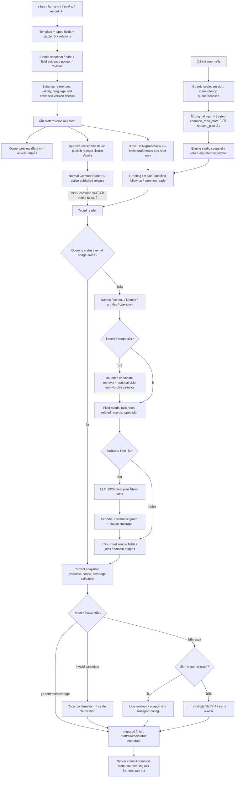

# Full Flow Format กลาง — as built ใน R88 / โค้ด R87 stage 2

## 0. ขอบเขต: runtime ปัจจุบันเป็น migration preview

ใช้โค้ด/ฐานที่ตรึงจาก R78 หลังติดตั้ง R87 stage2 มี 602 heads; profile=`r69-migration-preview` ไม่ใช่ published production profile แม้ชื่อบางช่องใน artifact ใช้ `common_published` ต้องอ่าน `content_view=evaluation_draft` และ `production_publication_verified=False` ประกอบ

ต้องแยก **owner editing/publication flow**, **published reader**, **migration-preview reader**, และ **web/engine execution flow** ไม่ใช้ผลผ่าน schema/preview แทน owner approval

## 1. Full flow ตั้งแต่เจ้าของกรอกถึงผู้ใช้ได้รับคำตอบ

หมายเหตุ: diagram แสดง logical families ของ branch; ตารางลำดับในข้อ 5 เป็นลำดับจากโค้ดจริง ไม่มีการปล่อยให้ทุกคำถามเข้าทั้งสอง reader หรือเข้าทุก bridge

## 2. Record กลางหนึ่งรายการประกอบด้วยอะไร

- `record_id`: ตัวตนอ้างอิงคงที่สำหรับแก้ record เดิม/เชื่อม record อื่น ไม่ใช้ชื่อที่ผู้ใช้เห็นแทน primary key
- `kind`: หมวดที่เลือก schema/form/relationship rules
- `revision`, lifecycle และ review metadata: แยก draft revision จาก revision ที่ approve/publish แล้ว
- `aliases.th/en`: ชื่อ/คำเรียกสำหรับหา entity ไม่ใช่ regex หรือเนื้อหานโยบายใหม่โดยอัตโนมัติ
- `fields[key].status`: known / unknown / conflicted; unknown ไม่ใช่ false หรือไม่มีบริการ และ conflicted ไม่ให้เลือกฝ่ายใดเอง
- `fields[key].value`: ค่าตามชนิด รวม localized text, list, numbers, periods และ references
- `evidence_refs`: source_id + JSON pointer ที่ต้องตรวจย้อนว่าค่าตรงกับ snapshot
- `validity`: effective_from/effective_until แบบมี timezone; expiry เป็น exclusive endpoint
- `localization`: translation/review status ไม่เท่ากับการมี string en ในทุกช่อง

ระบบอ่านค่าผ่าน `value()` เฉพาะ field ที่ known การบันทึกครบช่องจึงต้องมีความหมาย/หน่วย/relations/source ถูกต้องด้วย ไม่ใช่เพียง JSON parse ได้

## 3. Owner create/edit/publish flow

1. เลือก template ตามหมวด ถ้าแก้ราคา/เกมเดิม ให้ใช้ record_id เดิมและ expected_version ล่าสุด
2. กรอกเฉพาะ facts ที่ยืนยันได้ ระบุ unknown/conflicted เมื่อยังไม่รู้ ห้ามใช้ 0/false/[] แทนความไม่ทราบ
3. save_owner_record สร้าง immutable attestation snapshot ของค่าที่เจ้าของกรอก พร้อม source hash/pointers และ actor/change note
4. optimistic version ป้องกันแก้ทับ revision ที่เปลี่ยนไปแล้ว
5. validate schema/refs/source pointer/authority/interval/capacity/periods; unknown optional field ไม่จำเป็นต้องเดาให้ครบ
6. preview ใช้ CommonAnswerer กับ planner ตาม flag จึงไม่ใช่ full web/migrated dispatcher เสมอไป ต้องตรวจ end-to-end เพิ่ม
7. approve ผูก record version+hash; ถ้าแก้เนื้อหาหลังจากนั้นต้องไม่ถือ approval เก่าเป็นการอนุมัติค่าฉบับใหม่
8. publish ตรวจ selected revisions, referenced records, factual trust, required fields, translation metadata และ validity ตามชนิดก่อนสร้าง release/สลับ active อย่างมีเงื่อนไข
9. withdraw ระเบียนที่ไม่ควรตอบต่อ; rollback เป็นการเปลี่ยน release/สถานะผ่าน store ไม่ย้อนเขียนทับประวัติ

**ความต่างที่สำคัญ:** MigratedView ของแชททดสอบอ่าน latest heads แบบ read-only ไม่รอ active published release ดังนั้น “แก้ draft แล้วเห็นในแชททดสอบ” ไม่ใช่หลักฐานว่า deployment ที่อ่าน published release จะเปลี่ยนตาม draft ทันที หรือว่า draft ถูกอนุมัติแล้ว

## 4. ชนิดข้อมูลและ task ที่ต้องเชื่อม

| kind | Records | ขอบเขตงาน |
|---|---:|---|
| game | 51 | overview/genre/how_to_play/description |
| center | 1 | ข้อมูลศูนย์/ที่ตั้ง/map |
| policy | 1 | ขอบเขตการใช้บริการ/conditions |
| audience | 5 | กลุ่มราคา/สิทธิ์ |
| zone | 6 | หมวดพื้นที่/ระดับการถาม |
| rental_package | 24 | เหมา zone+audience+period |
| resource | 14 | เครื่องรายตัว/booking mapping |
| service | 8 | บริการ/เวลาเล่น/occupancy basis |
| game_service | 70 | เกมสัมพันธ์กับบริการ/การให้บริการ |
| faq | 190 | คำถาม/answer/query_profile |
| competition | 4 | เกม/รายการ/edition |
| competition_rule | 104 | clause/facet/dependency/text |
| control_set | 43 | bindings/action/platform/mode |
| person | 25 | directory/roles |
| equipment_model | 16 | รุ่น/จำนวน/specifications |
| closure | 3 | วันที่ปิดหรือเปลี่ยนเวลา |
| rate | 24 | price+billing+audience+validity |
| schedule | 7 | open/bookable/maintenance |
| contact | 1 | ช่องทางติดต่อ |
| facility | 2 | พื้นที่/สิ่งอำนวยความสะดวก |
| procedure | 3 | ขั้นตอน/conditions/required docs |

หน่วยที่ต้องแยกตลอด flow: service กับเครื่องรายตัว, zone กับ resource, จำนวนที่นั่งกับผู้เล่นพร้อมกัน, นาทีเล่นกับนาทีกันช่องจอง, package rate กับ hourly rate, historical rulebook กับรายการที่จะจัดใหม่

## 5. Common reader: ลำดับจริงและทางออก

| ขั้น | งานหลัก | การตัดสิน/ผลลัพธ์ |
|---|---|---|
| C01 | snapshot + timezone/current records | อ่าน revision/source/withdrawn ใน snapshot เดียว; at ต้องมี timezone |
| C02 | declined/confirmation/qualified reply | ตีความ yes/no/rephrase/เงื่อนไขเพิ่ม โดยไม่ถือ yes เป็น owner approval |
| C03 | compact opening status | เฉพาะคำถามรายวันที่ grammar ครอบคลุม; ไม่ใช้เปิดวันนี้เป็น occupancy |
| C04 | rental bridge | ใช้ grammar เดิม แต่ facts จาก current common snapshot พร้อม tuple/state |
| C05 | request roles + scoped names + derived names | แยกสิ่งที่ขอ สร้างชื่อจากข้อมูล ไม่ compile aliases ทั้งหมดเป็น regex |
| C06 | price-scope resume, named/context/identity links | exact/fuzzy entity ไม่ใช่หลักฐานว่า operation ถูกแล้ว |
| C07 | early intent/topic resolution ถ้ายังไม่มี scope | รักษา live query และ known-unconfirmed boundaries |
| C08 | compound operations / declared question profile | ไม่เลือก profile ที่ครอบคลุมเพียงส่วนเดียวแล้วตอบเหมือนครบ |
| C09 | primary_ids → operation | เลือก game/competition/service/zone และชนิดงาน |
| C10 | equipment / trusted legacy-intent bridges | รับเฉพาะขอบเขตที่ bridge ตรวจได้ ไม่ fallback facts เก่า |
| C11 | audience, budget, comparisons, live/calendar, people/rental | ห้ามเดากลุ่มราคา/ระยะเวลา/วันที่; live request อาจ defer dispatcher |
| C12 | FAQ/procedure/policy/game-service discovery | เลือก subject/context/qualifier; บาง operation เปลี่ยน roots เป็น related records |
| C13 | optional bounded entity selector เมื่อ scope ยังไม่พอ | candidates จำกัด, task backstop, LLM index/profile binding, independent-topic guard |
| C14 | field requests / state defaults / requested focus | แยก broad overview จาก field ชัดเจน; named FAQ บางกรณีเลือก answer |
| C15 | competition parent/rule text และ authority/field ownership | ไม่อ่านกฎคนละเกม; explicit all ขอครบตาม source order |
| C16 | competition clause bridge | สรุปบางข้อ/ประท้วงเฉพาะ proposition; source facts ไม่มาจาก legacy loader |
| C17 | unresolved clauses / semantic review | ตรวจสิ่งที่ literal grammar ยังไม่รู้จัก ไม่ถือ field ที่ parse ได้ว่าครอบคลุมเจตนาทั้งหมด |
| C18 | optional LLM field plan | เลือกได้เฉพาะ field/schema ของ scope ที่ล็อกแล้ว ไม่ย้าย entity/fabricate facts |
| C19 | checked_plan + semantic_guard | JSON/schema ผ่านอาจยัง reject ถ้า intent ยังไม่มี independent typed support |
| C20 | read contract + relation projection + render | อ่าน known fields, unknown/conflicted/expired, dependencies และ citations |
| C21 | billing/comparison/budget/source caveats | สูตรเฉพาะที่มี source, warning/partial ของขอบเขตที่ยังไม่ยืนยัน |
| C22 | finish validation + still_current | ตรวจ source pointer/needs/epoch แล้วเลือก answer/list/partial/clarification/not_current/retry |

แต่ละขั้นมี early return; field planner ไม่ได้ทำงานทุกครั้ง และไม่สามารถย้อนแก้ entity ที่ถูกเลือกผิดก่อนหน้าได้เอง

## 6. การเลือก entity และการให้คะแนน

### 6.1 Name matcher

`normalize` → exact observed spans → suppress เฉพาะ nested mention ที่พบจริง → one adjacent non-digit duplicate deletion หากได้ entity เดียว → bounded SequenceMatcher spans

- fuzzy ต้องยาวพอ, numeric edition/resource digits ต้องตรง
- threshold `.88`; กรณีหลาย candidate ต้องมี margin อย่างน้อย `.06`
- exact hit ที่มีอยู่ทำให้ matcher คืนทันที ส่วน task cue ที่สะกดผิดยังอาจไม่ฟื้น

ตัวเลข similarity เป็นความคล้ายชื่อ ไม่ใช่ความถูกต้องของเจตนา/คำตอบ เช่น Zelda ถูกชื่อแต่คำว่า “คือเกมอะไร” พิมพ์ผิดยังเลือก field ไม่ได้

### 6.2 Bounded semantic entity/profile selector

ค้น known textual fields และ names ด้วย weighted trigram overlap: generic grams มีน้ำหนักน้อยลง; score ต้องผ่าน `.16`; ส่ง candidates ไม่เกิน 8 โดยมี declared-task backstop ไม่เกิน 4

ก่อนเรียกโมเดลมี guard สำหรับ numbered targets, price ที่ไม่มี target, broad/live query และ independent topic anchor โมเดลเลือก index และส่ง quoted bindings ตาม schema ไม่เขียนข้อเท็จจริง

หลังตอบมี JSON/schema checks, subject/task/ownership/context/clauses binding และ independent support checks ความถูกต้องของ binding ไม่ใช่การตรวจความหมายโดยมนุษย์ และการกรองก่อน LLM อาจทำให้ source ที่มีคำตอบไม่ถูกส่งให้โมเดลตั้งแต่แรก

## 7. LLM field planner และคอขวดที่พบจริง

1. scope/record ถูกเลือกแล้ว จึงสร้าง schema ของ field ที่สัมพันธ์ได้ พร้อม meanings ภาษาไทยหรืออังกฤษ
2. คำถามถูกแบ่ง semantic clauses; ปกติ batch ไม่เกิน 6 clauses และจำนวน batch จำกัด
3. deadline/model admission/queue/local model gate ต้องอนุญาตก่อน HTTP
4. ส่ง JSON schema, `think=False`, `temperature=0`; ไม่ขอข้อความคำตอบหรือ SQL/source facts
5. ตรวจขนาด/JSON/envelope/clause IDs/allowed field keys/platform/all_fields
6. `semantic_guard` เทียบ typed known needs, broad request, unresolved spans และ unverified intents
7. หากไม่พบ strong needs ที่ระบบรู้จัก อาจ reject ทั้งแผน แม้โมเดลตอบ schema ถูก

**ผล R88:** field-planner audit schema ผ่าน 2,623 events แต่ final รับ 129 events; อีก 2,494 events ถูก `rejected_unverified_intent` ตัวเลขเป็น audit events ไม่ใช่คำถามไม่ซ้ำ ผลสุดท้ายมี method bounded_llm_schema_fields62 requests เพราะมีการเรียกซ้ำ/ย่อย/เปลี่ยนทางออก

จึงมีปัญหาสองฝั่งพร้อมกัน: โมเดลบางครั้งเสนอ field กว้าง/ผิดงาน และ semantic guard ยังพึ่ง cue ที่รู้จักจนปฏิเสธ paraphrase ที่ควรเข้าใจ ห้ามแก้โดยปิด guard ทั้งหมดหรือเชื่อทุก JSON ของโมเดล

## 8. R87 bridges: สิ่งที่นำกลับมาแล้วและขอบเขต

| Bridge | ส่วนเดิมที่ใช้ | แหล่ง facts | Final method requests ใน R88 |
|---|---|---|---:|
| legacy_intent_bridge | regex compiler, priority/category/intent | FAQ intent_key/answer ปัจจุบันที่ตรงรายการเดียว |16|
| rental_bridge | zone/audience/period/task grammar | current rental_package และ relations |5|
| equipment_bridge | operation/catalog projection | current equipment/source grouping |166|
| competition overview | pure substantive clause/facet helpers | current competition_rule ของ parent เดียว |13|
| competition proposition | pure protest query/source predicates | current rule text และ source pointers |2|

รวม 202 requests ที่จบด้วย method เหล่านี้ **ไม่ใช่**จำนวนทุกคำถามที่ระบบตอบได้ และไม่ใช่อัตราความครอบคลุมของ “คำถามที่ควรเข้า bridge” เพราะ corpus มีคำถามแต่ละหมวดไม่เท่ากัน เป็นหลักฐานว่าการเชื่อมบางส่วนไม่เท่ากับนำ interpreter เดิมกลับมาทั้งหมด

Legacy intent bridge ยังไม่รับ rules/rental/price/games/controls/equipment/people และ correction/profile บางกลุ่มโดยตั้งใจ ต้องครอบคลุมสาระทั้งคำถามหลังตัดคำสุภาพและ map current FAQ intent ได้รายการเดียว จึงไม่ใช่ generic legacy router

## 9. Domain read/render subflows

### เกม/อุปกรณ์

game → game_service/service/zone หรือ control_set ตาม operation; แยก source listing จาก installation/live availability ที่ยืนยันจริง คำถามระดับ zone ควร render ระดับ zone หากมี relation ที่ยืนยัน ไม่ตอบเฉพาะชื่อ service แล้วถือว่าครบทุกกรณี

### ปุ่ม

เลือก control_set ที่ตรงเกม/แพลตฟอร์ม/โหมด → action/binding projection → render ปุ่มและ scope caveat; “ปุ่มทั้งหมด” กับปุ่มเฉพาะ action เป็นคนละ coverage partial source ต้องบอกว่าข้อมูลมีเพียงบางส่วน

### ราคา/เหมา

service/zone/resource + audience + duration/period → related rate/package → billing basis/validity → calculation ที่ source อนุญาต → current value และ evidence ไม่อ่านตัวเลขจาก history

24 rental packages ยังมี validity unknown ใน snapshot ส่วน 18 rates มี end ก่อน 1 เม.ย.2026 และ 6 rate validity unknown กรณีงดตอบราคาปัจจุบันต้องแยกจาก parser/กลุ่มราคาเลือกผิด

### กติกา

game → competition edition → children ordered by source_order/section → facet/proposition/explicit-all → depends_on_ids และ full clause text → citation

summarybridge ไม่เกิน 6facets พร้อมบอกว่าเป็นบางข้อ explicit-all ไม่ถูกจำกัดด้วย summary ข้อประท้วงต้องมี deadline หลังจบแมตช์และผู้ยื่นครบ ถ้าถามภาษา/authority ร่วมด้วยไม่ตัดเหลือข้อประท้วงอย่างเดียว

### ตาราง/วันปิด

open_day compact day request → schedule/closure/current date ไทย → day status พร้อมวันที่; วันกับ“ตอนนี้”/ช่วงเวลาย่อยและ live slot เป็นคนละคำถาม

มี schedule5 fields open_periods ที่ยังเป็น conflicted จากบันทึก migration เดิม; 12:00–13:00 จองไม่ได้และ VR30 นาทีกันชั่วโมงเต็มเป็นสิ่งที่ผู้ใช้ยืนยันแล้ว ไม่ย้อนถามเหมือนยังไม่เคยได้รับข้อมูล แต่ห้ามใช้การจองไม่ได้มายืนยันข้อเท็จจริงอื่น เช่น การเข้าพื้นที่ทางกายภาพ โดยไม่มีหลักฐาน

### สถานะจอง

common reader ต้อง defer live request ที่เกี่ยวข้อง → migrated dispatcher → live_status → WordPress/dashboard ตาม runtimeconfig → normalized snapshot/cache → time/resource/family filtering → vacancy answer

R88 bulk จำลอง unavailable จึงไม่ใช้ความล้มเหลวจาก mock นี้สรุปว่า WordPress จริงล่ม ผู้ใช้เคยยืนยันสถานะจริงถูกต้องแล้ว รอบนี้ไม่ได้เปิดประเด็นตรวจสถานะจริงใหม่

## 10. การถามต่อ การยืนยัน และการเปลี่ยนหัวข้อ

- state เก็บ IDs, requested_fields, operation, scope_ids, constraints และ request_contract ไม่เก็บราคาหรือ facts ให้ใช้แทน revision ใหม่
- pending profile ใช้ routing fingerprint/revision ตรวจ yes/no/เลือกชื่อ ถ้าข้อมูลขอบเขตเปลี่ยนต้องถามใหม่
- qualified reply/rejection/replacement ต้องทิ้งข้อเสนอที่ผู้ใช้ปฏิเสธและตรวจ task ใหม่ ไม่ยึด candidate เก่าเพียงเพราะมี history
- รหัส “PC”/“ครึ่งวัน”/“ภายใน” ต้องผูกกับ task ที่ส่งจริง; คำว่า“ทั้งหมด”ต้องรู้ว่าทั้งหมดของรายการไหน
- server จงใจไม่ส่ง legacyrequest_plan ให้ common แต่ส่ง original input + trusted common state ประวัติจึงไม่ได้หายไปเองทุกกรณี
- SF-006 พิสูจน์ว่า state มี PC และ relation อุปกรณ์ถูกพบแล้ว แต่ reply“อุปกรณ์”ยังถูก unresolved_query_clause veto เป็นปัญหา task→field/projection ไม่ใช่พิสูจน์ว่า server ไม่ส่ง history

## 11. Validation และ fallback

`finish` ตรวจ snapshot epoch, requested-field obligations, evidence pointer, unknown/conflicted/validity, scope_limits แล้วคืนชนิดผลที่ตรง ไม่อ้างว่ามนุษย์รับรอง semantics

หาก invalid candidate ถูกคืนมายัง migrated_chat จะถูกแทนด้วย profile confirmation หรือ safe clarification เก็บ rejected_candidate ไว้ บางผลจึงไม่มี query_plan ที่ระดับบน ต้องดู rejected_candidate.query_plan ด้วย

เมื่อ common ไม่พบคำตอบ จะมีเพียง live adapter ที่เข้าเงื่อนไข หรือข้อความไม่ยืนยัน/ขอรายละเอียด **ไม่มี factual fallback ไป FAQ/ราคา/RAG เก่า หรือให้ LLM แต่ง policy ใหม่** ถ้า DB อ่านไม่ได้ก็แจ้ง unavailable ไม่สลับฐานเอง

`confidence=.8` ของ answer/list เป็นค่าคงที่ใน common finish ไม่ใช่ accuracy80%; migration trace confidence1 ก็หมายถึงเลือก dispatch สำเร็จ ไม่ใช่ facts ถูก 100%

## 12. Translation และ publication readiness

ใน snapshot602 records มี fieldknown2,951 / unknown1,431 / conflicted5 unknown จำนวนมากเป็น optional หรือยังไม่ยืนยัน ไม่ใช่หลักฐานว่า migration หาย 1,431facts

metadata en_status: agent_translated486 / missing116 แต่การ scan ค่าที่ known จริงพบ localized objects ที่มี th และไม่มี en11 จุด ทั้งหมดเป็น section ใน bindings ของ Mario Kart Live: Home Circuit จึงห้ามเอา 116 ไปพูดว่า 116record ไม่มีภาษาอังกฤษทั้งหมด

มี localized en32 objects ปนอักษรไทย และคำตอบ English512 requests ที่ถูก Thai-proseflag บางส่วนเป็นชื่อเฉพาะ/หน่วย/ชื่อรายการ ต้องแยกจากการแปลผิดความหมาย

581 records มี validity unknown และ 5conflicted schedulefields จึงยังไม่ใช่ publication-ready โดยอาศัยผลทดสอบอัตโนมัติอย่างเดียว การย้ายเป็น draft กับการ review/publish เป็นคนละงาน

## 13. การเพิ่มข้อมูลใหม่ให้ตอบได้ ต้องผ่านอะไรบ้าง

1. ชนิดข้อมูล/field รองรับใน catalog/schema
2. source/ภาษา/หน่วย/validity ถูกต้องเท่าที่มีหลักฐาน
3. reference IDs และระดับ zone/service/resource/เกมถูกต้อง
4. query semantics เลือก task/subject/qualifier ได้ ไม่ใช่เพียงเจอ alias
5. field contract/projection รู้ว่าควรคืนอะไรตามคำถาม
6. renderer/citations/state รักษาความหมายครบ
7. LLM proposals ผ่าน schema และ binding โดยไม่ถูกบล็อกจากข้อจำกัดที่ไม่จำเป็น
8. preview/full chat/packaged runtime ใช้ revision/config เดียวกันตามที่ตั้งใจ

Fixture R87 ผ่าน 19 checks และกติกา 7 checks ยืนยันบางกลุ่มเพิ่ม/แก้/ถอนได้โดยไม่แก้ router แต่ไม่ใช่หลักฐานว่าเพิ่มทุกหมวดด้วยคำถามทุกรูปแบบแล้วจะตอบถูกเสมอ หรือว่าเพิ่มโซนใหม่แล้ว live adapter จะรู้ mapping ใหม่นอกขอบเขตที่ตรวจแล้วอัตโนมัติ

## 14. ขอบเขต full test ที่ต้องอ่านประกอบ

- 20,554 unique questions,55,811 grades; single-question bulk เริ่ม history ว่าง
- เพิ่ม engine session12 ชุด/24 เทิร์น ผ่าน literal 23 เทิร์น โดยมี positive contract 12 เทิร์น; ไม่ใช่ HTTP session head-to-head กับเดิม 22/24
- guard500 เคสเป็น diagnostics ของ layout/repeat/blockpolicy ไม่ใช่ proof ว่าฟื้น typo ทุกชนิด
- model HTTP4,412 calls transport สำเร็จ 4,376/timeout36; typed/model/schema สำเร็จไม่ใช่หลักฐานว่าเลือกคำตอบถูก
- reference clock16 ต.ค.2026 เที่ยงไทย ไม่ใช่วันที่ปัจจุบันของคนที่เปิดรายงาน; per-job reference_date มีสิทธิ์เหนือกว่า
- ไม่ได้ rebuildportable package หรือทดสอบ production หลาย user/หลายเครื่องในรอบนี้

## 15. จุดอ้างอิงโค้ดที่ตรวจ

- [app/web_api/server.py :: do_POST](C:/Users/Chokhun/Documents/Codex/2026-09-25/psu-esports-studio-phuket-chatbot-c-2/r88_full_common_llm_20261017/system/app/web_api/server.py:477)
- [server: common profile ไม่ใช้ legacy request_plan](C:/Users/Chokhun/Documents/Codex/2026-09-25/psu-esports-studio-phuket-chatbot-c-2/r88_full_common_llm_20261017/system/app/web_api/server.py:661)
- [engine: migrated early return](C:/Users/Chokhun/Documents/Codex/2026-09-25/psu-esports-studio-phuket-chatbot-c-2/r88_full_common_llm_20261017/system/app/pipeline/engine.py:882)
- [app/pipeline/migrated_chat.py :: answer](C:/Users/Chokhun/Documents/Codex/2026-09-25/psu-esports-studio-phuket-chatbot-c-2/r88_full_common_llm_20261017/system/app/pipeline/migrated_chat.py:13)
- [app/knowledge/common/migrated_view.py :: snapshot](C:/Users/Chokhun/Documents/Codex/2026-09-25/psu-esports-studio-phuket-chatbot-c-2/r88_full_common_llm_20261017/system/app/knowledge/common/migrated_view.py:25)
- [app/knowledge/common/owner_server.py :: save_owner_record](C:/Users/Chokhun/Documents/Codex/2026-09-25/psu-esports-studio-phuket-chatbot-c-2/r88_full_common_llm_20261017/system/app/knowledge/common/owner_server.py:52)
- [app/knowledge/common/owner_server.py :: preview_answer](C:/Users/Chokhun/Documents/Codex/2026-09-25/psu-esports-studio-phuket-chatbot-c-2/r88_full_common_llm_20261017/system/app/knowledge/common/owner_server.py:17)
- [app/knowledge/common/store.py :: publish](C:/Users/Chokhun/Documents/Codex/2026-09-25/psu-esports-studio-phuket-chatbot-c-2/r88_full_common_llm_20261017/system/app/knowledge/common/store.py:167)
- [app/knowledge/common/registry.py :: validate](C:/Users/Chokhun/Documents/Codex/2026-09-25/psu-esports-studio-phuket-chatbot-c-2/r88_full_common_llm_20261017/system/app/knowledge/common/registry.py:62)
- [app/knowledge/common/answer.py :: named](C:/Users/Chokhun/Documents/Codex/2026-09-25/psu-esports-studio-phuket-chatbot-c-2/r88_full_common_llm_20261017/system/app/knowledge/common/answer.py:90)
- [app/knowledge/common/answer.py :: answer](C:/Users/Chokhun/Documents/Codex/2026-09-25/psu-esports-studio-phuket-chatbot-c-2/r88_full_common_llm_20261017/system/app/knowledge/common/answer.py:200)
- [app/knowledge/common/entity_search.py :: candidates](C:/Users/Chokhun/Documents/Codex/2026-09-25/psu-esports-studio-phuket-chatbot-c-2/r88_full_common_llm_20261017/system/app/knowledge/common/entity_search.py:57)
- [app/knowledge/common/planner.py :: semantic_guard](C:/Users/Chokhun/Documents/Codex/2026-09-25/psu-esports-studio-phuket-chatbot-c-2/r88_full_common_llm_20261017/system/app/knowledge/common/planner.py:54)
- [app/knowledge/common/legacy_intent_bridge.py :: select](C:/Users/Chokhun/Documents/Codex/2026-09-25/psu-esports-studio-phuket-chatbot-c-2/r88_full_common_llm_20261017/system/app/knowledge/common/legacy_intent_bridge.py:24)
- [app/knowledge/common/answer.py :: finish](C:/Users/Chokhun/Documents/Codex/2026-09-25/psu-esports-studio-phuket-chatbot-c-2/r88_full_common_llm_20261017/system/app/knowledge/common/answer.py:964)
