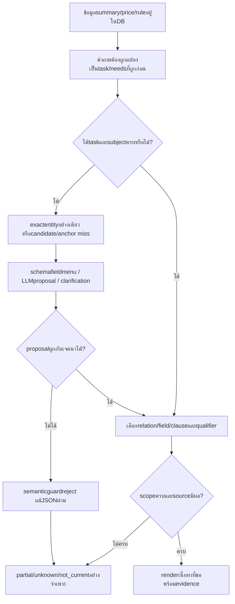
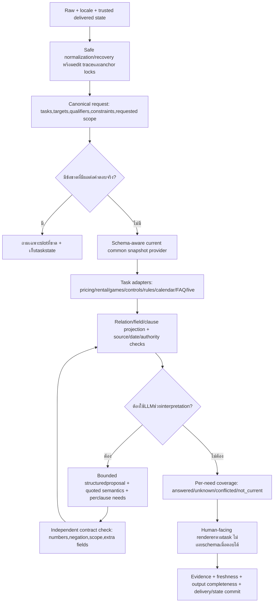

# เทียบ Full Flow และแผนผสานที่รักษา facts กลาง

## 1. ตารางจุดต่าง: เดิมทำอะไร กลางทำอะไร ผลกระทบอยู่ตรงไหน

| ชั้น | Legacy R64 | Common R88/R87 | จุดที่ต้องรักษา/พัฒนา |
|---|---|---|---|
| ขอบเขตธุรกิจ |studio/scope/boundary และ protectedhandlers|studio ก่อน migrated; commonno-factualfallback|คงร้านเกม scope และไม่เปิด general ตอบทุกเรื่อง|
| Recovery |หลาย errorchannels ใน preprocess/cuepaths|normalize/schema-recovery/typedcue คนละช่วง|แชร์ taskrecovery ก่อน earlyreturn อย่างมี anchor|
| Entity |aliases/resolvers/targetlock ของแต่ละ domain|exact/spans/one-repeat/fuzzy และ boundedentityLLM|exact subject ไม่ใช่ taskproof; numeric/gameedition ต้องปลอดภัย|
| Intent |routepriority/universal/frame/capabilities|operation/roles/profiles/schema-fieldneeds|ทำ canonicaltask contract ที่อ่านจาก knownsource ได้ทุก record|
| Score |rulepriority/capabilityscore+margin|namesimilarity/trigram/guard/binding/defaultconfidence|แยก score แต่ละชั้น ไม่ใช่ accuracy|
| Factsource |rules/static/structured/curated/canonical หลาย provider|currenttypedrecords และ source pointers|นำ logic กลับมา ไม่ดึง answer/price เก่ากลับมา|
| ราคา |typedfeeplan+เฉพาะ formula/source|rate/packagejoins,billing+validity|preserveaudience/durationtuple และ currentvalidity|
| Controls |specializedquery/controlcontract|controlset/action/modeprojection|sharedactionintent พร้อม sourcecompleteness|
| Competition |lockedtargets/detail/overview/sourceclauses|parent/childfacets,rule_selection และ 2bridges|sharedpropositioncontract กับ commonclausefacts|
| FAQ |trustedregexpattern+priority→sourceanswer|intentindex/profiles/semanticselector และ narrowbridge|concept-levelcoverage;ไม่ compileowneralias เป็น regex|
| Broad/all |domain-specificfull-list/overview|broad_request/fields/relatedrecords/summarybridge|all ของ scope ไหน;summary บางข้อห้ามอ้างครบ|
| Qualification |specializedpolicy/compoundtools|quotedprofilebinding/ownership/context/clauses|ห้ามขยายสลิปเป็น identity/amountpolicy|
| State |typedrequest_plan/resolve_question/contextcontracts|common_read_state/confirmationfingerprint/request_contract|สองแบบต้อง mapoperation/slots ได้ ไม่ copyfacts จาก history|
| LLM |planner/intent/toolrouter/scopedgeneration ตาม gate|record/profileindex หรือ fieldJSON;facts อ่านจาก DB|schema/binding/semantics/answerproof ต้องแยก|
| Validation |source/language/task contracthardveto|typedfields/evidence/currentepoch+outerveto|validate ถูก structure ไม่ใช่ intentcorrectness|
| Updates |หลาย sourcefile/index/provider|stableID/revision/source/approve/publish หรือ draftview|owner บันทึกง่ายแต่ต้อง querydiscoverable ด้วย|
| Live |dashboard หรือ WordPress ตาม flags|adapter เดิมหลัง commondefer|ไม่ใช้ staticfacts เป็น live;API200≠slottruth|
| Render |domain-humanformattedanswers|genericfieldrenderer+somebridges|task-specificpresentation บน factprovider เดียว|
| Production |legacyruntime ตาม snapshot|migrationpreview ยังไม่ publishedcutover|อย่าเอา draftvisible เท่ากับ ownerapproved|

## 2. Causal chain ที่อธิบายว่าข้อมูลอยู่แล้วแต่ยังไม่ตอบ

**ไม่แก้ที่ข้อมูลเพียงอย่างเดียว:** Zeldaknownfields มีแล้วแต่ taskcue ไม่ผ่าน; SF006history และ relations มีแล้วแต่ shorttask ถูก veto; model HTTP สำเร็จแต่ semanticguard ยังไม่รับ; คำแปลตรงความหมายบางข้อ literal ไม่รับ

## 3. Target flow ที่แนะนำ (proposal ไม่ใช่ของที่ติดตั้งแล้ว)

ลูกศรย้อนจาก LLM เป็น logicalone-passproposal/review ไม่อนุญาตให้ retry ไม่จำกัดหรือเปลี่ยน facts เพื่อให้ accept ต้องมี attempt/deadlinebudget ชัด

## 4. Step-by-step repair flow หลังงานวิเคราะห์นี้

### รอบ A — ตรึงหลักฐานและนิยามคำว่า “ตอบถูก”

1. ยึด samekey/corpus/source version กับ R88 และเก็บ R64answers สำหรับเทียบ ไม่ทับ logs
2. จัดแต่ละ case เป็น currentfact/historicalfact/missingfact/wording / protocol / test fixture ตาม source จริง
3. สร้าง need contract ว่าต้องมีอะไร ต้องไม่สรุปอะไร เช่น protestdeadline+after-match+captain/coach หรือ permission ไม่ใช่ playtime
4. แยก schema / transport / semantic / source / owner approval ในผลประเมิน

### รอบ B — นำ interpreter กลับมาอย่างมีขอบเขต

1. แชร์ purelegacytypo/cue recovery ก่อน commontaskresolution โดยเก็บ raw/edits และไม่เปลี่ยน explicitgame/numbers/negation
2. ทำ canonicaltaskprofile เช่น game_overview/equipment_list/booking_policy/competition_protest/rental_price ไม่ผูกกับชื่อ record ทีละรายการ
3. ส่ง contract ไป commonprovider ไม่เรียก buildanswer/price จาก legacyJSON
4. ให้ LLM เติมหรือเสนอ requestneeds ที่ grammar ยังไม่รู้จัก แต่ผูก input spans/qualifiers/sourcekind ได้ ไม่ต้องบังคับทุก paraphrase กลับไปเข้า regex เดิมก่อน
5. ตัด unrequestedfields แต่ไม่ยอมรับแผนที่ ambiguous/wrongsubject เพียงเพราะ schema ผ่าน

### รอบ C — ทำ projection/coverage ให้ตรงงาน

1. source/record/field/relatedchild ต้องอ่านตาม task ไม่ใช่เอา defaultfields ของ kind มาตอบทุกครั้ง
2. gameoverview อ่าน summary/genre; permission อ่าน policyanswer; equipmentlist อ่าน equipmentchildren; rules อ่าน clause/conditions ที่ตรง
3. multi-task เก็บแต่ละ need และ dependency ไม่ตอบครบเทียมหรือทิ้งส่วนที่ตอบได้ทั้งหมด
4. followup ใช้ pendingtask/operation และ scope ที่ส่งจริง พร้อม revisionfingerprint ไม่เก็บราคาหรือ policyfacts ใน state
5. captions ตอบระดับ zone/service/resource ตามที่ถามโดยอาศัย verifiedrelations

### รอบ D — Data-only lifecycle และ preview/chat parity

1. ตรวจ knownrequiredfields/relations/source/validity ที่มีผลต่อ task แยก optionalunknown
2. เติม English11sectionvalues จากต้นฉบับที่มีจริง ตรวจ 32Thai-in-enflags ว่าเป็นชื่อเฉพาะหรือ prose
3. ใช้ confirmation เดิมเรื่อง bookability/VRoccupancy ไม่ขอซ้ำ ถ้าต้องการ facts อื่นค่อยตั้งคำถามเจาะจง
4. แยก draftpreview/publishedrelease/migrationprofile และใช้ dispatchercontract ที่สอดคล้องกัน
5. ทดสอบ record ใหม่/แก้ราคา/แก้ rule/ถอนข้อมูลในฐานแยกโดยไม่ approveproduction แทน owner

### รอบ E — ตรวจผลหลังแก้แบบไม่ overfit

1. Small root-cause regression: Zelda task typo, Friday maintenance policy, SF006 อุปกรณ์, qualifiedpayment, scopedrules และ priceexpiryprotectivecase
2. Neighbor cases หลายรูปแบบ+counterexamples: เปลี่ยนเกม/ภาษา/กลุ่ม/เวลา/negation/จำนวน โดยเป้าหมายเดิม
3. Held-outstrata ที่ไม่เลือกจากข้อที่ผ่าน และ new data-only fixtures ทุก supportedkind
4. ตรวจ transport/schema/binding/task/source/render แยก โดยเปิด LLM ตาม productiongates
5. Fulltest ครั้งถัดไปเมื่อได้รับคำขอ ไม่รันหรือแก้ระบบในงานเอกสารนี้อัตโนมัติ

## 5. เงื่อนไขออกจากงานซ่อมแต่ละหมวด

| หมวด | เงื่อนไขที่ต้องเห็น |
|---|---|
| Recovery | taskcue ฟื้นได้และ counterexample ไม่เปลี่ยน entity/negation/numericID |
| Fieldplanning | known need ไม่หาย, extraunaskedfields ไม่ถูกอ่าน, unknownwording ไม่ถูก reject อย่างไร้เหตุ |
| Relations | targetlevel และ joins ตรง source; no-FK ไม่ถูกเดาสร้าง |
| Compound/state | ทุก clause มีสถานะ, context ไม่รั่วข้าม task, shortreply ที่จำแนกได้ตอบถูก |
| Rules/controls |ครบ propositions/bindings ตาม scope พร้อม conditions/partial-sourcecaveat |
| Price/calendar |validity/timezone/closure/billing/occupancy ไม่ปนกัน |
| English |factparity และ propernamepolicy ชัด ไม่ใช้ Thai-characterflag เป็น translationaccuracy |
| Publication |draft/review/release ไม่ปนกัน ข้อมูลใหม่ visible ใน mode ที่ตั้งใจจริง |
| Evaluation |same criteria / same keys; strict และ semantic/sourcecriteria แยก; ไม่ใช้ passmarker เป็น factcertificate |

## 6. สิ่งที่ไม่ควรทำเพื่อแก้คะแนน

- ไม่เปิด legacyfactsfallback กลับมาเมื่อ common หาไม่เจอ
- ไม่ปิด semantic/source/validityvalidator ทั้งหมด หรือยอมทุก JSON จาก LLM
- ไม่เพิ่ม alias รายคำถามจากข้อสอบแทนการแก้ task contract
- ไม่ลบ expiry หรือเดาจำนวนชั่วโมง/ราคา/นโยบายเพื่อให้มีคำตอบ
- ไม่ย้าย metadatafield/internaldebug ขึ้น mainchat เพียงเพื่อให้ oracle พบ keyword
- ไม่เปลี่ยน oracle เก่าให้เข้ากับ output ใหม่แล้วอ้างว่า accuracy ดีขึ้น โดยไม่รายงานคนละเกณฑ์
- ไม่ใช้ targeted55/55,HTTP200 หรือ confidence.8 เป็น production approval

งานนี้ส่งมอบ Flow/หลักฐาน/แผน ไม่ได้ติดตั้ง Targetflow หรือแก้ runtime ระหว่างอ่านผล
