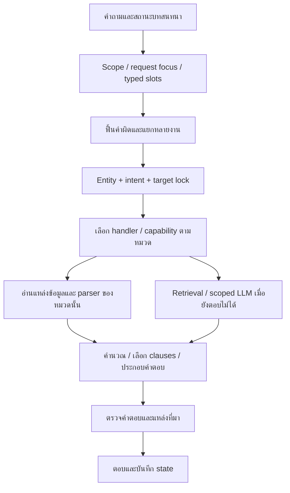
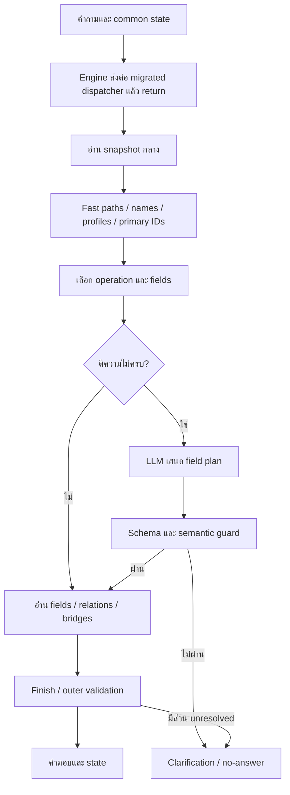
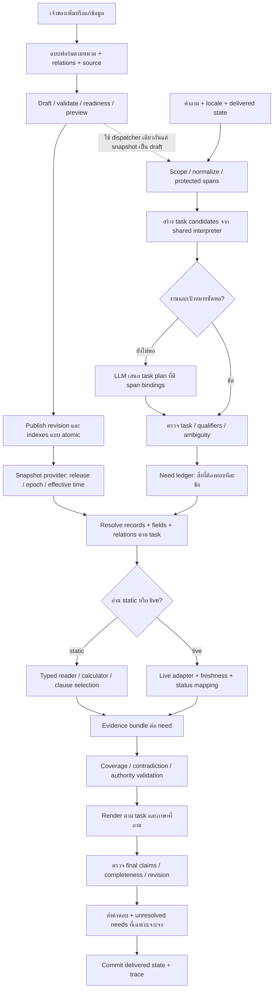
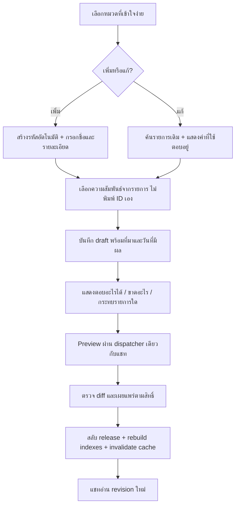

# แผน Flow กลางฉบับปรับปรุง — เทียบระบบเดิมและเตรียมให้เจ้าของเพิ่ม/แก้ข้อมูลเอง

วันที่จัดทำ: 18 ตุลาคม 2026 (Asia/Bangkok)

**สถานะเอกสาร: แผนพัฒนา หลังตรวจโค้ดและผลที่มีอยู่ ยังไม่ใช่การรับรองว่าได้ติดตั้งหรือทำทุกขั้นแล้ว**

ตามคำขอล่าสุด งานรอบนี้เป็นการวิเคราะห์และปรับแผน ไม่เริ่มทดสอบเพิ่มเติม ไม่ติดตั้ง candidate ไม่เปลี่ยนข้อมูล/approval และไม่เริ่ม full test ผลทดลองและ candidate ที่เตรียมก่อนคำสั่งนี้เก็บแยกไว้ตามเดิม ไม่ใช้แทนผลของระบบที่ผู้ใช้กำลังเปิด

## 1. ข้อสรุปที่ใช้ตัดสินใจ

ระบบเดิมตอบได้ดีกว่าในหลายหมวด เพราะมีความสามารถตีความงานเฉพาะหมวดสะสมอยู่ เช่น แก้คำผิดของคำกริยา แยกผู้ใช้ภายใน/ภายนอก รักษาชื่อเกมแข่งขัน เข้าใจคำถามต่อ และเลือกเนื้อหาที่สัมพันธ์กัน ระบบกลางมีข้อมูลหลายส่วนครบแล้ว แต่ตัวอ่านใหม่ยังเชื่อมความสามารถเหล่านี้เข้ากับข้อมูลกลางไม่ครบ

จุดสำคัญจึงมีสามส่วน:

1. **ข้อมูลต้องมีและอ้างอิงได้** — ย้ายค่าข้อมูล ความสัมพันธ์ เงื่อนไข หน่วย ช่วงเวลามีผล และที่มาให้ครบตามงานที่ต้องตอบ
2. **ต้องรู้ว่าคำถามต้องการงานใด** — รู้ชื่อ Zelda ไม่เท่ากับรู้ว่าถามแนวเกม วิธีเล่น ปุ่ม หรือเครื่องที่เล่นได้
3. **ต้องเลือกและประกอบคำตอบให้ตรงงาน** — เจอกฎถูกเล่มยังไม่พอ ต้องรวมข้อยกเว้น เงื่อนไข ผู้มีสิทธิ์ และกำหนดเวลาที่เกี่ยวข้อง

ข้อเสนอคือสร้างตัวตีความงานร่วมที่นำความสามารถเดิมมาใช้ได้ แล้วให้ทุกทางอ่าน facts จาก snapshot กลางที่มีสิทธิ์ใช้งานเท่านั้น เจ้าของเพิ่มเกมใหม่ในหมวดที่รองรับแล้ว ไม่ต้องเพิ่ม handler หรือ regex เฉพาะชื่อเกมใหม่

### สิ่งที่คำว่า “เพิ่มข้อมูลแล้วตอบได้” หมายถึง

- เพิ่มรายการในหมวดที่รองรับ พร้อมข้อมูลและความสัมพันธ์ที่งานนั้นต้องใช้ → ระบบสร้างดัชนีและนำไปตอบผ่าน task contract เดิม
- แก้ข้อมูลเดิม → สร้าง revision ใหม่ ตรวจและเผยแพร่ แล้วคำถามใหม่อ่านค่าจาก revision ที่มีผล
- เพิ่มข้อเท็จจริงที่ยังไม่รู้ → เปลี่ยน field จาก unknown เป็น known พร้อมที่มา ไม่ต้องเขียนคำถามทุกสำนวน
- เพิ่มความสามารถใหม่จริง เช่น ธุรกรรมจ่ายเงินหรือหมวด schema ใหม่ → ยังต้องออกแบบ capability/สิทธิ์/renderer ไม่ควรสัญญาว่าการกรอกข้อความอย่างเดียวสร้างความสามารถนั้นได้
- บันทึก draft กับเผยแพร่เป็นคนละสถานะ หน้าฟอร์มควรทำให้ขั้นตอนง่าย แต่ต้องบอกว่า “ฉบับร่าง” หรือ “ใช้ตอบแล้ว” ให้ตรงกับ reader

## 2. หลักฐานเปรียบเทียบที่อ่านได้จากผลเดิม

แหล่งหลัก: R89 `SAME_CHECKER_COMPARISON.json`; วิเคราะห์รายละเอียดใน R90; โค้ดเดิม R64, โค้ดกลางที่ตรึง R88 และโค้ดติดตั้ง R78

| ตัววัดที่มีอยู่ | Flow เดิม | Flow กลาง R88 | ความหมายที่สรุปได้ |
|---|---:|---:|---|
| Positive literal contracts | 23,517/24,909 = 94.41% | 17,960/24,909 = 72.10% | ผ่านเงื่อนไขข้อความ/สาระที่ตัวตรวจระบุ ไม่ใช่คนรับรองทุกคำตอบ |
| Strict contracts | 42,601/55,811 = 76.33% | 5,033/55,811 = 9.02% | รวมชื่อ route/mode/source และ protocol เดิม จึงไม่ใช่ semantic accuracy |
| Positive ภาษาไทย | 12,547/13,142 = 95.47% | 9,674/13,142 = 73.61% | ช่องว่างอยู่ทั้งการตีความและการประกอบคำตอบ |
| Positive ภาษาอังกฤษ | 9,087/9,466 = 96.00% | 6,701/9,466 = 70.79% | ไม่ควรสรุปว่าเกิดจากการแปลทั้งหมด |

ข้อมูลเปรียบเทียบมี 20,554 request keys และ 55,811 grades ต่อแขน; หนึ่งคำถามอาจมีหลาย grade ผลเก่าไม่ได้มาจากวัน/engine/data revision/นโยบาย validity เดียวกันทั้งหมด จึงใช้ระบุ regression และหาเหตุจาก trace เพิ่ม ไม่ใช่พิสูจน์ว่า schema กลางเป็นต้นเหตุเพียงอย่างเดียว

### หมวดที่ช่วยจัดลำดับงาน

| หมวดในตัวตรวจ | จำนวน positive grades | เดิม | กลาง | อ่านอย่างไร |
|---|---:|---:|---:|---|
| service_fee | 2,331 | 95.84% | 30.24% | เร่งแยกปัญหา slot/billing ออกจากราคาหมดอายุ |
| game_detail | 3,196 | 98.25% | 66.36% | ช่องว่าง task → field ชัดและกระทบหลายสำนวน |
| games_catalog_availability | 2,614 | 98.28% | 67.60% | แยกเกมที่มีให้บริการ/การติดตั้ง/สถานะเครื่องสด |
| equipment | 2,181 | 98.21% | 74.19% | relation projection และคำถามต่อ |
| reservation_policy | 1,458 | 97.05% | 74.01% | subject/qualifier/ขั้นตอนต้องตรง |
| schedule_calendar | 1,162 | 97.59% | 73.84% | วันที่จริงและ open/bookable/exception |
| game_controls | 5,349 | 96.09% | 94.91% | ช่องว่างน้อยกว่า จึงรักษาส่วนที่ดีไว้ |
| competition_rules | 152 | 19.08% | 80.92% | กลางดีกว่าใน subset นี้ ไม่ควรย้อนทั้งระบบไปแบบเดิม |

จำนวนในตารางเป็น label ของชุดประเมิน ไม่ใช่การแบ่งชนิดข้อมูลแบบไม่ทับกันทางความหมาย และไม่ครอบคลุมทุกคำถามของหมวดนั้น หลักฐานเพิ่มเรื่อง candidate/guard อยู่ในเอกสารปัญหารายข้อ

### ไล่เหตุจากเคสจริงที่บันทึกไว้ ไม่ได้ส่งคำถามใหม่

| เคสใน R90 | สิ่งที่ผู้ใช้ต้องการ | สิ่งที่ระบบกลางทำจริง | จุดที่ต้องแก้และคำตอบเป้าหมาย |
|---|---|---|---|
| K01: `The Legend of Zelda: Breath of the Wild คือกมอะๆร` | ภาพรวมว่าเป็นเกมอะไร | พบชื่อเกม exact; operation ว่าง; LLM เสนอถึง 12 fields; schema ผ่าน แต่ถูก rejected_unverified_intent; ถามกลับว่าจะเอาชื่อเกมหรือไม่ | ฟื้น task cue และจำกัด game overview profile; อ่าน summary/genre ที่มีอยู่ ตอบภาพรวม ไม่ถามชื่อเกมซ้ำ |
| K02: `PC มีอะไรบ้าง` → `อุปกรณ์` | เลือกหัวข้ออุปกรณ์ของ PC ต่อจากบริบทเดิม | state มี scope PC, operation equipment และพบ relations ของอุปกรณ์ 6 ประเภท แต่ unresolved_query_clause ทำให้คำตอบถูก veto | ผูก short reply กับ pending task; ใช้ equipment projection และ coverage เดียวกับประโยคเต็ม; แสดงรายการที่มีหลักฐาน |
| K03: `Can an external visitor use the VR headset?` | สิทธิ์บุคคลภายนอกใช้บริการ | จับ VR ได้ แต่ candidate ย่อยไปเรื่องสลิป/เวลา; selector ไม่เลือก; field planner อีก call timeout; สุดท้ายถามเลือกรายละเอียดเวลาเล่น | เลือก eligibility/policy ก่อน fields ของ VR; แยก retrieval miss กับ transport timeout; ตอบสิทธิ์ตาม policy ปัจจุบันหรือระบุข้อที่ยังไม่ทราบ |

K01 ยืนยันจาก inventory ว่า summary/genre/how_to_play อยู่ในฐานแล้ว K02 ยืนยันว่าประวัติไม่ได้หาย และ K03 มีหลายเหตุในคำถามเดียว จึงต้องแก้เป็นชั้น ไม่ติดป้ายว่า “โมเดลไม่เข้าใจ” หรือ “ย้ายข้อมูลไม่ครบ” ให้ทุกเคสเหมือนกัน

อีกหลักฐานหนึ่งคือ field-planner audit ใน R88: schema ผ่าน 2,623 events แต่ยอมรับ final plan 129 events และปฏิเสธ `rejected_unverified_intent` 2,494 events ตัวเลขนี้เป็น **audit events** ไม่ใช่ 2,494 คำถามไม่ซ้ำ และไม่แปลว่าแผนทั้ง 2,494 ถูกต้องแล้ว คอขวดมีทั้งตัวตีความที่ยังให้ task support ไม่พอ และ model proposals ที่เสนอ fields กว้างเกินโจทย์

## 3. เปรียบเทียบ Full Flow ทั้งสามภาพ

### 3.1 Flow เดิมที่ใช้อ้างอิง



ข้อดี: มีตัวตีความงานเฉพาะหมวดและวิธีตอบตามความต้องการผู้ใช้ ข้อเสีย: facts และพฤติกรรมกระจายหลาย loader/handler; เพิ่มข้อมูลอาจไม่ถึงทุกเส้นทาง; ยังมี bug ของเดิมและความเสี่ยงเรื่องข้อมูลหมดอายุ

### 3.2 Flow กลางปัจจุบันที่ทำให้เสียความสามารถบางส่วน



จุดจากโค้ดที่ตรวจซ้ำ: `engine.py:881–885` เข้า migrated แล้ว return ก่อน request focus ที่เริ่มบรรทัด 891; `answer.py:315` เริ่ม `primary_ids` ก่อนเลือก field ในช่วงหลัง ความรู้เดิมที่อยู่ถัดจาก early return จึงไม่ถูกเรียกโดยอัตโนมัติ

การจัดข้อมูลกลางช่วยเรื่อง revision/ที่มา/การแก้ไข แต่ยังไม่ทดแทน task interpreter เดิม และถ้า semantic guard ยังอาศัยคำที่ grammar รู้จักเท่านั้น LLM จะช่วยสำนวนใหม่ได้น้อย

### 3.3 Flow กลางที่เสนอ



แผนภาพเป็นเป้าหมายการ refactor ไม่ใช่ลำดับที่ติดตั้งแล้วทั้งหมด ตัวแกนร่วมต้องรับ provider ที่ระบุแหล่งข้อมูลและสิทธิ์ชัด ไม่แอบสลับ published เป็น draft เพื่อให้หาคำตอบเจอ

## 4. ขอบเขตที่ต้องแยกในสถาปัตยกรรม

| ชั้น | หน้าที่ | สิ่งที่ไม่ควรทำ |
|---|---|---|
| Owner data | เก็บ facts/relations/เงื่อนไข/ที่มา/ช่วงเวลามีผล | กำหนด Python handler หรือ regex ให้เจ้าของกรอก |
| Schema catalog | ชนิด field, ความหมาย, reference kinds, validation | ถือว่ามี field แล้วเข้าใจทุกคำถาม |
| Task registry | งานที่รองรับ, slots, needs, allowed projections, renderer | ฝังราคา ชื่อเกมรายตัว หรือคำตอบจริงใน profile |
| Interpreter | แปลงคำถามและบริบทเป็น task candidates | ออกข้อเท็จจริงธุรกิจเอง |
| Evidence planner | หาว่างานนี้อ่าน record/field/relations ใด | เปลี่ยนโจทย์ให้เข้ากับ source ที่หาเจอ |
| Reader/executor | อ่านค่าปัจจุบัน คำนวณตามสูตรที่ source อนุญาต | ใช้ราคาหรือคำตอบเดิมจากประวัติแทน source ใหม่ |
| Renderer | ตอบตาม need ด้วยภาษาอ่านง่าย | ยืนยันว่าตอบทั้งหมดเมื่อยังมีรายการตกหล่น |
| Validator | ตรวจงาน หลักฐาน ข้อจำกัด coverage และความสด | ใช้คะแนนความคล้ายชื่อแทนความถูกต้องทั้งหมด |

Task registry เป็นงานของผู้พัฒนา เจ้าของเลือกหมวด/กรอกข้อมูลตามฟอร์ม ระบบควรเสนอความสามารถที่รองรับและแสดงช่องที่ยังขาดอัตโนมัติ

## 5. Runtime ทีละขั้น พร้อม input/output และเงื่อนไขหยุด

### F01 — รับคำถามและตรึงบริบท

รับ raw text, locale, request ID, session ID, trusted delivered state และเวลาอ้างอิงไทย คง raw text ไว้เสมอ ตรวจ idempotency/ขนาด/ขอบเขตงาน แล้วเปิด request context เดียว ใช้ release/epoch เดียวกันสำหรับ facts ในคำตอบนั้น

Output: `RequestContext` พร้อมเวลาและ budget; ถ้า timeout/busy ให้เป็น technical outcome แยกจาก “ไม่มีข้อมูล” ไม่อนุมานว่าศูนย์ไม่มีบริการ

### F02 — แยกคำสำคัญที่ห้าม recovery เปลี่ยน

ป้องกันเลขเครื่อง รุ่น ปี จำนวนเงิน ระยะเวลา คำปฏิเสธ เงื่อนไข กลุ่มผู้ใช้ และชื่อที่ยืนยันตรงแล้ว เช่น PC11, Tekken 8, 30 นาที, “ไม่เอา VR”, “เฉพาะบุคคลภายนอก”

แก้ normalization ที่ไม่เปลี่ยนสาระก่อน; ชื่อ entity กับ task cue ใช้ candidate recovery แยกกัน คำไทยพิมพ์ขาด/เบิ้ล/สลับและแป้นข้างเคียงใช้เป็นสัญญาณเสนอทางเลือก ต้องดูบริบทและตัวเลือกคู่แข่ง ไม่ลดตัวซ้ำทุกตำแหน่งและไม่ถือ edit distance ต่ำว่าเป็นคำที่ตั้งใจแน่นอน

Output: normalized variants + protected spans + รายการแก้และเหตุผล; ไม่เขียนทับ raw question

### F03 — อ่านการถามต่อก่อนเติม slots

ถ้าคำถามสั้น เช่น “PC”, “ทั้งหมด”, “อุปกรณ์”, “ภายนอก” ให้ผูกกับ pending need ของคำตอบที่ผู้ใช้ได้รับจริง ตรวจ scope และ revision ใหม่:

- ถ้าเพิ่งถามว่าต้องการราคาบริการใด → “PC” เติม service และคง audience เดิม
- “ทั้งหมด” หลังถามเลือกรายการบริการ → scope เป็นบริการทั้งหมดของงานราคา ไม่ใช่ทุก field ในฐาน
- “อุปกรณ์” หลังสนทนา PC → task equipment list ภายใต้ PC
- “ไม่ใช่ อันอื่น” ยกเลิก selection เดิม ไม่ถือเป็น yes
- เปลี่ยนหัวข้อชัดเจน → เปิด task ใหม่ ไม่ดึงกลุ่มราคา/เกมเดิมตามไป
- ไม่มีบริบทพอ → ถามเฉพาะสิ่งที่ยังระบุไม่ได้

State เก็บ IDs/slots/needs/options/revision lineage; คำตอบเก่าใช้เป็นบริบทภาษา ไม่ใช่แหล่งราคาหรือข้อเท็จจริง

### F04 — สร้าง TaskPlan ก่อนผูกกับ field

ใช้ shared interpreters ตามงาน: game overview, how-to, controls, price, rental, rules, schedule, live status, policy, procedure, directory และ multi-task

สร้าง candidate พร้อม subject, operation, scope, qualifiers, source spans และสิ่งที่ยังไม่เข้าใจ ไม่ให้การเจอชื่อเกมหนึ่งชื่อยุติการทำความเข้าใจประโยค ส่วน “เล่นยังไง” ต้องได้รับการตัดสินก่อน projection ที่เปลี่ยน game ไปเป็น service availability

แนวทางเริ่มต้นคือ pure helpers เดิมที่ไม่โหลด facts + grammar ตาม task ที่ใช้กับทุก record + LLM เมื่อยังไม่ชัด ไม่ทำ alias ของทุกชื่อเกมคูณทุกคำถาม

### F05 — ใช้ LLM เฉพาะส่วนที่เพิ่มความเข้าใจได้

เมื่อ interpretation ยังไม่ครบ ให้โมเดลเสนอ TaskPlan จากคำถาม, context และ task catalog ที่จำกัดขอบเขต ไม่ให้สร้าง SQL/URL/ราคาหรือคำตอบธุรกิจ ใช้หนึ่งแผนรวมหลาย clauses เท่าที่ budget อนุญาต เพื่อลดการเรียกซ้ำหลายรอบ

JSON ที่มี shape ถูกยังไม่พอ ต้องตรวจ:

1. ทุก subject/slot/qualifier ผูกกับ raw span หรือ trusted state ที่ระบุได้
2. ไม่เพิ่ม/ลบตัวเลข คำปฏิเสธ เงื่อนไข หรือจำนวนงาน
3. task อยู่ใน capability ที่รองรับ และไม่สลับ “มีเกมให้เล่น” เป็น “เครื่องว่าง”
4. คำแปลหรือคำผิดที่ไม่ตรง literal ยังมีความสอดคล้องเชิงความหมาย ไม่บังคับให้ผ่าน regex เดิมเท่านั้น
5. ถ้ามีงานคู่แข่งที่ทำให้คำตอบต่างกันมาก ให้ถามเลือก ไม่เลือกเพราะมี source พร้อมกว่า

**ข้อจำกัดที่ต้องยอมรับ:** span/JSON/schema validator ตรวจความหมายทุก paraphrase ไม่ได้ด้วยตัวเอง การยอมรับ semantic proposal ต้องมีเกณฑ์เฉพาะ task และชุดประเมินที่แยกจากโจทย์พัฒนา ความมั่นใจที่โมเดลรายงานเองไม่ใช่เกณฑ์อนุญาตราคา/นโยบาย ส่วนที่ยังคลุมเครือให้คืน targeted clarification

### F06 — ทำรายการสิ่งที่ต้องตอบ (Need ledger)

ตัวอย่าง “บุคคลภายนอกเล่น PC สองชั่วโมงเท่าไหร่ แล้วต้องใช้หลักฐานอะไร”:

| need | subject | operation | slots | dependency |
|---|---|---|---|---|
| N1 | PC service | fee quote | audience=ภายนอก, duration=120 นาที | rate ที่มีผล + billing rule |
| N2 | ผู้ใช้บริการ | required documents | audience=ภายนอก | procedure/policy ที่ตรงขอบเขต |

สถานะต่อ need: `answered / partial / missing_slot / missing_fact / conflicted / not_current / live_unavailable / unsupported / ambiguous` คำตอบต้องไม่รายงาน answered เมื่อเพียงเลือก record ได้

ความสัมพันธ์ระหว่าง needs สำคัญ: “มี 100 บาทเล่น PC ได้กี่ชั่วโมง” เป็นงานคำนวณที่ต้องมีราคาครบก่อนตอบจำนวนชั่วโมง ส่วน “ราคา PC และศูนย์อยู่ไหน” ตอบที่อยู่ได้แม้ราคาไม่ยืนยัน

### F07 — Resolve เป้าหมายและสร้าง EvidencePlan

ใช้ชื่อจากข้อมูลปัจจุบัน ค้นตาม task-compatible kinds และ relations; ถ้าชื่อย่อชนกันให้เทียบชนิด/edition/context แล้วขอรายละเอียดเมื่อยังแยกไม่ได้ เพิ่ม semantic retrieval ตาม topic/field meaning เมื่อชื่อไม่ปรากฏ แต่บันทึกว่า candidate ถูกตัดที่ขั้นใด

EvidencePlan ระบุ root IDs, relation paths, field keys, clause dependencies, requested cardinality และ output granularity เช่นถามโซนต้องแสดงโซน ไม่ใช้ชื่อ service ย่อยแทนทั้งหมดโดยไม่อธิบาย

กรณีไม่พบคำตอบให้แยก `record absent`, `field unknown`, `relation missing`, `retrieval miss`, `candidate rejected`, `task unsupported` ไม่รวมเป็น “ข้อมูลไม่มี” ทั้งหมด

### F08 — ตรวจสิทธิ์ของข้อมูลและช่วงเวลาที่ใช้ได้

อ่านเฉพาะ snapshot provider ที่ร้องขอ: owner draft preview หรือ active published release อย่าให้ draft/withdrawn/expired หลุดมาตอบว่าปัจจุบันใช้งานได้

แยกความขัดแย้งเฉพาะ field/need ที่กระทบ ไม่บล็อกที่อยู่เพราะราคาอีก field หมดอายุ การจัดลำดับแหล่งต้องเป็น policy ของชนิดข้อมูล เช่น owner tariff, event rulebook, official game description และ live provider ไม่ใช่ “ไฟล์ล่าสุดชนะทุกเรื่อง”

การถอนข้อมูลมีผลต่อ cached evidence และ pending state; ประวัติที่เคยกล่าวชื่อรายการไม่ได้คืนสิทธิ์ข้อมูลนั้น

### F09 — Execute ตามชนิดงาน

- Read: fields ที่อนุญาตตาม task
- Join: ความสัมพันธ์ที่มี reference หรือ mapping ที่พิสูจน์ได้
- Calculate: สูตร/หน่วย/rounding ที่ข้อมูลรองรับ ใช้ integer minor currency units
- Select clauses: ข้อที่เกี่ยว + dependencies + exception/penalty
- Live: provider ที่ตั้งค่าไว้ + snapshot time + resource mapping + freshness
- List: unique items ในขอบเขตเดียวกัน พร้อมจำนวนและ coverage

ใช้ computation provenance เก็บ inputs/revisions/formula/units แยกจากข้อความ LLM เพื่อย้อนตรวจตัวเลขได้

### F10 — Validate หลักฐานก่อน render

ตรวจทุก need ว่ามี facts เพียงพอหรือไม่; ทุก claim ต้องชี้ source field/clause; ไม่เปลี่ยน unknown เป็น false; ข้อปฏิเสธ/เงื่อนไขต้องอยู่ครบ หากสอง needs ขัดกันต้องแสดงความขัดแย้งหรือขอเลือก

Partial answer ต้องบอกส่วนที่ตอบได้และส่วนที่ขาดอย่างเฉพาะเจาะจง ไม่ยกเลิกทั้งคำตอบเพราะ clause อิสระอีกข้อไม่ผ่าน และไม่เอาคำตอบส่วนเดียวไปอ้างว่าครบ

### F11 — Render ให้ตรงสิ่งที่ถาม

ใช้ renderer ต่อ task ที่อาศัย facts กลาง ไม่คืนชื่อ field ดิบให้ผู้ใช้เลือกเมื่อเจตนาชัด ใช้ LLM เรียบเรียงได้เฉพาะ grounded bundle และต้องตรวจ claims หลังเรียบเรียงอีกครั้ง งานตัวเลข/สถานะ/เงื่อนไขสำคัญใช้ deterministic rendering ก่อน

| คำถาม | รูปคำตอบเป้าหมาย |
|---|---|
| วันนี้เปิดไหม | วันนี้ [วันที่ไทย] [เปิด/ไม่เปิดบริการ] พร้อมเวลาหรือเหตุผลเฉพาะที่จำเป็น |
| PC ว่างไหม | ณ [เวลา] ว่าง x/y; แจกแจงแต่ละเครื่องและสถานะเมื่อขอภาพรวมหมวด |
| บ่ายสามมีอะไรเล่นได้บ้าง | ระบุวันที่และช่วงเวลา แล้วแสดงเฉพาะอุปกรณ์ที่ยืนยันว่าตอนนั้นว่าง |
| ราคาบุคคลภายนอกทั้งหมด | ตารางบริการ–หน่วย–ราคา–เงื่อนไขที่มีผล; แยกรายการยังยืนยันไม่ได้ |
| เกมนี้คืออะไร | แนวเกมและภาพรวมที่มีหลักฐาน ไม่ dump metadata |
| เล่นยังไง | วิธีเริ่ม/วิธีเล่นตาม source; ปุ่มเฉพาะเมื่อถามหรือจำเป็นจริง |
| กฎแข่งทั้งหมด | เนื้อหากฎครบตามเล่ม/ขอบเขต พร้อมหัวข้อและจำนวน ไม่ตัดเป็นหกข้อเงียบ ๆ |
| ขอแค่เรื่องอุปกรณ์แข่ง | เฉพาะ clauses ที่เกี่ยวและ dependencies/ข้อยกเว้นที่จำเป็น |

คำว่า “ทั้งหมด” ต้องผูกกับสิ่งที่กำลังถาม หากยาวเกินขีดจำกัด UI ให้แบ่งส่วนพร้อมจำนวนทั้งหมดและสถานะที่แสดงแล้ว ไม่ใช้ top-k retrieval เป็นคำตอบ “ครบทั้งหมด” การมีข้อความใน source ไม่ได้ยืนยันว่าต้องแสดงทุก field ของ record

### F12 — ตรวจ final answer และบันทึกสิ่งที่ส่งจริง

ตรวจ coverage ต่อ need, forbidden extras, scope, numbers/units, negation, translations, citations และ snapshot version เมื่อ source เปลี่ยนกลางคำขอ ให้ใช้ผลจาก snapshot ที่สอดคล้องกันหรือคืน retry ที่มีขอบเขต ห้ามผสมราคาเก่ากับเงื่อนไขใหม่

ส่ง user answer และ technical diagnostics แยกกัน Commit state หลังทราบคำตอบที่ส่งจริงเท่านั้น บันทึก rejected candidate/reason/phase timing เพื่ออธิบายว่าทำไมเลือกหรือปฏิเสธคำตอบ

## 6. สัญญาข้อมูลระหว่างขั้น — ตัวอย่างเสนอใหม่

ตัวอย่างต่อไปนี้เป็น design pseudocode ไม่ใช่ schema ที่มีในระบบครบแล้ว และ IDs เป็น placeholder:

```json
{
  "task_id": "t1",
  "operation": "fee_quote",
  "subject": {"kind": "service", "record_id": "<PC-service-id>"},
  "slots": {"audience_id": "<external-audience-id>", "duration_minutes": 120},
  "scope": {"quantifier": "one", "excluded_ids": []},
  "bindings": [
    {"key": "subject", "source": "raw_input", "quote": "PC"},
    {"key": "audience_id", "source": "delivered_state", "turn_id": "<turn-id>"},
    {"key": "duration_minutes", "source": "raw_input", "quote": "สองชั่วโมง"}
  ],
  "unresolved_spans": [],
  "needs": [{"id": "N1", "type": "current_total_fee", "required": true}],
  "interpretation_method": "shared_typed_interpreter",
  "semantic_acceptance": "validated_by_task_contract"
}
```

`EvidenceBundle` ควรมี need_id, record/revision, field/path, source/hash, validity, localized value, units, dependency clauses และ calculation trace ส่วน `AnswerOutcome` ควรมี need_statuses, covered/total, unresolved_reason, references, response_language, release/epoch และ delivered_state_delta

ห้ามใช้ `confidence=0.8` คงที่เป็น probability ของคำตอบ ให้เก็บคะแนนแต่ละชนิดแยก: name similarity, task match, retrieval rank, coverage, evidence validity และ model proposal status ยังไม่รวมเป็นเปอร์เซ็นต์เดียวก่อนมีการ calibrate

## 7. นำอะไรจาก Flow เดิมกลับมาใช้

| ส่วนเดิม | วิธีนำมาใช้ | ข้อจำกัด |
|---|---|---|
| intent-cue / keyboard / transposition recovery | pure candidate generator ก่อน task selection | ป้องกันตัวเลข/negation/ชื่อที่ exact; ส่งหลาย candidate ได้ |
| request focus | ระบุ task ที่ผู้ใช้ยืนยัน/ปฏิเสธจาก spans | ไม่ลบส่วนที่ยังอยากถาม |
| fee/rental parsers | คืน slots/tuple/unknown เท่านั้น | ปิด dependency ที่โหลดราคาเดิม |
| competition target/facet/proposition helpers | คืน target/need/dependency constraints | อ่านกฎจาก competition_rule กลางปัจจุบัน |
| game/control interpretation | คืน operation/action/platform/mode | ไม่ฝัง facts หรือปุ่มเดิมใน parser |
| dialogue clarification/navigation | แปลงเป็น typed pending needs กลาง | ตรวจ delivered state และ revision ใหม่ |
| rendering patterns ที่เข้าใจง่าย | ใช้รูปแบบคำตอบกับ evidence กลาง | ไม่ยกข้อความคำตอบธุรกิจที่มีราคา/นโยบายเก่ามาใช้ |
| capability selection | ใช้เป็น proposal/ranking ช่วยตัดสิน | คะแนนเดิมไม่ใช่ calibrated confidence |
| legacy retrieval ทั้งก้อน | ไม่เป็น fallback ถาวรของ common | มี scope bug และโหลด facts เดิม; ต้องตรวจแยกหากจะนำส่วนย่อยกลับมา |

ทุก helper ต้องมี input/output contract และ dependency audit ถ้ายังเรียก source loader เดิม ให้แยกฟังก์ชันก่อนเชื่อม ไม่ใช้ “common หาไม่เจอจึงตอบเก่า” เพราะข้อมูลที่เจ้าของเพิ่งเปลี่ยนอาจถูก override

## 8. Domain subflows ที่ต้องรองรับ

### 8.1 เกม วิธีเล่น ปุ่ม และจำนวนผู้เล่น

resolve game/edition → operation → อ่าน game หรือ game_mode/control_set/game_service ที่เกี่ยว → ตรวจ platform/mode/source coverage → render

- ภาพรวม: title + genre + summary เป็นแกน; how_to_play เป็น optional ตามคำถาม ไม่บังคับว่าต้องมีครบจึงตอบได้
- วิธีเล่น: how_to_play หรือ mode ที่ตรง ไม่ส่งรายชื่อ service มาแทน
- ปุ่ม: action + input device + preset + platform; ถ้ายังไม่รู้และทำให้คำตอบต่างกัน ให้ถามเฉพาะช่องนั้น
- มา 4 คน: จำนวนคนเล่นพร้อมกันจาก mode/service capacity ที่ยืนยัน และความพร้อมของศูนย์ ไม่เอา room_seats มาใช้แทน
- เกมเล่นได้บนแพลตฟอร์มหนึ่ง ไม่แปลว่าศูนย์ติดตั้งหรือมีบัญชีให้ ใช้ game_service/offered/installed_resource_ids/account policy แยกกัน

### 8.2 ราคาและราคาเหมา

task → service/zone + audience + duration/package label + quantity → current rate/package → billing contract → total/table → source

คำถามไม่ระบุเครื่องแต่ระบุกลุ่มและขอทั้งหมด ให้รวมทุกบริการที่เกี่ยวโดยไม่ถามเลือกซ้ำ คำถามขาดกลุ่มที่เปลี่ยนราคาจริงต้องถามหรือแสดงทุกกลุ่มอย่างระบุชัด ห้ามเดาว่าเป็น PSU

ราคาเหมาไม่คำนวณจากราคารายชั่วโมง และไม่อนุมานว่า “เต็มวัน” เท่ากับกี่ชั่วโมงหากไม่มี duration ใน source การเล่น VR 30 นาทีและการกัน booking เต็มชั่วโมงเป็นคนละหน่วย

18 rates หมดอายุตาม snapshot และอีก 6 validity unknown; 24 rental packages validity unknown เป็น data readiness แยกจาก parser bug การทำคะแนนให้ดีขึ้นต้องไม่ลบ validity เพื่อให้ตอบตัวเลขเก่า

### 8.3 กฎศูนย์ FAQ และขั้นตอน

subject + action + object + context + conditions → policy/procedure/faq → answer/details/steps ที่ตรง → รวม exceptions/consequence ถ้าจำเป็น

“นำเมาส์ตัวเองมาได้ไหม” ไม่ใช่ “ศูนย์มีเมาส์ไหม”; “แนบสลิปผิด” ไม่ใช่ “ยอดเงินผิด”; “จ่ายแล้วเปลี่ยนวัน” ไม่ใช่ “ขอเลื่อนแทนคืนเงิน” ใช้ typed qualifiers ห้ามรวมเป็น FAQ ใกล้เคียงเฉย ๆ

FAQ.question ใช้ค้นความหมาย; FAQ.answer เป็นเนื้อหาคำตอบปกติ คำถามของผู้ใช้ไม่ได้ขอให้แสดงถ้อยคำโจทย์ในฐาน

### 8.4 กติกาแข่งขัน

ล็อกเกม/รายการ/ปี → เลือก overview / all / detail → อ่าน ordered competition_rule → ขยาย depends_on_ids/exception/penalty → ตรวจ clause completeness → render

ใช้ record ที่อยู่ในเล่มเดียวกัน; ชื่อ CS2/ROV/Tekken ต้องไม่ถูกแทน VALORANT เพราะคล้ายคำว่า “กฎ” ถ้าไม่มีเล่มของเกมนั้นให้แจ้งขอบเขตที่ไม่มี ไม่ตอบรายชื่อเกมทั้งหมดแทน

การอ้างอิงเล่มเก่ายังทำได้เมื่อผู้ใช้ถามเล่มนั้น แต่ไม่ยืนยันว่าใช้กับการแข่งขันครั้งใหม่โดยอัตโนมัติ

### 8.5 ตารางบริการและการจองสด

แยกคำถามวันเปิด, เวลาเปิดตอนนี้, ช่วงจองได้, Maintenance และ occupancy ตั้งแต่ TaskPlan จากนั้นใช้ date/time ไทยและ precedence ที่อธิบายได้: closure ที่มีผลกับพื้นที่นั้น → schedule ปกติ; unknown/conflict ต้องคงสถานะ

สถานะสด: วันที่/interval → service/resource/pool mapping → provider snapshot → normalize → occupancy rule → per-resource status → aggregate

ความเป็น unknown ต้องนับแยกจากว่าง: ถ้า 2 เครื่อง มี 1 ว่างและอีก 1 ไม่ทราบ ให้ตอบ “ยืนยันว่าว่าง 1 เครื่อง อีก 1 เครื่องยังตรวจไม่ได้” ไม่ตีความ unknown เป็น occupied/free

ผู้ใช้ยืนยันแล้วว่า 12:00–13:00 ไม่เปิดให้จอง และ VR 30 นาทีใช้ช่องชั่วโมงเต็ม รวมทั้งตรวจสถานะจริงว่าถูกต้องแล้ว ให้ใช้หลักฐานนี้ตามขอบเขตเดิม ไม่กลับไปตั้งคำถามซ้ำ ส่วนการเข้าใช้พื้นที่กายภาพระหว่างพักต้องไม่อนุมานเพิ่ม

### 8.6 อุปกรณ์ บุคลากร ที่ตั้ง และสิ่งอำนวยความสะดวก

task → root level ที่ผู้ใช้ถาม → relation projection → fields ที่ต้องการ → deduplicate โดย record identity → render เป็นหมวดอ่านง่าย

ใช้อุปกรณ์จาก resource.equipment_model_ids หรือความสัมพันธ์ที่ตรวจยืนยันได้; ถ้าปัจจุบันอาศัยชื่อโซนใน specification ให้ทำ migration เป็น explicit relation เมื่อจับคู่ได้แน่นอนและเก็บ provenance ห้าม join ด้วยชื่อคล้ายอย่างเดียว

ข้อมูลบุคลากรใช้ public_scope/public contact; ที่อยู่ใช้ center; ที่จอดรถ/ที่นั่งพักใช้ facility; ไม่เอาข้อมูลส่วนตัวที่ไม่กำหนดให้เปิดเผยไปแสดง

## 9. Flow เจ้าของเพิ่ม/แก้ข้อมูลให้ใช้งานง่าย



### 9.1 หน้าฟอร์มควรแบ่งข้อมูลอย่างไร

1. **ข้อมูลหลัก**: ชื่อ หมวด รายละเอียดที่จำเป็น
2. **เกี่ยวข้องกับอะไร**: เกม–บริการ–เครื่อง–โซน หรือรายการแข่ง–ข้อกฎ เป็น dropdown/search
3. **เงื่อนไขและช่วงเวลาที่ใช้ได้**: เลือกวันที่/กลุ่ม/หน่วยจากฟอร์ม
4. **ภาษา**: ไทย/อังกฤษ พร้อมสถานะแปลและความต่างจาก revision ต้นทาง
5. **สถานะก่อนใช้ตอบ**: draft / ขาดข้อมูลสำหรับงานใด / พร้อมเผยแพร่ / เผยแพร่แล้ว

ไม่บังคับให้เจ้าของจำ record ID; ระบบสร้างและเก็บไว้ให้ การแก้ชื่อไม่เปลี่ยน identity การเปลี่ยนราคาเดิมใช้แก้รายการเดิมหรือเพิ่มรุ่นตามช่วงเวลาที่ schema รองรับ ไม่สร้างรายการซ้ำที่มีผลชนกันโดยไม่เตือน

### 9.2 ตัวอย่างเพิ่มเกมใหม่ — เป็นตัวอย่างสมมุติ

เพิ่ม “Aurora Paths” → กรอกแนว/ภาพรวม/วิธีเล่น → เลือกแพลตฟอร์ม → เชื่อมกับบริการและเครื่องที่ให้เล่นจริง → ใส่โหมด/ปุ่มถ้ามี → บันทึก → preview → publish

ระบบสร้าง names/text index และ reverse references ใหม่ คำถาม “Aurora Paths คือเกมอะไร”, “เล่นยังไง”, “มีให้เล่นที่โซนไหน” ใช้ task profile เดิมโดยเลือก records ใหม่ หากยังไม่ใส่ปุ่ม “ปุ่มกระโดดคืออะไร” ต้องแจ้งว่าข้อมูลปุ่มยังไม่ยืนยัน ไม่แต่งจากเกมอื่น

### 9.3 ตัวอย่างเปลี่ยนราคา — ไม่กำหนดราคาใหม่ให้ศูนย์

เปิด rate เดิม → เห็น service/audience/unit/calculation_rule/validity ปัจจุบัน → แก้ amount และวันที่มีผลตามเอกสารเจ้าของ → ตรวจราคาซ้อนช่วง/relations → preview diff → publish ตามช่วงเวลาที่รองรับ

ก่อนวันมีผลต้องไม่แสดงราคาล่วงหน้าเป็นราคาปัจจุบัน หาก store ปัจจุบันยังไม่รองรับการตั้งเวลา release แบบอัตโนมัติ ต้องแสดงข้อจำกัดและวาง scheduler/version selection เป็นงานเพิ่ม ไม่สัญญาว่ามีแล้ว

### 9.4 ตัวอย่างแก้กติกา

เลือกเล่ม/edition → แก้ clause เดิม → ตรวจ dependent clauses/คำแปล → แสดงสิ่งที่เปลี่ยน → publish revisions ที่สัมพันธ์กันแบบชุดเดียว หากเป็นเล่มใหม่ให้สร้าง competition ใหม่เชื่อม supersedes ไม่เขียนทับประวัติเล่มเก่า

### 9.5 Readiness ที่ต้องบอกเจ้าของ

แยก `required_to_save`, `required_to_publish`, `required_for_task`, `optional` ตัวอย่างชื่อเกมครบอาจบันทึกได้ แต่การตอบปุ่มต้องมี control_set; คำตอบ overview ยังตอบได้แม้ไม่มี publisher_url

หน้าฟอร์มควรแสดง “ตอบภาพรวมได้ / ยังตอบปุ่มไม่ได้เพราะยังไม่กรอกชุดปุ่ม / ยังตอบสถานะสดไม่ได้เพราะไม่มี live mapping” ไม่แสดงแค่ “ผ่าน schema”

## 10. ภาษาอังกฤษและความหมายที่ต้องรักษา

- แยกการเข้าใจคำถามอังกฤษ การเลือก source อังกฤษ และการ render อังกฤษ เป็นสามชั้น
- เชื่อม localized values กับ source revision; ถ้าไทยเปลี่ยน ให้ English status เป็นต้องทบทวนเฉพาะส่วนที่กระทบ
- ชื่อเกม/ชื่อบุคคล/รหัสปุ่มอาจไม่ต้องแปล แต่เงื่อนไข วันเวลา ตัวเลข คำว่าได้/ไม่ได้ และข้อยกเว้นต้องเทียบความหมาย
- การแปลอัตโนมัติเป็น agent-translated ไม่เลื่อนเป็น owner-reviewed เพราะเทสผ่าน
- R90 พบ known localized values ที่ไม่มีอังกฤษ 11 จุด ไม่ใช่ 116 records ไม่มีอังกฤษทั้งหมด
- ถ้าภาษาอังกฤษขาดใน field ที่ต้องตอบ ให้ใช้ translation path ที่ประกาศสถานะและตรวจ invariants หรือแจ้งข้อจำกัดตาม policy ที่กำหนด ห้ามดึงกฎคนละ record ที่มีอังกฤษมาแทน

## 11. การจัดอันดับและการยอมรับคำตอบ

ใช้ hard constraints ก่อน ranking: target edition/resource, polarity, audience, qualifiers, authority, validity และ supported operation หากขัด hard constraint ให้ตัดออก ไม่เพิ่ม similarity bonus ชดเชย

จัดอันดับ candidate ที่เหลือด้วยสัญญาณแยก: exact/current entity match, task-span coverage, trusted pending context, relation match, source topic, fields available และ semantic proposal support ต้องเก็บเหตุผลการเลือก/ปฏิเสธคู่แข่งไว้

**ไม่กำหนดน้ำหนักใหม่เป็นตัวเลขโดยเดาในแผนนี้** ให้สร้าง calibration subset และ held-out negatives ก่อนกำหนด threshold เงื่อนไขตอบคือเข้าใจ task เพียงพอและ evidence ครบต่อ need ไม่ใช่คะแนนรวมมากกว่าเลขหนึ่งเพียงอย่างเดียว

## 12. ลำดับพัฒนาและเกณฑ์เสร็จแต่ละช่วง

| ช่วง | งาน | สิ่งส่งมอบ | เกณฑ์เสร็จที่จะตรวจภายหลัง |
|---|---|---|---|
| A | ตรึง provenance และทำ behavioral inventory ของเก่า | mapping old task → common task/field/relationship | ทุก task สำคัญระบุ input/expected output/unknown behavior ได้ |
| B | shared TaskPlan + Need ledger + protected recovery | interpreter contract และ adapters ที่ไม่อ่าน facts เดิม | entity/operation/qualifier แยกกัน และบอก unresolved ได้ |
| C | game overview/how-to, equipment follow-up, FAQ answer | task profiles ทั่วหมวด + projection | เกม/อุปกรณ์/FAQ ใหม่ใช้ได้โดยไม่มีโค้ดรายชื่อเพิ่ม |
| D | fee/rental slots + current-source billing | typed price plans + validity outcomes | จำนวนเงิน หน่วย กลุ่ม ระยะเวลาไม่สลับ; ไม่ตอบราคา expired ว่า current |
| E | competition/policy/procedure + multi-need | clause/dependency/qualifier contracts | เล่มถูก เงื่อนไขครบ ตอบ partial ได้โดยไม่ทิ้งงานที่ตอบได้ |
| F | schedule/live/catalog separation + common state | task-specific time/status contracts | open/bookable/occupied/unknown แยก และ follow-up ไม่อ่าน facts เก่า |
| G | owner-preview/runtime dispatcher ร่วมกัน | SnapshotProvider และ shared execution entry | draft/published ใช้ semantics เดียวแต่สิทธิ์ต่างกัน |
| H | readiness + publish/index/cache + localization | owner workflow ที่บอกงานที่ตอบได้จริง | เพิ่ม/แก้/withdraw ไม่มี stale value/index/state และ translation status ตรง |
| I | trace/evaluator contract + packaging | evidence-based report + build manifest | แยก protocol/content/transport และระบุ runtime/data/model version |

Observability และ preservation เริ่มตั้งแต่ A ไม่รอ I ส่วน C เป็นก้อนแรกที่ขอบเขตชัด ไม่ใช่แก้เสร็จทั้งระบบแล้ว C และ D ต้องใช้ TaskPlan เดียวกันเพื่อไม่เกิด interpreter ใหม่หลายชุด

ไฟล์เป้าหมายเชิงหน้าที่: engine/migrated dispatcher, common answer/query contract/planner/dialogue, domain bridges, owner_server/store/catalog และตัวแสดงผล การตั้งชื่อโมดูลใหม่ต้องทำระหว่าง implementation โดยลดวง dependency และรักษา API เดิมจนมี replacement ครบ

## 13. ข้อบกพร่องที่ทบทวนแล้วปรับแผนสามรอบ

### รอบ 1 — ย้าย facts อย่างเดียวไม่พอ

แผนเริ่มต้นแบบ “เพิ่ม field ให้ครบแล้วให้ LLM เลือก” ยังไม่แก้ task interpretation และ guard ที่ปฏิเสธสำนวนใหม่ จึงเพิ่ม TaskPlan/Need ledger และ pure legacy adapters ก่อน field selection

### รอบ 2 — interpreter ใหม่อาจทำให้ตอบผิดอย่างมั่นใจ

ตรวจพบความเสี่ยงที่คำใกล้กันกลายเป็นอีกงาน เช่น play/pay, name/game, “มีเครื่อง”/“เครื่องว่าง”, ไม่เอา/เอา จึงเพิ่ม protected spans, hard constraints, full meaningful-span coverage, ambiguity และ explicit unsupported outcome การใช้ fuzzy เป็น candidate proposal ต้องไม่ข้าม semantic checks

### รอบ 3 — ตอบได้ใน draft ยังไม่เท่ากับเจ้าของใช้งานจริง

ตรวจช่องว่าง owner preview กับ runtime, stale revisions, data-only onboarding และคำว่า “ทั้งหมด” จึงเพิ่ม shared dispatcher + SnapshotProvider, atomic publish/index invalidation, task readiness, source dependency graph, coverage cardinality และภาษา/approval lineage

หลังสามรอบยังมีสิ่งที่ต้องพิสูจน์ด้วยการลงมือและทดสอบภายหลัง โดยเฉพาะ semantic acceptance ของ paraphrase และความครอบคลุมข้อมูลใหม่ แผนไม่อ้างว่าเป็นหลักประกันความถูกต้อง 100%

## 14. วิธีตรวจภายหลัง — ยังไม่เริ่มรันตามคำขอรอบนี้

1. ตรวจ preservation: source เดิม/DB/log/approvals ไม่ถูกเปลี่ยนโดยงานที่ไม่เกี่ยว
2. Unit/contract checks ตามจุดแก้: protected spans, slots, graph projection, per-need outcomes
3. Paired targeted replay: ข้อที่เคยพลาด + รูปประโยคใกล้เคียง + strong negatives ไทย/อังกฤษ; บันทึกผลครั้งแรกไม่เลือกรันซ้ำจนผ่าน
4. Unseen records: เพิ่มข้อมูลใหม่ด้วย owner form โดยไม่เปลี่ยน interpreter ทดสอบ create/edit/publish/withdraw และ revision invalidation
5. Cross-surface: owner draft preview / published reader / engine / HTTP ต่างกันเฉพาะสิทธิ์และ envelope ที่ตั้งใจ ไม่ใช่คำถามเดียวกันคนละ semantics
6. LLM transport แยกจาก task accuracy: model reachable, body complete, JSON/schema, accepted task, evidence correctness, final response คนละ metric
7. Held-out ตาม task/language/typo/qualifier/multiturn ก่อนเสนอ full common LLM ON รอบใหม่; ไม่รัน full โดยอ้างการอนุญาตจากแผนนี้

เกณฑ์เทียบเดิม: รายงาน raw strict เดิมต่อไป พร้อม task/content/source contracts ใหม่แยกตาราง แยก historical/current validity และ controlled live-unavailable fixtures ห้ามใช้คะแนน wording ที่ดีขึ้นจากการตอบราคาเก่ามารับรอง production

เป้าหมาย “เท่าหรือดีกว่าเดิม” ต้องเห็นการคืนความสามารถที่หายไปใน cohort ที่เทียบได้ รักษาหมวดที่กลางดีกว่าอยู่แล้ว ไม่มี regression ร้ายแรงด้านราคา/นโยบาย/กติกา/สถานะ และเพิ่มข้อมูลใหม่โดยไม่เพิ่มโค้ดเฉพาะรายการ ไม่ใช้ targeted pass เพียงไม่กี่สิบข้อสรุปแทนทั้งระบบ

## 15. สิ่งที่ทำเองได้และสิ่งที่ต้องอาศัยข้อมูลจริง

ทำเองได้: dependency inventory, refactor helpers, task/need contracts, source mapping ที่ตรงแน่นอน, relation/index/readiness, draft/runtime parity, translation draft, logging, evaluator design และ targeted verification ภายหลัง

ยังไม่ควรเดา: ราคาที่มีผลใหม่หลังข้อมูลหมดอายุ, ระยะเวลาแพ็กเกจที่ไม่ได้ระบุ, เงื่อนไขธุรกิจที่ source ขัดกันหรือไม่เคยยืนยัน, นโยบาย physical access ที่ไม่ใช่ bookability, การรับรองปุ่มจากเครื่องจริง และการอนุมัติเผยแพร่ของเจ้าของ

คำถามเจ้าของในอนาคตต้องเฉพาะเจาะจง เช่น “ตารางราคาชุดนี้สิ้นสุดก่อน 1 เม.ย. 2026; ใช้ราคาชุดใดต่อ ตั้งแต่วันไหน” หรือ “แพ็กเกจเต็มวันรายการนี้รวมกี่ชั่วโมงและนับต่อเนื่องหรือเป็นรอบ” ไม่ถามกว้าง ๆ ให้เจ้าของตรวจทุกอย่างใหม่

## 16. สิ่งที่จะไม่ทำเพราะจะทำให้ปัญหาซ่อนอยู่

- ไม่ยกเลิก semantic guard เพื่อให้ LLM plan ผ่านมากขึ้น
- ไม่ fallback ไป facts เดิมเมื่อ common อ่านไม่สำเร็จ
- ไม่ฝังชื่อเกม ราคา นโยบาย หรือคำตอบราย record ใน task profiles
- ไม่สร้าง alias ของทุกประโยคข้อสอบเพื่อทำคะแนน
- ไม่ตีความการพบชื่อ exact ว่าเข้าใจ task แล้ว
- ไม่ให้ unknown กลายเป็น “ไม่มี/ไม่ว่าง/ฟรี”
- ไม่แสดงข้อมูล schema ดิบแทนคำตอบ และไม่ตอบ “ทั้งหมด” ด้วย top-k โดยไม่บอกส่วนที่ขาด
- ไม่เพิ่ม concurrency โดยไม่วัด model capacity/queue budget และไม่ใช้ transport pass เป็น content pass

## 17. สถานะตอนส่งแผน

เอกสารนี้เป็นแผนฉบับทบทวน มี candidate code และผลทดลองก่อนคำสั่งล่าสุดอยู่แยกใน `candidate/` และ `verification/` แต่ยังไม่ถือเป็นระบบติดตั้งหรือคำตอบว่าทั้ง Flow เสร็จแล้ว การตรวจ hash ก่อนจัดทำแผนพบรายการที่ติดตามจาก baseline R91 จำนวน 201 ไฟล์ของ R78 ไม่เปลี่ยน รวมฐานข้อมูลที่อยู่ใน manifest

รายการปัญหา P01–P37 พร้อมวิธีแก้รายข้ออยู่ใน `02_PROBLEM_TO_REPAIR_PLAN_TH.md`; schema ปัจจุบันครบ 24 kinds และงานที่ควรตอบได้อยู่ใน `03_OWNER_SCHEMA_TASK_MAP_TH.md`; ผลทบทวนและข้อจำกัดของแผนอยู่ใน `04_PLAN_REVIEW_TH.md`

แหล่งอ้างอิงและลิงก์ไฟล์จริงทั้งหมดอยู่ใน README ของชุดนี้ เพื่อแยก as-built ของเก่า/กลางออกจาก proposed flow ฉบับนี้อย่างชัดเจน
