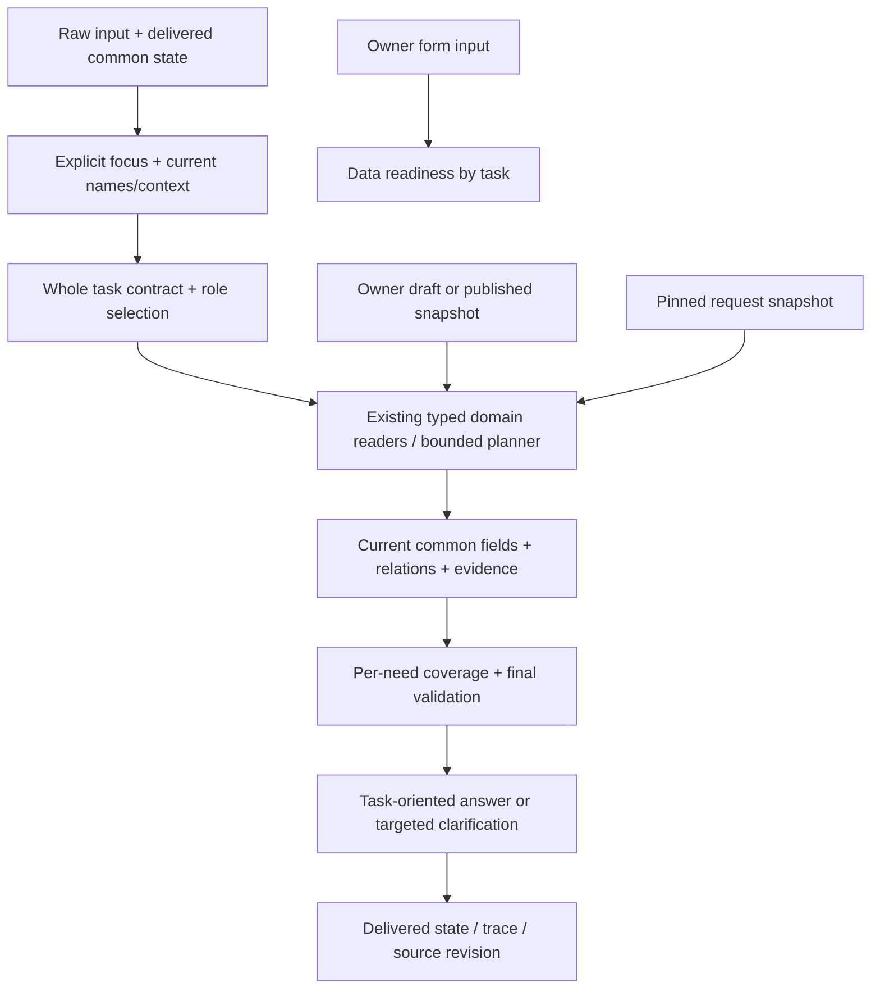

# ผลพัฒนา Flow กลาง R92 และขอบเขตที่ใช้งานได้แล้ว

วันที่ 18 ตุลาคม 2026 (เวลาไทย)

## 1. คำตอบต่อคำถามว่า ดีกว่า Flow กลางเดิมหรือไม่

ดีขึ้นในพฤติกรรมที่มีหลักฐานตรวจในรอบนี้: จาก common เดิมที่ผ่าน 24/49 คำถามในชุดเฉพาะจุด R91 baseline เป็น 49/49 คำถามชุดเดียวกันหลังแก้ โดยมี strong negative checks เพิ่มอีก 12 ข้อ รวม suite 61/61 ไม่ใช่คะแนน full corpus ใหม่ และไม่ได้ใช้ตัวเลขนี้แทนการเทียบ legacy ทั้งระบบ

ความต่างที่จับต้องได้คือชื่อเกมถูกแล้วต้องเลือกงานถูกด้วย วิธีเล่นไม่ถูกแปลงเป็นรายชื่อบริการ คำถามต่อใช้บริบทที่ส่งจริง และคำถามหลายส่วนยังตอบส่วนที่มีข้อมูลได้ รายการใหม่ในหมวดเหล่านี้ใช้ตัวตีความร่วมโดยไม่ต้องเพิ่มโค้ดชื่อเกม/คำตอบราย record

ได้ติดตั้งการแก้ใน R78 จำนวน 12 application/UI files แล้ว และยืนยัน build `common-r92-task-contracts` ผ่าน health/fingerprint ของเว็บจริง ชุด portable เดิมยังเป็นคนละ artifact และยังไม่ได้ rebuild ในรอบนี้

## 2. สิ่งที่เปลี่ยนแล้ว

### 2.1 Shared task interpretation ก่อนเลือก fields

- task families ที่เสริมตรงจุด: game overview, game how-to, equipment list และ FAQ content
- ชื่อและ IDs มาจาก snapshot ปัจจุบัน ไม่มี business facts/ราคา/ชื่อเกมรายตัวใน profiles
- คำถามถูกจับทั้ง task span; มี bounded typo recovery และ grammar สำหรับคำแนะนำ/ภาพรวม/วิธีเล่นไทย–อังกฤษ
- ป้องกัน negation, ปี/เลข, เงื่อนไข, คำถามหลายงาน และ valid English words เช่น pay/name/time จากการถูกแก้เป็นอีกงาน
- ภาพรวมใช้ summary เป็นแกนและ genre ที่มีข้อมูล; ไม่บังคับมีวิธีเล่นหรือ metadata ทุกช่องจึงตอบได้
- reused explicit request-focus helper ของเดิมสำหรับ rejected-task prefixes โดยไม่อ่าน facts เดิม

### 2.2 Context ต้องเลือก semantic role ให้ถูก

เมื่อประวัติมีทั้ง game, service และ control_set ระบบเลือกกลุ่ม records ที่เข้ากับ task ก่อน ตัวอย่าง “Beat Saber game overview and price” ต้องอ่านภาพรวมจาก game แล้วเลือก rates ผ่าน game-service relations ไม่เอา generic overview ของศูนย์มาแทน

ไม่เก็บตัวเลขราคา/คำตอบเก่าเป็น facts ใน state; คำถามต่ออ่าน current snapshot อีกครั้ง ขอบเขตที่ถอนหรือเปลี่ยนต้องผ่าน current checks

### 2.3 Owner preview และแชทใช้ dispatcher ร่วมกัน

owner preview เรียก common chat dispatcher แล้วฉีด provider ที่ชัดเจน: draft view หรือ CommonStore published view แทนการเรียก CommonAnswerer ตรงอีกทางหนึ่ง Metadata บอก draft/published ตาม provider และไม่เปลี่ยน approval ใด ๆ

หน้าทดลองข้อมูลยังไม่อ่าน live booking provider และบอกข้อจำกัดนั้นตรง ๆ การเชื่อมสถานะสดยังใช้หน้าแชทจริงตามเดิม ส่วนการตีความ/เลือกข้อมูล/ตรวจคำตอบ/ถามต่อใช้แกนเดียวกัน

### 2.4 หน้ากรอกแสดง readiness แยกตามงาน ครบ 24 kinds

เพิ่ม endpoint อ่านอย่างเดียว `/api/readiness` ภายใต้ capability authentication เดิม และแสดงผลในหน้า owner เช่น “ภาพรวมเกม — มีข้อมูลที่ต้องใช้แล้ว” กับ “ปุ่มควบคุม — ยังขาดรายการที่เชื่อมโยง”

required-to-publish ของ schema กับ required-for-task แยกกัน การมีข้อมูลพร้อมไม่ได้ถือเป็น factual approval หรือการรับรองว่าแชทเข้าใจทุกสำนวน ข้อมูลราคาที่วันมีผลไม่ชัดแสดง needs_effective_dates ไม่ยกเป็นราคาปัจจุบันเอง

ชื่อ revision ใน UI เปลี่ยนเป็น “ฉบับเผยแพร่” และอธิบายว่าแชททดลองที่อ่าน draft อาจเห็นค่าที่บันทึกทันที เพื่อไม่ให้เข้าใจว่าหน้า R78 preview เป็น production published reader

### 2.5 Compound answer และ Need ledger

คำตอบผสมเก็บผลต่อ clause: answered/partial/missing_fact/not_current/ambiguous ฯลฯ พร้อม fields/evidence refs และส่วนที่ยังไม่ครบ แต่ละ child อ่าน revision set เดียวกับ parent

ถ้า child validation ไม่ผ่าน จะไม่เอาข้อความและ hits ของ candidate ที่ไม่ผ่านมารวมเป็นคำตอบยืนยัน แต่แสดงส่วนที่ยังต้องตรวจได้ ข้อที่ตอบได้อิสระยังคงอยู่

Ledger เป็น coverage ของ selected fields/clauses ไม่ใช่หลักฐานว่าระบบเข้าใจทุกเจตนาของมนุษย์ ต้องอ่าน semantic_correctness_verified=False ตามจริง

### 2.6 Snapshot consistency

ตรึง records/sources/names/references/epoch ต่อคำขอ รวม child clauses และ dialogue repair หาก owner แก้ข้อมูลระหว่างตอบยังตรวจ epoch และคืน retry ได้ ไม่ประกอบราคาเก่ากับเงื่อนไขใหม่

## 3. Flow ที่มีการเปลี่ยนจริงในรอบนี้

ตัวตีความและ renderer ของหมวดอื่นที่ทำงานอยู่ยังใช้ของเดิมใน common ไม่ได้เปลี่ยนทั้งต้นไม้เป็น LLM task planner ใหม่ทุกหมวด

## 4. ผลตรวจที่เก็บไว้

| ชุดตรวจ | ผ่าน/ที่ตรวจยืนยัน | หลักฐาน |
|---|---:|---|
| คำถามที่เคยพลาด + strong negatives | 61/61 | [candidate_release](<C:/Users/Chokhun/Documents/Codex/2026-09-25/psu-esports-studio-phuket-chatbot-c-2/r92_common_flow_implementation_20261018/verification/candidate_release/SUMMARY.json>) |
| วงจรเพิ่ม/แก้/เผยแพร่/ถอน ข้อมูลจำลอง | 13/13 | [owner_2](<C:/Users/Chokhun/Documents/Codex/2026-09-25/psu-esports-studio-phuket-chatbot-c-2/r92_common_flow_implementation_20261018/verification/owner_2/SUMMARY.json>) |
| ราคาเหมา/FAQ ใหม่/แก้ข้อมูล/ไม่ fallback facts เดิม | 19/19 | [existing_fixture](<C:/Users/Chokhun/Documents/Codex/2026-09-25/psu-esports-studio-phuket-chatbot-c-2/r92_common_flow_implementation_20261018/verification/existing_fixture/SUMMARY.json>) |
| แก้กฎ/เพิ่ม clause/ถอนข้อมูลใหม่ ไทย–อังกฤษ | 7/7 | [competition_fixture](<C:/Users/Chokhun/Documents/Codex/2026-09-25/psu-esports-studio-phuket-chatbot-c-2/r92_common_flow_implementation_20261018/verification/competition_fixture/SUMMARY.json>) |
| สำนวนใหม่ / readiness / preview parity / compound / snapshot | 65/65 | [flow_3](<C:/Users/Chokhun/Documents/Codex/2026-09-25/psu-esports-studio-phuket-chatbot-c-2/r92_common_flow_implementation_20261018/verification/flow_3/SUMMARY.json>) |
| Owner API + assets + สิทธิ์ + read-only checks | 7/7 | [owner_http](<C:/Users/Chokhun/Documents/Codex/2026-09-25/psu-esports-studio-phuket-chatbot-c-2/r92_common_flow_implementation_20261018/verification/owner_http/SUMMARY.json>) |
| Local model เปิดจริง + คำตอบที่มี assertions | 5/5 | [live_2](<C:/Users/Chokhun/Documents/Codex/2026-09-25/psu-esports-studio-phuket-chatbot-c-2/r92_common_flow_implementation_20261018/verification/live_2/SUMMARY.json>) |
| เว็บ R78 ที่ติดตั้งใหม่ เปิด LLM | 7/7 | [installed_web_2](<C:/Users/Chokhun/Documents/Codex/2026-09-25/psu-esports-studio-phuket-chatbot-c-2/r92_common_flow_implementation_20261018/verification/installed_web_2/SUMMARY.json>) |

แต่ละ suite ใช้หน่วยคนละแบบ เช่น assertions, owner lifecycle checks, readiness checks และ HTTP turns หลายข้อมีโจทย์ซ้ำกันเพื่อเช็กคนละ surface จึงไม่รวมเป็น accuracy ของผู้ใช้ทั้งหมด

Local model smoke มี 6 requests: 5 ข้อมี answer assertions และอีก 1 ข้อสังเกตพฤติกรรม broad PC question มี actual model preflight ที่สร้าง response จบแล้ว และ chat HTTP model call 1 ครั้งที่ transport/schema ผ่านแต่ semantic plan ไม่รับ เพราะ PC broad request ยังไม่ชัด ระบบจึงถามเลือกหัวข้อ งานที่ task ชัดใช้ source-backed path โดยไม่เรียกโมเดล ไม่ใช่การทดสอบให้ LLM generate คำตอบทั้ง 6 ข้อ

Owner API checks ใช้ฐานจำลองและยืนยันว่า readiness/preview ไม่เขียน DB ความถูกต้องของการเพิ่ม/แก้/withdraw และ approval revision ผูก hash ตรวจด้วย simulated approvals ในฐานแยก ไม่ใช่เจ้าของอนุมัติ production data แล้ว

เวลาที่พบใน HTTP smoke รอบสุดท้าย (การสังเกตบนเครื่องนี้ ไม่ใช่ concurrency SLA):

typo-overview: 3.344s / how-to: 0.705s / new-wording: 0.499s / compound: 0.700s / pc-clarification: 1.898s / pc-followup: 0.276s / faq-policy: 0.547s

## 5. ปัญหาที่พบระหว่างลงมือและแก้อย่างไร

1. **Overlay resource dependency:** การแยก candidate ของ planner ต้องมี schema_descriptions.json ด้วย รอบแรกจึงขึ้น FileNotFoundError ก่อนอ่านคำถาม แก้การประกอบ candidate resources และเก็บ failed results ไว้ ไม่ใช่สรุปว่าข้อมูล production หาย
2. **Compound สูญเสีย context ของ game overview:** bare task ไม่เข้า context resolver เดิม จึงเพิ่ม whole-task continuation ที่ผูกกับ trusted prior IDs
3. **ฐานจริงมี aliases หลาย semantic roles:** เกมเดียวจับได้ทั้ง game/service/control_set ทำให้ continuation ยังเลือกไม่ได้และ generic LLM retrieval ตอบ overview ของศูนย์ แก้การเลือกกลุ่มชนิด records ตาม task และเพิ่ม regression จาก actual dataset; HTTP รอบแรก 6/7 ถูกเก็บไว้ต่างหาก
4. **Ollama ไม่ได้เปิดก่อน smoke:** model preflight ครั้งแรกได้ WinError10061 ยังไม่ได้ส่ง chat requests เริ่ม installed local Ollama แบบ background และลองใหม่เมื่อ listener พร้อม ไม่ดาวน์โหลดโมเดลและไม่เปลี่ยน Windows settings ความผิด transport ไม่ถูกนับเป็น content failure
5. **ป้าย published/draft ชวนเข้าใจผิด:** เปลี่ยนป้ายใน owner UI ให้กล่าวถึงฉบับเผยแพร่ และบอกข้อแตกต่างของแชททดลองที่อ่าน draft

หลักฐานรอบที่ไม่ผ่านยังอยู่ใน verification/candidate_1, owner_1, flow_1, installed_web และ live_1; ผลล่าสุดเป็นคนละ directory ไม่เขียนทับ

## 6. ความคืบหน้าตาม Flow A–I

| ช่วง | สถานะที่มีหลักฐาน | งานที่ยังไม่ครบ |
|---|---|---|
| A inventory/provenance | ใช้ R90/R91 inventory; มี baseline/backups/final diff และ source hashes | behavior contracts ของ long-tail capabilities ยังไม่ครบทุกสำนวน |
| B task/need contracts | มี four task families, role-aware continuation, explicit focus และ need ledger | generic LLM TaskPlan ที่ตรวจ semantic paraphrases ได้ทุกหมวดยังไม่ได้แทน field planner เดิม |
| C games/equipment/FAQ | แก้ targeted regressions, new wording, short follow-up และ data-only addition ที่ตรวจ | ไม่รับรอง arbitrary wording ทั้งหมด |
| D fee/rental | รักษา typed calculator/bridges ปัจจุบัน; isolated update/validity/no-fallback checks ผ่าน | current price validity ของข้อมูลจริงยังต้องใช้เอกสารที่มีผล; ไม่แก้ expiry เพื่อคะแนน |
| E rules/policy/compound | รักษา rule-clause logic; modified/new/withdraw clause checks ผ่าน; compound coverage เพิ่ม | general proposition coverage และ dependent multi-task ทุกแบบยังไม่ครบ |
| F calendar/live | คง paths เดิมและ semantics ที่ผู้ใช้ยืนยัน; content preview ไม่อ้าง live | ไม่ตรวจสถานะจริงใหม่และไม่ทำ live_binding cutover |
| G shared preview/chat | ใช้ shared dispatcher และ provider ชัด; owner API + web verified | preview ปิด live และใช้ budget ต่างจาก public chat; API input guards/session delivery ยังเป็นชั้นเฉพาะเว็บ จึงไม่อ้าง end-to-end equivalence ทุกส่วน |
| H owner lifecycle/readiness | readiness 24 kinds + existing version/approval/publish/withdraw exercised in isolated DB | future scheduling, relation remediation บางชุด, language review และ publish readiness จริงทั้งฐาน |
| I observability/evaluation/delivery | need ledger, source revisions, loaded build, retained failures, installed web checks | ไม่รัน full corpus, calibrate scores, load test หรือ rebuild portable |

## 7. สิ่งที่ยังต้องพัฒนาต่อและยังไม่ต้องเดาข้อมูล

1. ขยาย shared task contracts ไป policy/procedure/controls/price slots และ qualifiers ที่ยังไม่ครอบคลุม โดยใช้ records ใหม่ในหมวดเดิม ไม่เพิ่ม per-record aliases
2. เพิ่ม semantic binding/acceptance ของ LLM สำหรับ paraphrases ที่ grammar ยังไม่รู้จัก พร้อม strong negatives และ held-out questions; การเปิดรับ JSON ทุกแผนยังไม่ใช่วิธีแก้
3. ปรับ retrieval/topic guard ที่ไม่มี subject/context ให้ไม่เลือก source ใกล้คำแต่คนละงาน และเก็บ candidate recall diagnostics
4. เพิ่ม per-record/per-need evidence/cardinality ที่ละเอียดขึ้น โดยเฉพาะ “กติกาทั้งหมด”, ปุ่มทั้งหมด และหลายเงื่อนไขที่พึ่งกัน
5. เชื่อมข้อมูล relation ที่ยืนยันได้ให้เป็น explicit references, ตรวจ task readiness ของข้อมูลจริง และแยก optional unknown จากข้อที่บล็อกงาน
6. ตรวจ workflow published production ของข้อมูลจริงตามสิทธิ์เจ้าของ; profile R78 ปัจจุบันยังเป็น migration preview ไม่แอบเปลี่ยนเป็น approved/published
7. เมื่อ correctness พร้อมและผู้ใช้สั่งจึงทำ full common LLM ON, วัด concurrent performance และ rebuild package ให้ตรง build

ประเด็นข้อมูลที่ไม่ควรเดา: ราคาใหม่หลังวันสิ้นสุด, duration/terms ของแพ็กเกจที่ไม่ระบุ, conflicts ที่ไม่มีหลักฐานตัดสิน, การยืนยันปุ่มจากเครื่องจริง และ owner factual approval ที่ยังไม่ได้ทำ ส่วนช่วงเที่ยงไม่เปิดให้จอง/VR30 กินชั่วโมงเต็ม/สถานะสดถูกต้อง ใช้คำยืนยันเดิมของผู้ใช้ตามขอบเขตนั้น ไม่ขอซ้ำ

## 8. การรักษางานเดิม

ฐานข้อมูลจริงมี SHA256 เดิม ไม่แก้ production facts หรือ approval ในงานนี้ Frozen R64/R88 ตรวจเทียบ manifest เดิมแล้วไม่เปลี่ยน ไฟล์ก่อนแก้และแต่ละ revision ของการติดตั้งอยู่แยก และ log/ผลที่ไม่ผ่านยังเก็บอยู่

กำลังให้บริการเว็บจาก R78 ที่ http://127.0.0.1:8115/; เปิด owner editor ของชุดเดียวกันด้วย Open-Data-Editor.cmd ที่ R78 เพื่อใช้หน้า readiness ใหม่ การเปิด owner editor บน path ของแพ็กเกจอื่นยังใช้โค้ดของแพ็กเกจนั้น

## 9. ไฟล์อ้างอิง

- [Flow ที่ใช้อ้างอิง](<C:/Users/Chokhun/Documents/Codex/2026-09-25/psu-esports-studio-phuket-chatbot-c-2/r91_common_task_flow_20261018/01_PROPOSED_COMMON_FLOW_TH.md>)
- [Final installation manifest](<C:/Users/Chokhun/Documents/Codex/2026-09-25/psu-esports-studio-phuket-chatbot-c-2/r92_common_flow_implementation_20261018/INSTALLATION_3.json>)
- [Final source diff](<C:/Users/Chokhun/Documents/Codex/2026-09-25/psu-esports-studio-phuket-chatbot-c-2/r92_common_flow_implementation_20261018/FINAL_CHANGESET.diff>)
- [ผลตรวจทุกชุด](<C:/Users/Chokhun/Documents/Codex/2026-09-25/psu-esports-studio-phuket-chatbot-c-2/r92_common_flow_implementation_20261018/VERIFICATION_FINAL.json>)
- [Preservation และ hashes](<C:/Users/Chokhun/Documents/Codex/2026-09-25/psu-esports-studio-phuket-chatbot-c-2/r92_common_flow_implementation_20261018/PRESERVATION_FINAL.json>)
- [เปิดเว็บแชท](<C:/Users/Chokhun/Documents/Codex/2026-09-25/psu-esports-studio-phuket-chatbot-c-2/r78_web_session_check_20261016/Open-New-Chat.cmd>)
- [เปิดหน้าจัดการข้อมูล](<C:/Users/Chokhun/Documents/Codex/2026-09-25/psu-esports-studio-phuket-chatbot-c-2/r78_web_session_check_20261016/Open-Data-Editor.cmd>)
