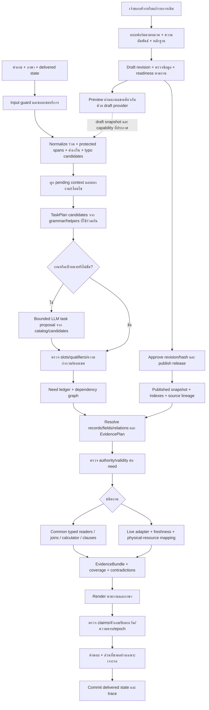

# Flow กลางฉบับรวม R94 — ใช้ R91 เป็นแกนและรักษาส่วนที่ดีของ common เดิม

วันที่: 18 ตุลาคม 2026 · สถานะ: **แบบพัฒนาที่รวมและทบทวนแล้ว ยังไม่ได้ติดตั้ง runtime ตามเอกสารนี้**

## 1. รวมฉบับไหน และทำไม

คำว่า “กลางเดิม” ในเอกสารนี้คือ common R88/R87 ตาม R90 ไม่ใช่ legacy format ทั้งระบบ ส่วน “กลางใหม่” คือแผน R91 และส่วนที่ติดตั้งจริงใน R92 ผล R93 ใช้ชี้ว่าการติดตั้งบางส่วนยังติดอะไร ไม่ถือว่า R91 ทั้งแผนถูกนำไปใช้แล้ว

เป้าหมายคงเดิม: เจ้าของเพิ่ม/แก้ข้อมูลในแบบฟอร์มกลาง ผู้ใช้ถามเรื่องบริการของ PSU Esports Studio และระบบตอบจากข้อมูลที่มีสิทธิ์ใช้งานและมีผลในเวลาที่ถาม รองรับไทย/อังกฤษ คำผิด และการถามต่อ โดยไม่ต้องเพิ่มโค้ดชื่อเกมหรือเฉลยทีละรายการ

**เลือก R91 เป็นโครงหลักเพราะแยก task, needs, evidence และ authority ชัดกว่า ไม่ใช่เพราะมีผลวัดแล้วว่าทั้งแผนตอบดีกว่า** R93 แสดงว่าของที่ติดตั้งยังไม่คืนความสามารถครบ

| เรื่อง | เก็บจากกลางเดิม/R92 | ใช้แนวใหม่เป็นแกน | วิธีเชื่อม |
|---|---|---|---|
| ข้อมูลเจ้าของ | schema, stable IDs, refs, sources, revisions, approvals | readiness ต่อสิ่งที่ต้องตอบ | ไม่สร้างฐานข้อเท็จจริงอีกชุด |
| ตีความคำถาม | name recovery, field meanings และ domain grammar ที่ยังถูกต้อง | shared TaskPlan ก่อนเลือก fields | helpers เดิมคืน candidates; ไม่ตัดสินคำตอบก่อนแผนกลาง |
| LLM | bounded calls และ JSON/schema validation | เสนอ subject/task/slots/qualifiers ที่ผูกกับข้อความ | แทน field-only fallback เป็นราย capability เมื่อพร้อม |
| อ่านข้อมูล | controls, competition, rental, billing, relation readers | EvidencePlan ต่อ need | adapters รับ typed inputs และคืนหลักฐาน ไม่ค้นเจตนารอบใหม่ |
| สนทนา | common state/role-aware follow-up | pending need/choice ที่ส่งจริง | ตอบสั้นแล้วเติมช่องที่ค้าง อ่าน facts ใหม่เสมอ |
| ความครบ | source/epoch/field checks | need dependencies + claim coverage | ได้ record ถูกยังไม่ถือว่าตอบครบ |
| การตอบ | compact opening, list/table/clause formats ที่ดี | render ตามงาน list/compare/procedure | ไม่ใช้ generic field dump แทนคำตอบ |
| เจ้าของทดลอง | R92 shared dispatcher/provider | published/draft authority ชัด | semantics ร่วมกัน สิทธิ์และ live capability ระบุแยก |

สิ่งที่เปลี่ยนจากแผนก่อนอย่างมีนัยสำคัญคือกำหนด **จุดเชื่อมและเกณฑ์ปลด branch เก่า** ไม่ใช่เพียงนำลูกศรสองแผนมาต่อกัน

## 2. ภาพรวมตั้งแต่กรอกข้อมูลจนตอบผู้ใช้

แผนภาพนี้เป็น target design ข้อมูลเก่าและข้อมูลใหม่ที่ย้ายเข้ากลางอ่านด้วยกติกาเดียวกัน ไม่ให้แพลนที่ตีความไม่สำเร็จย้อนกลับไปใช้ราคา/นโยบายจาก loader เดิม

## 3. กติกากลางที่ทุกเส้นทางต้องใช้

1. เก็บ raw input และ span offsets; การแก้คำผิด/ตัดคำเกริ่นต้องย้อนตรวจได้
2. Entity, task และ evidence เป็นคนละผลตรวจ การเจอชื่อ exact ไม่เติมงานหรือความมั่นใจให้เอง
3. Static facts อ่าน snapshot เดียวต่อ request รวม child needs; live มีเวลาสังเกตของตัวเองและต้องตรวจ freshness แยก
4. Record/field authority, validity และความขัดแย้งตรวจต่อ need ไม่บล็อกเรื่องที่เป็นอิสระทั้งหมด
5. ไม่ให้ source ที่มีข้อมูลพร้อมกว่าเอาชนะ interpretation ที่ตรงคำถามกว่า
6. Unknown ไม่เท่ากับไม่มี/ไม่ว่าง/ฟรี/อนุญาต; conflict ไม่ให้เลือกฝ่ายใดเอง
7. คำว่า “ทั้งหมด” มี scope และ completeness contract ไม่ใช่ top-k หรือทุก field ใน record
8. Helpers และ typed executors ไม่มีสิทธิ์ตอบ HTTP หรือ commit state เอง ต้องผ่าน finalizer ร่วม
9. LLM เป็นผู้เสนอการตีความ/เรียบเรียงจากหลักฐาน ไม่ออกนโยบาย ราคา การคำนวณ หรือสถานะสดเอง
10. การส่งรูปแบบ JSON ถูก การเชื่อมโมเดลสำเร็จ และการตอบสาระถูก รายงานคนละตัววัด

## 4. สัญญาข้อมูลที่เชื่อมสอง Flow

ชื่อเหล่านี้เป็น **interface ที่เสนอ** ไม่อ้างว่ามี class/field ครบในโค้ดปัจจุบัน

| Interface | ข้อมูลที่ต้องมี | ผู้สร้าง → ผู้ใช้ |
|---|---|---|
| RequestContext | raw/locale/timezone/reference time, deadline, session, provider identity, static epoch | API/preview → ทุกขั้น |
| NormalizedQuery | raw-to-normalized spans, protected values, discourse spans, correction alternatives/reasons | shared normalizer → task interpreters |
| TaskPlan | operation, subject candidates, scope, slots, qualifiers, exclusions, cardinality, unresolved spans, bindings | deterministic/LLM proposers → plan arbiter |
| NeedGraph | need IDs, required facts/slots, independent/dependent edges, statuses | accepted plan → evidence/execution |
| EvidencePlan | compatible kinds, selected IDs, fields, relation paths, clause dependencies, output granularity | resolver → readers |
| EvidenceBundle | values/statuses, revision/source/hash/pointers, validity, translation lineage, calculations/live observation | readers → validator/renderer |
| AnswerOutcome | per-need result, coverage, missing reason, citations, rendered answer, state delta | finalizer → delivery/logger |

Need status อย่างน้อย: answered, partial, missing_slot, missing_fact, ambiguous, conflicted, not_current, live_unavailable, unsupported และ technical_error แยก timeout/busy ออกจาก source ไม่มีข้อมูล

Legacy-style/common field plans ที่ยังใช้ชั่วคราวต้องแปลงเป็น EvidencePlan ได้ แต่ **field plan อย่างเดียวสร้างหลักฐานว่าตีความ intent ถูกไม่ได้** ห้ามใช้ adapter ยกระดับ unverified เป็น verified โดยเปลี่ยนชื่อ field

## 5. Runtime ทีละขั้น

### M01 — รับ input และเลือก capability

ใช้ guard/auth/session/deadline/idempotency เดิมที่ยังตรงงาน ตรวจขอบเขตศูนย์/ร้านเกมตามข้อมูล ไม่สร้างทางตอบความรู้ทั่วไปนอกบริการเพื่อเพิ่มคะแนน การตรวจ layout/repeat ให้เสนอคำแก้หรือถามกลับเมื่อกำกวม ไม่ปฏิเสธข้อความไทยที่ผสมชื่อเกมอังกฤษเพียงเพราะสัดส่วนตัวอักษร

Owner preview มีสิทธิ์อ่าน draft ตาม authentication; public production อ่าน published เท่านั้น Profile migration preview ที่อ่าน draft ต้องแสดงสถานะตามจริง การเลือก provider ไม่ให้ข้อความผู้ใช้สลับเอง

### M02 — ทำ normalization ก่อนแยกทุก branch

ทำ Unicode/spacing/punctuation normalization โดยคง mapping กลับ raw text แยกเลขเครื่อง รุ่น ปี เวลา เงิน ระยะเวลา polarity/negation audience และ exception ก่อนเสนอ recovery

จำแนกคำเกริ่น/คำสุภาพเป็น discourse เมื่อไม่เพิ่มข้อเท็จจริงหรืองาน เช่น planning-a-visit หรือขอสอบถามหน่อย คำว่า “สำหรับบุคคลภายนอก” และ “หลัง First Blood” เป็น qualifiers ไม่ใช่ discourse

ใช้ bounded deletion/duplication/transposition/keyboard-neighbor เป็น candidate signals ร่วมกับบริบทไทย/อังกฤษ ไม่ลดตัวซ้ำทุกคำหรือแก้ valid word pay เป็น play อัตโนมัติ Exact entity ไม่ทำให้ข้าม recovery ของ task cue

**จุดแก้ R93:** named-target และ entity-search ต้องรับ NormalizedQuery เดียวกัน ไม่ให้ wrapper stripping อยู่เฉพาะ selector ทางหนึ่ง และไม่ปฏิเสธทั้งประโยคเพียงเพราะมี and/ตัวเลข

### M03 — ผูกคำตอบสั้นและแยกโครงคำถาม

ใช้ pending need/choices จากคำตอบที่ส่งถึงผู้ใช้จริงก่อนเติม “PC”, “ทั้งหมด”, “ภายนอก”, “อุปกรณ์” เก็บ scope/audience/task เดิมเท่าที่ไม่ถูกแก้หรือเปลี่ยนหัวข้อ ตรวจว่า record ยังอ่านได้ใน snapshot ใหม่

แบ่ง substantive conjunction, conversational conjunction, conditions และ comparisons แยกกัน “อยากไปและขอถามว่าเกมนี้คืออะไร” มีงานเดียว แต่ “ราคา PC และ VR” มีหลายเป้าหมาย และ “ก่อน/หลัง First Blood” เป็น compare ที่มีสองฝั่งสัมพันธ์กัน

คำปฏิเสธการยืนยันต้องยกเลิกตัวเลือกเดิม ไม่ใช่เลื่อนเป็น yes การเปลี่ยนหัวข้อชัดเจนไม่สืบทอด audience/เกมเก่าโดยอัตโนมัติ

### M04 — สร้างและตัดสิน TaskPlan

ใช้ shared grammar/task profiles, names จาก snapshot, existing pure helpers และ schema meanings เพื่อเสนอแผน entity กับ task ช่วยจำกัดกันได้เป็น candidate sets ไม่ยึด entity ตัวแรกถาวรก่อนรู้ operation

มีแผนตรงงานครบและไม่มีคู่แข่งที่เปลี่ยนคำตอบสาระ → ใช้ deterministic path ได้ หากไม่ครบ → bounded LLM proposal พร้อม task catalog และ candidates ที่ตรวจได้ ไม่ใช่ขอโมเดลเลือก field จาก record ที่ล็อกผิดไปแล้ว

ตัวเลือกแข่งขันต้องเทียบ subject/operation/audience/polarity/edition/time/qualifiers ก่อน similarity แผนที่ขัด hard constraints ตัดออก; similarity หรือ self-reported confidence ชดเชยไม่ได้ Threshold ใหม่ต้อง calibrate จากชุดพัฒนาแยก held-out ไม่กำหนดน้ำหนักโดยเดา

### M05 — ตรวจ semantic acceptance โดยไม่ย้อนบังคับให้เหมือน regex ทุกคำ

ตรวจ schema, allowed operations, valid current IDs, raw/state span bindings, normalized units, negation, audience, qualifiers, scope และ meaningful-span coverage

Span binding ยืนยันว่าโมเดลอ้างข้อความจริง แต่ไม่พิสูจน์ว่าความหมายถูก ต้องมี task-specific acceptance contracts และ negatives ที่แยกงานใกล้กัน เช่น available=มีให้บริการ กับ free now=ว่างสด, allow bringing กับ allow consuming

คำที่ใหม่แต่ผ่านการตรวจ semantic contract ไม่ต้องกลับไปผ่าน literal grammar เดิมซ้ำ ส่วนที่ตรวจไม่ได้ต้องเป็น uncertain/targeted clarification ไม่แอบผ่านเพราะ JSON ถูก ห้ามใช้ LLM ตัวเดิมโหวตรับตัวเองเป็นหลักฐานอิสระ

**กลไก acceptance ที่ต้องลงมือจริง:** registry ต่อ task ต้องประกาศชนิด subject, slots และ scope ที่รับ, qualifier roles ที่จำเป็น, allowed fields/joins, output needs และ confusion pairs ของงานนั้น ตัว proposer คืน task ID กับ span-bound slots และ canonical request เช่น “ขอภาพรวมเกม X” หรือ “ขอสิทธิ์ของ audience Y ในการทำ action Z ภายใต้ condition C” validator ตรวจให้ทุกสาระลงบทบาทและไม่มี qualifier สำคัญถูกทิ้ง ส่วน semantic match ของสำนวนใหม่ใช้ acceptance policy ที่ calibrate บน intent/paraphrase/negative cases แยกตาม task ไม่ใช้การมีคำว่าเกม/จองเพียงคำเดียวเป็นการยืนยัน

แผนที่ semantic proposer เสนอและผ่าน policy นี้บันทึก `acceptance_path=semantic` กับเหตุผล/ข้อจำกัด ไม่ปลอมว่าได้ independent deterministic intent support แล้ว การตั้ง policy ต้องพิสูจน์ด้วย held-out cases; หากความหมายยังแยกงานคู่แข่งไม่ได้ให้ถามประเด็นนั้น ส่วน calculators/claim checks ยังปิดทางตัวเลขและนโยบายที่ไม่มีหลักฐาน แม้ task classification จะได้รับอนุญาตแล้ว

งบเป้าหมาย: reuse deterministic result ก่อน ใช้ task proposal แบบรวม needs ไม่วนถามแต่ละ field ไม่จำกัดตายตัวว่า LLM ได้หนึ่งครั้งทุกกรณี แต่ต้องมี request-level admission/deadline และบันทึกทุก call การเรียบเรียง grounded text เป็นอีกงานที่ต้องนับ budget

### M06 — สร้าง NeedGraph และเลือกหลักฐาน

แปลงทุกสิ่งที่ต้องตอบเป็น need พร้อม dependencies ตัวอย่าง “PC ภายนอก 2 ชั่วโมงราคาเท่าไรและอยู่ตึกไหน” มี price need กับ location need ที่เป็นอิสระ ส่วน “งบ 100 เล่นได้นานสุดเท่าไร” พึ่ง current rate และ billing policy ก่อนสรุป duration

Need สร้างจากคำถาม ไม่สร้างจาก fields ที่ค้นเจอแล้วเพียงอย่างเดียว มิฉะนั้น ledger จะดูครบแต่ขาดสิ่งที่ผู้ใช้ถาม

ค้นตาม kind/relationship ที่เข้ากับงาน รวม unnamed semantic/topic retrieval เมื่อไม่มีชื่อ แยก no candidate, wrong kind, field unknown, relation missing, rejected interpretation และ actual source absent ใน trace

FAQ อาจช่วยค้นหัวข้อหรือให้คำตอบที่มีหลักฐาน แต่ข้อความราคา/กฎใน FAQ ที่ขัดกับ authoritative rate/policy revision ห้ามชนะเพราะ match คำถามใกล้กว่า ใช้ authority/validity ของ facts ที่เกี่ยว หากแหล่งมีสิทธิ์เท่ากันและขัดกันจริงให้ conflicted เฉพาะ need นั้น ไม่เลือก latest file โดยอัตโนมัติ

กรณีชื่อชนกัน/edition ต่างกันเก็บ candidates จนเลือกได้ การเพิ่ม relation หรือ candidate recall ต้องรักษา target/independent-topic constraints ไม่ปล่อยไปอีกเกมเพื่อให้มีคำตอบ

### M07 — ใช้ typed readers ที่ดีของกลางเดิม

Reader รับ accepted task, slots, scope และ snapshot จากแผนร่วม คืนหลักฐาน/ข้อขาด ไม่ตีความคำถามใหม่หรือโหลด facts เก่าเอง

Read/join ใช้ known values และ refs ที่พิสูจน์ได้ Calculate ใช้ข้อมูลสูตร/หน่วยที่มีหลักฐาน Select clauses รวม exceptions/dependencies และ source order Live ใช้ provider mapping/freshness List deduplicate ตาม identity ที่ถูกชนิด

Fast path เช่น compact opening/rental ยังใช้ได้เมื่อมี task contract ที่ตรงและอ่าน provider เดียวกัน แต่ผลต้องเข้าตัวตรวจ/finalizer ร่วม ไม่ bypass semantic/authority checks

### M08 — ตรวจผลและประกอบคำตอบตามงาน

ตรวจ evidence sufficiency ต่อ need ก่อน render: claim ที่ยืนยันต้องชี้ field/clause/revision; numbers/polarity/exceptions ต้องไม่เปลี่ยน Partial ตอบส่วนอิสระที่ผ่าน และระบุส่วนที่ยังขาดชัดเจน

งานเปรียบเทียบแสดงสองฝั่งพร้อมเงื่อนไข งานขั้นตอนแสดงลำดับและ prerequisites งานทั้งหมดตรวจ cardinality และแบ่งต่อโดยมี continuation token ผูก release/scope/order หากข้อมูลเปลี่ยนต้องแจ้งให้เริ่มขอบเขตใหม่ ไม่อ้างว่ารวมครบข้าม revision

ภาษาอังกฤษแยก localized values, machine translation และ owner review ชื่อเฉพาะไทยไม่เท่ากับแปลสาระไม่ครบ การแปลต้องรักษาตัวเลข/หน่วย/ปฏิเสธ/ข้อยกเว้นและ lineage ของ source revision

### M09 — ส่งผลและ commit เฉพาะสิ่งที่ส่งจริง

ตรวจ final claims/coverage/authority/epoch และ deadline หาก snapshot เปลี่ยน ใช้ snapshot ที่อนุญาตตามนโยบาย request consistency หรือคืน retry ที่มีขอบเขต ห้าม reuse withdrawn evidence โดยอ้างประวัติ

ไม่ commit choice ที่ candidate ถูกปฏิเสธหรือคำตอบยังไม่ได้ส่ง session state ไม่ใช้ข้อความ/ตัวเลขเก่าเป็น facts Cache ต้องผูก provider/release/revisions/locale/task constraints และแยก live freshness ไม่ cache คำตอบข้าม session โดยปะปนประวัติ

## 6. Domain subflows และรูปคำตอบ

### เกม แพลตฟอร์ม วิธีเล่น ปุ่ม จำนวนผู้เล่น

game/edition → operation → game, game_mode, control_set, game_service/service/resource ตามงาน → evidence/validity → render

ภาพรวมอ่าน summary/genre วิธีเล่นอ่าน how_to_play ปุ่มเลือก action/input/preset/platform ที่จำเป็น ไม่ให้ game→service projection เปลี่ยนวิธีเล่นเป็นรายการบริการ เกมรองรับแพลตฟอร์มหนึ่งไม่ยืนยันว่าศูนย์ติดตั้ง/มีบัญชี/เครื่องว่าง

ถามมา 4 คนใช้ players_min/max, studio_supported และ capacity ตามหลักฐาน ไม่เอา room_seats มาแทนผู้เล่นพร้อมกัน หากขาดข้อมูลให้ระบุขอบเขตที่ยังไม่ยืนยัน

### อุปกรณ์ โซน และเครื่องรายตัว

resolve zone/service/resource/equipment_model ตามระดับที่ถาม → refs/reverse refs → name/type/specs/usage/capacity ตามงาน

“PC มีอุปกรณ์อะไร” เป็น list ภายใต้ PC; “Sofa 2 seats คืออะไร” เป็น explain equipment; “PC1 ใช้จอรุ่นอะไร” เป็น relation query ไม่ใช่งานเดียวกัน การแก้ equipment_list อย่างเดียวไม่ปิดทั้งหมวด

### ราคา รายชั่วโมง ราคาเหมา และงบประมาณ

service/zone + audience + duration/package + quantity + date → current rate/package → supported calculation rule → quote/table หรือ specific missing outcome

ไม่สมมุติกลุ่ม PSU ไม่คูณราคาเองเมื่อ billing ไม่รองรับ ราคาเหมาอ่าน rental_package ไม่อนุมานจากรายชั่วโมง และไม่ตีความ full-day เป็นจำนวนชั่วโมงที่ไม่มีหลักฐาน

VR session_minutes กับ occupancy interval เป็นคนละเรื่อง: ผู้ใช้ยืนยัน VR 30 นาทีใช้ช่องจองเต็มชั่วโมง การแบ่งช่องต้องใช้กฎ anchor/boundary ที่ยืนยัน/กำหนดใน provider ไม่แปล occupancy_minutes=60 ว่าเริ่มทุกนาทีแล้วบวก 60 เสมอ

“ภายนอกทั้งหมด” → ตารางทุกบริการใน scope พร้อมหน่วย/เงื่อนไข ไม่ถามเลือกบริการซ้ำ “PC” หลังถามเลือกบริการ → เติม PC และคง audience ที่มีอยู่ หากราคา expired ตอบเฉพาะข้อจำกัดปัจจุบันและทางตรวจราคา ไม่ dump อัตราหลายกลุ่มที่ไม่ได้ถาม

### นโยบาย ขั้นตอน FAQ และข้อมูลศูนย์

task/action + subject + audience + qualifiers → policy/procedure/FAQ/center/contact/facility/person → answer/steps/conditions/dependencies

เลือกด้วย scope ไม่ใช่ชื่อคล้ายที่สุด นำอาหารเข้า/รับประทาน/อาหารส่วนตัวแยกกัน ดูเพื่อนเล่นได้ไม่ยืนยันว่าการเข้าชมทุกกรณีฟรี เปลี่ยนเครื่องก่อนจ่าย/เปลี่ยนวันหลังจ่าย/ขอคืนเงินไม่ใช้ FAQ เดียวแทนกัน

คำถามผู้ดำเนินการใช้ center.operator/ข้อมูลเกี่ยวข้องที่มีหลักฐาน ไม่ให้ตอบเมนูชื่อเกม ที่อยู่/map/contact ตอบได้ตรง field ถ้าสิทธิ์เข้าถึงอนุญาต รายชื่อคนใช้ public_scope ไม่ดึง private contacts

### กติกาการแข่งขัน

game + event/edition/division → competition → rules ตาม facet/proposition → dependency/exception closure → source-order/compare/steps renderer

เก็บความสามารถ clause selection ที่กลางทำได้ดีอยู่แล้ว แยก text equivalence จาก proposition coverage เช่น RoV ก่อน/หลัง First Blood ต้องรักษาเกณฑ์เวลา การอนุญาตและ hero/position ตามต้นฉบับ พร้อมจัดสองฝั่งตามโจทย์ ไม่ dump ทั้งเล่มเมื่อถามเปรียบเทียบ

ถามทั้งหมดต้องครบเล่ม/ขอบเขตที่ระบุ ถ้าระบุเกมที่ยังไม่มีกฎตรง ให้แจ้งตรงเกมนั้น ไม่ใช้ VALORANT แทนเพราะมีข้อมูลพร้อม

### เวลาเปิด การจอง และสถานะสด

date/time/timezone → scope → schedule/closure precedence ที่มีหลักฐาน → open/bookable/maintenance → live mapping ถ้าถาม occupancy

12:00–13:00 ผู้ใช้ยืนยันว่าไม่เปิดให้จอง ใช้เป็น bookability constraint ไม่ขยายเป็นนโยบายห้ามเข้าศูนย์โดยไม่มีหลักฐาน Special closure/override ต้องอ่าน scope และ resolution policy ถ้าขัดกันตัดสินไม่ได้ให้ conflicted ไม่เลือกตามเวลาที่ไฟล์ถูกแก้ล่าสุด

“วันนี้เปิดไหม” → “วันนี้ [วันที่ไทย] เปิด/ไม่เปิดบริการ” ตามหลักฐาน ถ้ายังยืนยันไม่ได้ตอบสั้นตรงเหตุ ไม่แสดง JSON schedule หรือผูกกับ booking outage ทั้งที่มีหลักฐาน static ที่ยืนยันวันได้

“Cockpit ว่างไหม” → เวลาอ้างอิง + ยืนยันว่าง x/y + รายเครื่อง ใช้ physical inventory ที่มี mapping ไม่ซ้ำ VR30/VR60 เป็นสองเครื่อง Unknown/maintenance/out-of-service แสดงแยกจาก booked

“บ่ายสามมีอะไรเล่นได้บ้าง” → วันที่/ช่วงเวลาชัด → แสดงเฉพาะ free ที่ยืนยันแล้ว ถ้าบางเครื่องตรวจไม่ได้ให้แจ้งว่ารายการอาจไม่ครบ ไม่เรียก unknown ว่าไม่ว่าง และ API สำเร็จอย่างเดียวไม่รับรอง status mapping

live denominator ต้องนิยามชัด: ทรัพยากรกายภาพใน scope ที่ยังไม่ retired; out-of-service/maintenance/unknown คงเห็นสถานะตามจริง เมื่อ mapping ไม่พอห้ามเดาจำนวนเครื่องจาก product labels

## 7. Owner flow ที่ทำให้เพิ่มและแก้ข้อมูลใช้ได้จริง

1. เลือกหมวด สร้างรายการหรือแก้ stable ID เดิม ฟอร์มแสดงชื่ออ่านง่าย ระบบจัดการ ID/ref ให้
2. ใส่ facts/source/relations/ช่วงมีผลเท่าที่ทราบ ใช้ unknown/conflicted ตรงความจริง
3. Save draft revision ด้วย expected_version และ immutable evidence/attestation ตามกลไกเดิม
4. Validate shape/refs/units/intervals พร้อมแสดง readiness ต่อ task เช่น “ตอบภาพรวมได้ ยังตอบปุ่มไม่ได้”
5. Preview ใช้ runtime dispatcher เดียวกัน แต่ provider=draft และ live disabled จนกว่าจะมี capability ทดสอบที่ประกาศชัด
6. Review/approve ผูก revision/hash ตามสิทธิ์เดิม ไม่ให้ผลเทสหรือการแปลอัตโนมัติอนุมัติแทนเจ้าของ
7. Publish ใช้ selected coherent revisions และตรวจ referenced versions สร้าง indexes ของ release ก่อนสลับ active แบบ atomic ตามความสามารถ store; scheduled activation ยังเป็นงานเพิ่มถ้าระบบไม่รองรับ
8. Invalidate names/text/reverse refs/evidence/plan caches ที่เกี่ยว และทำให้ pending references อ่านรุ่นปัจจุบันใหม่
9. Public chat อ่าน published provider; migration preview ยังคงป้าย draft ตามจริงจนมีการย้าย deployment ที่ตรวจครบ
10. Withdraw/rollback เก็บ audit/revision history และทดสอบ effect ต่อ refs/translation/cache ไม่ลบฐานเดิม

Data-only extensibility หมายถึงเพิ่ม **records ใน kinds และ tasks ที่รองรับแล้ว** เพิ่ม schema kind ใหม่หรือธุรกรรมใหม่ยังต้องพัฒนาความสามารถ ไม่มีสัญญาว่ากรอกข้อความใดก็ทำ task ใหม่ได้ทันที

## 8. ตัวอย่างเดิน Flow เพื่อใช้ทบทวนแบบ ไม่ใช่ผลเทสใหม่

| Input | Task/need ที่ต้องได้ | จุดเชื่อมที่แก้ปัญหา |
|---|---|---|
| planning-a-visit + Animal Crossing เป็นเกมอะไร | game_overview, game เดิม, genre/summary ที่รู้ | discourse ไม่สร้าง unresolved need ปลอม |
| จอสอบถาม… Sofa 2 seats คืออุปกรณ์อะไร | explain_equipment + candidate typo preface | ไม่ทิ้ง record/specs/usage ที่พบเพราะ framing ที่ไม่เปลี่ยนสาระ |
| ราคาบุคคลภายนอก → ทั้งหมด | fee_table audience=external, scope=all services | pending slot และ quantifier เดียวกับประโยคเต็ม |
| ราคาภายนอก → PC | fee task เดิม + service=PC | ไม่เริ่ม general PC topic ใหม่ |
| Who operates… + verified information | center_operator พร้อม source requirement | source requirement ไม่กลายเป็นหัวข้อใหม่ |
| ต่างมหาลัย VR 90 นาที | fee_quote; audience/duration/validity needs | เลือกกลุ่มตรง; ไม่คำนวณก่อน billing/current rate พร้อม |
| RoV restart before/after First Blood | compare_rules, two branches + exceptions | executor เดิมให้ clauses, renderer ใหม่จัด compare |
| ราคา PC และอยู่ตึกไหน | independent price/location needs | price not_current ไม่ลบทิ้งที่อยู่ที่ยืนยันได้ |
| จ่ายแทนเพื่อนได้ไหม | payment actor policy | ไม่อนุมานจาก permission จองหลายเครื่อง/โอนครั้งเดียว |
| วันนี้เปิดไหม | day_open_status | compact answer จาก schedule/exception ที่อนุญาต |

## 9. ขอบเขตผลสำเร็จที่ยังต้องพิสูจน์

เอกสารนี้รวมแบบแล้ว ยังไม่แปลว่าคะแนนดีขึ้นจาก 67.11% การพัฒนาต้องเดินตาม milestones ในเอกสาร 02 และลงสถานะพร้อม artifacts ต่อ capability

ผล R93 เดิมเก็บไว้ครบ ไม่ rerun ในงานออกแบบนี้ ไม่ใช้ strict legacy protocol เป็น semantic accuracy ไม่เพิ่ม keyword ในคำตอบเพื่อหลอกให้ผ่าน และไม่แก้ข้อมูลหมดอายุให้มีผลโดยไม่มีหลักฐาน

รายละเอียด implementation, P01–P37, schema 24 kinds, exit criteria และการทบทวนสามรอบอยู่ในเอกสาร 02 และ 03 ของชุด R94
