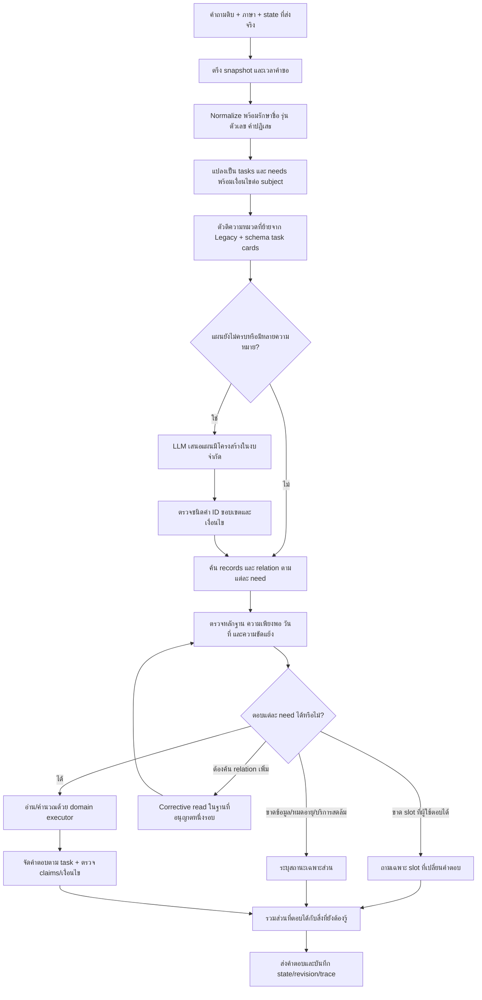

# Flow กลางที่เสนอหลังทบทวนงานวิจัยและผล R95

สถานะ: **design proposal ไม่ใช่ runtime ที่ติดตั้งแล้ว**

อ้างอิงบทความ P01–P15 และหลักฐานโค้ด/ผลเดิมใน [รายงานวิเคราะห์](01_RESEARCH_AND_DIAGNOSIS_TH.md) ขั้นตอนและค่า budget ต่อไปนี้เป็นข้อเสนอของโครงการ ต้องตรวจด้วย focused evaluation ก่อนใช้จริง

## 1. เป้าหมายและสิ่งที่ต้องรักษา

- คำถามที่ Legacy ตีความได้ ให้สามารถอ่าน facts กลางเพื่อให้คำตอบครอบคลุมเทียบเท่าเดิม
- เจ้าของเพิ่ม/แก้ record ในหมวดที่รองรับแล้ว โดยไม่ต้องเขียน regex หรือคำตอบทีละประโยค
- ข้อมูลราคา นโยบาย รุ่นเกม และรายการแข่งขันต้องอ้างอิงข้อมูลกลางที่มีสิทธิ์อ่านและมีผล
- รับคำถามหลายส่วนและการตอบสั้นหลังถูกถามเพิ่ม โดยไม่ปะปนเงื่อนไขระหว่าง subject
- หากบางส่วนไม่มีข้อมูล ให้บอกเฉพาะส่วนนั้นและรักษาคำตอบส่วนที่เป็นอิสระ
- รับเฉพาะเรื่องศูนย์และบริการร้านเกมตามข้อมูล ไม่ขยายเป็นแชทความรู้ทั่วไปเพื่อไล่คะแนน
- รักษาความต่างระหว่าง “มีให้เล่น”, “เปิดบริการ”, “จองได้” และ “ว่างขณะนี้”

## 2. ภาพรวม



LLM branch และ corrective read มี attempt counter และ deadline ไม่วนตามลูกศรได้ไม่จำกัด การเข้าตรวจรอบสองไม่รีเซ็ตงบคำขอ

## 3. ขอบเขตการใช้ Logic เดิม

### 3.1 ย้ายอะไร

| ส่วน | นำมาใช้แบบไหน | ต้องตัดการพึ่งอะไร |
|---|---|---|
| recovery ภาษา/คำผิด | pure function คืน variants และ edit map | คำตอบหรือราคาในไฟล์เก่า |
| game/event target lock | สร้าง target constraints | registry ชื่อจริงต้องมาจาก snapshot กลาง |
| fee/budget/rental parser | แปลงเป็น service/audience/duration tuples | amount และ billing rule จาก legacy table |
| controls intent | action/button/platform/preset | bindings ต้องอ่าน control_set กลาง |
| competition interpreter | event/game/topic/condition/edition | ข้อกฎต้องอ่าน competition_rule กลาง |
| schedule interpreter | date/weekday/period/status intent | ตารางและ closure ต้องอ่านข้อมูลกลาง |
| FAQ/policy task grammar | action/actor/condition/exception | FAQ answer strings และ old search index |
| dialogue logic | pending tasks, selection, scope reset | ห้ามใช้ facts จากข้อความคำตอบเก่า |

### 3.2 ทำให้ตรวจได้ว่าไม่ใช้คำตอบเก่า

1. แยก interface เป็น `interpret(question, schema, names, state) -> RequestPlan` ที่ไม่รับ legacy fact store
2. scan imports และ dependency graph ก่อนนำเข้า candidate ใหม่
3. ใช้ fixture ที่เปลี่ยน facts กลาง เช่น ราคาเปลี่ยน/ถอน rule แล้วคำตอบต้องเปลี่ยนตาม
4. ใช้ชื่อใหม่ที่ไม่อยู่ใน legacy registry; intent เดิมต้องทำงานได้ผ่านชื่อและ relation กลาง
5. ทดสอบ unknown/withdrawn target ต้องไม่เรียกตอบจาก legacy file แม้ชื่อเคยมี
6. log factual provider ของทุก claim เป็น common snapshot หรือ approved live adapter เท่านั้น

ไม่มีการเรียก chatbot เก่าเพื่อขอคำตอบแล้วใช้เมื่อ Common ไม่ตอบ วิธีนั้นทำให้ข้อมูลใหม่กับเก่าขัดกันและทำให้การแก้ข้อมูลของเจ้าของไม่มีผลจริง

## 4. รูปแบบข้อมูลกลางกับ task cards

### 4.1 แยกงานเจ้าของกับงานระบบ

**เจ้าของกรอก:** ชื่อ/รายละเอียด/ความสัมพันธ์/อุปกรณ์หรือบริการที่เกี่ยวข้อง/กลุ่มผู้ใช้/เงื่อนไข/แหล่งข้อมูล/ช่วงมีผล ตามหมวด พร้อมดูตัวอย่างว่าตอบอะไรได้

**ระบบจัดให้:** ID ที่เสถียร รุ่นข้อมูล หน่วย ชนิดค่า relation validation task cards ตัวอย่างระดับงาน index และ health report

**ผู้พัฒนาต้องเพิ่มเมื่อเป็น capability ใหม่:** operator ใหม่ สูตรคิดเงินใหม่ หรือธุรกรรมใหม่ การเพิ่ม record ไม่ควรจำเป็นต้องแก้โค้ด แต่การเพิ่มความสามารถทางธุรกิจชนิดใหม่อาจต้องมี executor ใหม่

### 4.2 TaskCard ที่เพิ่มให้ระบบ

ตัวอย่างนี้เป็น contract เชิงแนวคิด ไม่ใช่ schema ที่รองรับอยู่แล้วทั้งหมด:

```json
{
  "task": "game_player_count",
  "meaning": {
    "th": "จำนวนผู้เล่นในโหมดเกมที่ถาม ไม่ใช่จำนวนที่นั่งหรือรายชื่อทีมแข่ง",
    "en": "Player count of the requested game mode, distinct from seats and tournament roster size"
  },
  "subjects": ["game", "game_mode"],
  "required_input": ["game_id"],
  "conditional_input": [{"slot": "mode_id", "when": "different modes imply different counts"}],
  "required_claims": ["player_count_for_requested_mode"],
  "optional_claims": ["mode_name", "studio_support_if_known"],
  "read_alternatives": [
    {"path": ["game", "game_mode"], "read": ["players_min", "players_max"]}
  ],
  "must_not_infer": ["seats_equal_players", "roster_equal_concurrent_players"],
  "clarify_on": ["multiple_modes_with_materially_different_counts"]
}
```

card ต้อง compile ตรวจ field/relation against catalog ปัจจุบัน ข้อความภาษาธรรมชาติไม่เพิ่มสิทธิ์อ่านหรือสร้างสูตร ถ้า relation ใน schema ยังไม่มี ต้องเสนอ schema migration และรายงานว่า capability ยังไม่พร้อม

ไม่บังคับ mode_name/studio_supported เป็นคำตอบจำเป็นทุกครั้งเพียงเพราะอยู่ใน schema และไม่ตัด players_min/max หากเป็นสาระที่ผู้ใช้ถามจริง

### 4.3 ตัวอย่างระดับ task

ให้ระบบมี examples และ counterexamples ต่อ task ไม่ผูกกับชื่อรายการจริง:

- “เกม A เล่นได้กี่คน” → player count
- “เครื่อง A นั่งได้กี่คน” → resource capacity
- “ทีมแข่ง A ส่งชื่อได้กี่คน” → tournament roster
- “เกม A เกมหลุดตอนแข่งทำยังไง” → rule/procedure ไม่ใช่ how-to-play
- “มีเกม A ไหม” → catalog presence ไม่ใช่ live slot
- “ราคาแต่ละเครื่องของบุคคลภายนอก” → service set + audience เดียว ไม่ใช่ถาม service ซ้ำเมื่อคำว่าแต่ละเครื่องบอก scope แล้ว

ตัวอย่างสังเคราะห์แยกจาก facts และ GT สำหรับทดสอบ ตัวอย่างที่ระบบสร้างจากข้อมูลเจ้าของยังไม่ใช่การอนุมัตินโยบายใหม่

## 5. ขั้นตอน request โดยละเอียด

### S01 — Snapshot และขอบเขต

Input: raw text, locale, reference time, trusted delivered state, source profile

1. ตรึง release ID/epoch และ revision ที่อ่านในคำขอเดียว
2. ระบุ draft preview หรือ published ให้แน่ชัด ไม่ผสมสองแบบในคำตอบเดียว
3. ใช้ Asia/Bangkok; รักษาวันที่ที่ผู้ใช้ระบุ ถ้าเป็นคำถามวันนี้ใช้เวลาคำขอ
4. ป้องกัน scope หลุดไปเรื่องทั่วไป และไม่อ่าน instructions ในข้อมูลเป็นคำสั่งระบบ

Output: RequestContext ที่ทุก executor ใช้ร่วมกัน

### S02 — Normalize โดยไม่ทำให้เงื่อนไขหาย

1. เก็บ raw text และตำแหน่งทุก edit
2. ฟื้นอักษรไทย/คำซ้ำ/คำหายเฉพาะเมื่อมีหลักฐานเพียงพอ
3. lock ชื่อเกมและเลขรุ่น จำนวนเงิน เวลา ระยะเวลา กลุ่มคน และคำปฏิเสธ
4. แยก discourse เช่น “ขอสอบถามหน่อยครับ” ออกจาก qualifiers เช่น “ก่อน First Blood”
5. เก็บ variants เท่าที่จำเป็น และห้ามเลือกรูปที่เปลี่ยนเงื่อนไขเพียงเพราะค้นเจอข้อมูลมากกว่า

Output: normalized query + protected spans + residual spans ที่ยังไม่ตัดสิน

### S03 — Resolve pending state ก่อนเริ่มเรื่องใหม่

1. ถ้า state มี pending slot และคำตอบตรงชนิดของ slot ให้เติม slot นั้น
2. “PC” หลังถามเครื่อง → service; “บุคคลภายนอก” หลังถามกลุ่ม → audience
3. “ทั้งหมด” หมายถึง candidate scope ที่แสดงจริงในรอบก่อน ไม่ใช่ทุก record ในฐาน
4. ถ้าผู้ใช้เปลี่ยนเรื่องชัด ให้ reset task ที่ไม่เกี่ยวข้อง
5. ตรวจ fingerprint และ revision ก่อนอ่าน facts ใหม่; ถ้าข้อมูลเปลี่ยนจนตัวเลือกเดิมใช้ไม่ได้ ให้แจ้งและถามตัวเลือกปัจจุบัน
6. เก็บ provenance ของ state ว่ามาจากคำผู้ใช้หรือสิ่งที่ส่งจริง ไม่ใช้คำตอบเก่าเป็น source facts

Output: active tasks/slots + scope + conflict/clarification ที่ต้องแก้

### S04 — Task/Need extraction

1. แยก action และ subject ก่อนเลือก fields
2. ใช้ pure domain interpreters ที่ย้ายจาก Legacy และ task cards เป็นผู้เสนอแผน
3. ได้ needs หลายรายการเมื่อมีงานหลายส่วน; ผูก qualifiers กับ need ที่ถูก
4. ไม่แยกชื่อ “conduct and etiquette” หรือชื่อข้อกฎที่มี and เป็นสองงานอัตโนมัติ
5. ถ้าแผน deterministic ไม่ครบ ให้ LLM เสนอ plan พร้อม quoted spans และ IDs จาก candidate set
6. ตัวเลข/negation ไม่ใช่เหตุปิด semantic interpretation ทั้งหมด แต่เป็นข้อบังคับที่ต้องอยู่ในแผน

แผนตัวอย่างเชิงแนวคิด:

```json
{
  "needs": [
    {"id": "n1", "task": "price", "subject_ref": "selected_service", "audience_ref": "external", "duration_minutes": 120},
    {"id": "n2", "task": "booking_procedure", "subject_ref": "selected_service"}
  ],
  "dependencies": [],
  "unresolved": [],
  "business_facts_generated_by_model": false
}
```

ค่าที่แสดงเป็นตัวอย่างแผน ไม่ใช่ราคา/นโยบายจริง ไม่มีคำตอบสุดท้ายหรือสูตรที่โมเดลสร้างเองในแผน

### S05 — Joint task/record resolution

1. อ่าน candidate จากชื่อ/alias/คำอธิบาย/relations ที่มีใน snapshot
2. candidate ของเกมไม่จำกัดให้ทุกงานต้องอ่าน game record เช่น competition question ต้องค้น competition/rules ที่เกี่ยวข้องด้วย
3. แยกคะแนน name similarity, task compatibility, relation support และ qualifier coverage
4. ชื่อเหมือนมากไม่เท่ากับ task ถูก; ID อยู่ใน enum ไม่เท่ากับ source รองรับ
5. หากมีหลายแผนที่ทำให้คำตอบต่างสาระ ให้ถามเฉพาะตัวแปรที่แยกได้
6. หาก candidate recall ต่ำจริง จึงทำ ablation lexical vs hybrid multilingual retrieval; ไม่เปลี่ยน embedding ก่อนรู้ว่าข้อมูลที่ต้องการหลุดจาก candidate หรือไม่

Output: typed plan ที่แก้ subject/slot แล้ว หรือ pending slots ที่มีเหตุผล

### S06 — Compile read graph

1. แต่ละ need มี required claims และ paths ที่อ่านได้
2. รองรับ required-all, any-of และ optional context ไม่ใช้ flat field list แทนทั้งงาน
3. ป้องกันการ join ข้ามคนละ event/edition/platform/audience หรือรวมระยะเวลาคนละ tuple
4. อ่าน relations ที่ประกาศจริง ไม่แต่งความสัมพันธ์ด้วย LLM
5. หาก relation แตก ให้รายงานข้อมูลไม่สมบูรณ์แทนการถามผู้ใช้ในสิ่งที่เจ้าของต้องแก้
6. กำหนด dependency เช่น budget ต้องมี current price และ billing basis ก่อนคำนวณเวลาที่เล่นได้

### S07 — Evidence sufficiency ต่อ need

สถานะต้องแยกอย่างน้อย:

| สถานะ | ความหมาย | พฤติกรรม |
|---|---|---|
| supported | หลักฐานที่อนุญาตครอบคลุม claim และเงื่อนไข | ตอบได้ |
| needs_user_slot | ขาดตัวเลือกที่มีผลต่อคำตอบ | ถามเฉพาะ slot |
| missing_source_fact | ข้อมูลที่เจ้าของยังไม่ได้ให้ | แจ้งสิ่งที่ยังไม่ยืนยัน |
| relation_broken | record มีแต่การเชื่อมข้อมูลไม่สมบูรณ์ | แจ้งช่องว่างข้อมูล/บันทึก owner issue |
| not_current | หลักฐานใช้ไม่ได้กับวันที่ถาม | ไม่ยืนยันข้อมูลปัจจุบันจากอัตราเก่า |
| conflicting_sources | sources ที่มีอำนาจขัดกัน | ระบุข้อขัดแย้ง ไม่เลือกตามความคล้าย |
| live_unavailable | ระบบสดไม่พร้อม/ไม่ผ่าน freshness | บอกตรวจสดไม่ได้ ไม่ใช้ตารางเก่าเป็น slot |
| unsupported_task | งานอยู่นอก capability ที่มี | บอกขอบเขต ไม่สร้าง executor จากข้อความ |

ประเมินได้โดยอาศัย source fields/clauses และ typed constraints เป็นหลัก ไม่ใช้ score ที่ LLM รายงานเองเพียงค่าเดียว ส่วน free text ที่จำเป็นต้องใช้ semantic verifier ให้เก็บเหตุผลและสถานะความไม่แน่นอน

### S08 — Corrective read แบบจำกัด

ใช้เมื่อ task ถูก แต่ candidate/field path แรกไม่รองรับ และยังมีเส้นทางที่อนุญาตซึ่งยังไม่ได้อ่าน เช่น game→competition หรือ service→schedule

- ข้อเสนอเริ่มต้น: เพิ่มได้หนึ่ง corrective pass ภายใน deadline เดิม
- ต้องมีเหตุผลและ path ใหม่ ไม่ทำ query เดิมซ้ำโดยหวังสุ่มคำตอบใหม่
- ไม่ข้าม explicit target lock และไม่เปิดเว็บทั่วไปมาเติมราคา/นโยบาย
- หากไม่พบ source ให้จบด้วยสถานะที่ถูก ไม่วนต่อ

### S09 — Execute โดย domain logic

| งาน | หลักฐาน/ตัวดำเนินการที่ต้องใช้ |
|---|---|
| ราคา/งบ | service, audience, duration tuple, unit, rate validity, billing policy |
| ราคาเหมา | rental package ตามโซน ระยะครึ่งวัน/เต็มวัน เงื่อนไข ไม่อนุมานจากรายชั่วโมง |
| ตาราง | regular periods + closures + maintenance + date/timezone; live แยก provider |
| เกม/อุปกรณ์ | relation ที่ยืนยันการติดตั้ง/ให้บริการ ไม่ตีความ supported platform เป็นติดตั้งแล้ว |
| Controls | platform, game version, control set, action/button; รักษา alternate bindings |
| Rules | event/edition/division/topic + condition/exception/related clauses |
| Policy/procedure | action/actor/preconditions/exception + source authority |

การคำนวณใช้ deterministic code กับหน่วยที่ตรวจแล้ว ไม่ส่งให้ LLM คิดราคาเอง

### S10 — จัดคำตอบตามงานและถามเพิ่มเฉพาะจุด

1. “วันนี้เปิดไหม” → วันที่ + สถานะที่ source ยืนยันได้; อย่าแสดง schema หรือรายการบำรุงรักษาเป็นคำตอบหลัก
2. “มีอะไรบ้าง” ใน scope ที่รู้ → list ทั้ง scope พร้อมระบุรายการที่ไม่ยืนยัน แบ่งหน้าได้แต่ห้ามอ้างครบเมื่อแสดงแค่บางส่วน
3. “ราคาแต่ละอย่างของบุคคลภายนอก” → ตารางบริการและกลุ่มเดียวกัน ถ้า current prices ไม่พร้อมให้ระบุเป็นรายบริการ
4. คำถามหลายเรื่อง → ตอบเป็นหัวข้อที่ตรงแต่ละ need
5. ถ้า need หนึ่งขาด ห้ามตอบ dependent claim ต่อ เช่น ไม่มีราคาที่มีผล ห้ามคำนวณว่าเงิน 100 บาทเล่นได้กี่ชั่วโมง
6. ถ้า need อื่นเป็นอิสระ เช่น วิธีจอง ให้ตอบได้พร้อมระบุราคาที่ยังไม่ยืนยัน
7. คำถาม ambiguous ให้แสดงตัวเลือกที่มีผลจริง เช่น “หมายถึงเล่นทั่วไปหรือกติกาการแข่งขันครับ” ไม่ถามกว้างว่าเกม ปุ่ม ราคา จอง หรืออุปกรณ์

### S11 — Output verification และ delivery

1. claim ทุกข้ออ้าง source/revision ได้
2. จำนวน หน่วย เวลา กลุ่มคน การอนุญาต และข้อยกเว้นตรงกับ evidence
3. ทุก requested need มีสถานะ ไม่มีการตกหล่นเงียบ
4. current/historical/live ต้องไม่ถูกใช้สลับกัน
5. proper nouns ไม่ต้องแปล แต่ prose อังกฤษต้องไม่เป็นไทยทั้งย่อหน้าโดยไม่มีคำชี้แจง
6. คำตอบไม่แสดง internal schema/route เป็นเนื้อหาหลัก
7. ส่งแล้วจึง commit delivered state ที่ตรงกับข้อความที่ผู้ใช้เห็น

หากตรวจ claim หนึ่งล้ม ให้ตัด/แก้ claim นั้นอย่างมีเหตุผล ไม่ทิ้งทุกส่วนที่ยังมีหลักฐาน; หากกระทบความหมายทั้งหมดต้องไม่ยืนยันคำตอบ

## 6. ครอบคลุมทุก kind ที่มีปัจจุบัน

ตารางนี้เป็น mapping เป้าหมายของ 24 kinds ใน catalog ไม่ใช่ใบรับรอง NLU ผ่านแล้วทุก kind

| Kinds | Task families | จุดตรวจสำคัญ |
|---|---|---|
| center, contact, facility, person | overview/operator/location/contact/facilities/directory | public scope, owner/operator ระดับหน่วยงาน, ตำแหน่งและช่องทางไม่แต่ง |
| zone, equipment_model, resource, service | inventory/specs/capacity/location/duration | zone ≠ equipment; capacity ≠ ผู้เล่น; occupancy ≠ billing duration |
| game, game_service, game_mode, control_set | overview/how-to/offerings/accounts/players/controls/version | title/edition/platform/control preset/mode relations |
| audience, rate, rental_package | eligibility/hourly fee/budget/rental/compare | หน่วย กลุ่ม ช่วงมีผล สูตรที่อนุญาต และ tuple alignment |
| schedule, closure | opening/bookability/maintenance/special closure | timezone/date/override, schedule ไม่ใช่ live occupancy |
| policy, procedure, faq | permission/requirements/booking/payment/check-in/how-to | action/actor/condition/exception และ claim sufficiency |
| competition, competition_rule | event metadata/rules/compare/protest/penalty | game/event/edition/topic และข้อกฎพ่วง |
| news | event/news/registration | วันหมดอายุและรายละเอียดการสมัคร |
| live_binding | resource live status | external mapping/freshness/status truth, ไม่ให้ HTTP 200 แทนความว่าง |

## 7. วงจรเพิ่มและแก้ข้อมูลสำหรับเจ้าของ

```mermaid
flowchart LR
 A[เพิ่มหรือแก้รายการในแบบฟอร์ม] --> B[ตรวจชนิดค่า หน่วย relations และช่วงมีผล]
 B --> C[สร้าง draft snapshot และ index จาก revision เดียวกัน]
 C --> D[แสดงว่าข้อมูลนี้ตอบ task อะไรได้และยังขาดอะไร]
 D --> E[ลองคำถามตัวอย่างใน preview]
 E --> F[ผู้มีอำนาจเผยแพร่ revision]
 F --> G[เปลี่ยน release/index พร้อมกันและล้าง cache ตาม epoch]
 G --> H[แชทอ่านข้อมูลรุ่นใหม่ผ่าน task เดิม]
```



- เปลี่ยนราคาไม่ควรสร้าง regex ใหม่; record เดิมมี revision ใหม่และช่วงมีผลชัด
- เปลี่ยน rule แล้ว related clause references ต้องคงชี้ไปชุด edition ที่ถูก
- ถอน record แล้ว index/cache/state เก่าต้องไม่ทำให้ facts กลับมาตอบ
- เพิ่มเกมใหม่ใน kind เดิมควรใช้ task cards เดิม อุปกรณ์/บริการ/โหมดที่เกี่ยวข้องต้องเชื่อมครบ
- ถ้าเจ้าของไม่รู้ข้อมูลบางช่อง ให้เก็บ unknown ไม่เติมตัวเลขด้วย LLM
- ตัวตรวจและระบบ preview ต้องไม่กด publish/approve แทนเจ้าของ

## 8. ลำดับ implementation และเงื่อนไขจบแต่ละช่วง

| ลำดับ | งาน | จุดออกเมื่อเสร็จ |
|---|---|---|
| P0 | ตรึงหลักฐานและแยก failure taxonomy/answerability | ทุกกลุ่มมี source-backed cases และไม่รวม protocol กับ content |
| P1 | ย้าย pure Legacy interpreters + shared RequestPlan | ชื่อใหม่ทำงานได้ ไม่มี dependency อ่าน facts เก่า |
| P2 | per-need validation และ safe partial rendering | refund wrapper/เวลา/optional fields ไม่ถูก blanket reject; counterexamples ยังถูกป้องกัน |
| P3 | relation-aware task executors เกม/อุปกรณ์/การจอง/ตาราง | field selection และ subject constraints ตรวจได้แต่ละ need |
| P4 | รักษาราคา/งบ/เหมาจ่าย + validity/current/history views | ตัวเลข/หน่วย/tuple ไม่สลับ และไม่ยืนยัน expired current prices |
| P5 | competition clauses + multi-need + follow-up | topic/eventไม่ข้าม รักษา exceptions และ pending state |
| P6 | bounded semantic planner + examples | paraphrases ที่ไม่เข้ารูปเดิมมีทางสำเร็จโดยไม่ยอมรับ unsupported qualifiers |
| P7 | new/edit/withdraw lifecycle + bilingual parity | data-only fixtures ใหม่ใช้ได้และ revision ไม่รั่ว |
| P8 | retrieval/model ablations เมื่อวัดว่าต้องใช้ | เพิ่มส่วนใหม่เฉพาะที่แก้ measured bottleneck และผ่านเวลา/ทรัพยากร |
| P9 | acceptance gate และ deployment แยกขั้นตอน | ผ่านเกณฑ์ในไฟล์ 03 ก่อนเสนอเปลี่ยนรุ่นใช้งาน |

P4/P5 ต้องเริ่ม source inventory ระหว่าง P1 ได้ ไม่รอจนท้ายเพื่อพบว่าขาดข้อมูล เงื่อนไข owner-verified ที่มีอยู่แล้วใช้ต่อ ไม่ขอให้เจ้าของยืนยันเรื่องเดิมซ้ำ

## 9. งบโมเดลและข้อมูลที่ต้องเก็บ

ข้อเสนอเริ่มต้นเพื่อทดลอง ไม่ใช่ค่า production ที่พิสูจน์แล้ว:

- semantic planning ไม่เกินหนึ่ง call ต่อ request; corrective read ใช้ deterministic resolver ก่อน
- ถ้าจะมี verifier call เพิ่ม ต้องแบ่งงบจาก deadline เดียวและทดลองคุณภาพ/เวลาคุ้มจริง
- local model slot เดียวไม่ควรถูกกินด้วยการตรวจคำตอบที่ deterministic verifier ตรวจได้
- จำกัด context ตาม token จริงของ tokenizer และเงื่อนไขที่ต้องเก็บ ไม่ตัดตามตัวอักษรจน exception หาย
- เริ่มวัดจาก setting 3,072 context เดิมของ R95 เพื่อแยกผลของ algorithm ก่อนเปลี่ยน context/model
- cache key ต้องรวม release/epoch, normalized task, locale, qualifiers และ date bucket ที่เหมาะสม; live TTL แยก

Trace ใหม่ควรมี `raw_spans`, `normalization_edits`, `task_candidates`, `selected_needs`, `rejected_plans`, `slot_provenance`, `read_graph`, `evidence_sufficiency`, `claim_checks`, `snapshot_id`, `model_wait`, `model_body_status`, `delivery_status`

ค่าที่ตรวจเองไม่ได้ต้องระบุว่า unknown ไม่ใส่ `semantic_correctness_verified=true` เพราะ JSON ผ่านหรือโมเดลให้ confidence สูง

## 10. วิธีลงโค้ดให้เปลี่ยน Flow จริง ไม่กลายเป็นชั้นดักเพิ่ม

บทเรียนจาก R95 คือการเพิ่มเส้นทางใหม่ข้างหน้า แล้วปล่อยคำถามส่วนใหญ่ไหลกลับโครงเดิม ทำให้ผลดีขึ้นเฉพาะกลุ่มที่เปลี่ยนเส้นทาง การลงมือครั้งถัดไปต้องมีแผนย้ายและยกเลิกความรับผิดชอบที่ซ้ำกันด้วย

| Boundary ปัจจุบัน | เปลี่ยนความรับผิดชอบเป็น | หลักฐานว่าทำเสร็จ |
|---|---|---|
| normalized_query ใน dispatcher และ CommonAnswerer | สร้าง normalized input หนึ่งชุด ส่ง raw/spans ต่อทุกชั้น | trace หนึ่ง edit chain; normalization ซ้ำไม่เปลี่ยนเจตนา |
| task_flow และ fallback ใน answer | ใช้ RequestPlan ร่วมเป็นแกน ไม่ให้แต่ละ branch คิดเจตนาใหม่เงียบ ๆ | ทุก executor ได้ needs/slots ชุดเดียวกัน; เห็นเหตุผลของการแก้ plan |
| TaskPlan กับ common_read_plan ที่มีข้อมูลไม่เท่ากัน | adapter แปลงเป็น need/read graph เดียวก่อนอ่าน facts | qualifiers ไม่หายเมื่อข้าม typed/semantic/compatibility |
| task_proposer เลือก ONE task/record | proposer เลือก bounded needs และ candidate references ภายใต้ schema | คำถามหลายส่วนมี need ครบโดยไม่ใช้ free-form tool execution |
| task_contracts.fields รายการแบน | claims, required/optional, typed alternatives และ declared relations | ค่า optional ขาดไม่ล้มงาน; required ขาดต้องไม่ยืนยัน |
| answer.execute_task + validator | execute graph และคืน per-need results/evidence status | reader และ renderer ไม่ปนการตัดสิน intent ใหม่ |
| migrated_chat ยกเลิก candidate ทั้งก้อน | aggregate supported needs + targeted clarification/unknown | invalid dependent claim ไม่รอด และ supported independent need ไม่หาย |
| domain compatibility parsers | ย้ายเป็น interpreter/executor ที่มี interface เดียวกันทีละหมวด | รายงาน task coverage ของทุกหมวด ไม่สรุปจากแค่ 4 families |

ไม่จำเป็นต้องตั้งไฟล์ใหม่ทุกแถว ให้รวมกับโมดูลที่ทำหน้าที่นั้นอยู่แล้วเมื่อทำได้ เป้าหมายคือ ownership ของหน้าที่ชัด ไม่ใช่จำนวนโมดูลเพิ่ม

### แผนย้าย branch

1. ทำ inventory ของ early returns และระบุว่า branch ไหนทำ interpretation, fact read, validation หรือ rendering ซ้ำกัน
2. แยก logic ที่อ้าง facts เก่าออกก่อน ไม่มีการครอบ legacy handler ทั้งก้อนแล้วเปลี่ยนแค่ label ว่า common
3. ให้ domain ที่ย้ายแล้วรับ RequestPlan ร่วม ปิด interpreter เก่าที่ซ้ำเฉพาะ domain นั้นใน candidate ใหม่
4. domain ที่ยังไม่ย้ายใช้ adapter พร้อมเหตุผลและขอบเขตที่เห็นใน trace ไม่อ้างว่ามี feature แล้วเพียงเพราะมีชื่อใน registry
5. ตรวจทุก 24 kinds และ task families ที่เกี่ยวข้องตาม matrix; การพร้อมของ kind ต้องแยก create/edit/publish readiness, retrieval readiness และ question-answering readiness
6. compatibility ที่เป็นตัวคำนวณ/ตัวตรวจเฉพาะหมวดเก็บไว้ได้ สิ่งที่ต้องลดคือการสูญเสียเจตนาและเงื่อนไขเมื่อส่งต่อ ไม่ใช้ “จำนวน compatibility calls เป็นศูนย์” เป็นเป้าคุณภาพ
7. ห้ามเปิดสอง fact providers พร้อมกันเพื่อเพิ่มคะแนน ไม่รวมคำตอบ common กับ legacy ที่อาจคนละ revision

### จุดแก้เฉพาะที่ควรทำก่อน

- `task_flow.py:_select_task`: แยก slot extraction ออกจาก sensitive-word rejection แล้วส่ง policy/price/rule qualifiers ให้ typed checker
- `task_flow.py:_compatible_remainder`: lexical remainder เป็น diagnostic signal; คำที่มีความหมายต้องมี binding แต่ไม่ใช้ fullmatch เป็นหลักฐานเดียวว่าแผนตอบครบ
- `task_contracts.py:game_players`: อ่าน mode relations และถามเฉพาะ mode ที่เปลี่ยนจำนวนจริง ไม่บังคับทุก field บน game record
- `answer.py:execute_task`: required claims ตาม need และ evidence status แทนการเชื่อม requested_fields ทั้งก้อนเป็นข้อกำหนดเดียว
- `migrated_chat.py`: ให้คำถามกลับเก็บ pending task/slot และแยกข้อมูลที่ตอบได้ออกจากข้อมูลขาด
- `task_proposer.py`: เติม descriptions/examples ระดับงาน และ schema ของ multiple needs โดยคงการห้ามสร้าง facts/IDs/สูตรเอง

รายการนี้เป็นตำแหน่งที่จะพัฒนา ไม่ใช่ diff ที่ลงโค้ดแล้วใน R96
