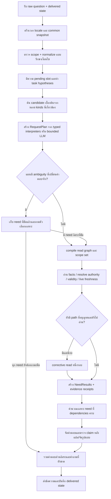

# Flow กลาง V2 — แผนงานร่วม การอ่านตาม need และคำตอบที่พิสูจน์ขอบเขตได้

เวอร์ชันเอกสาร: R97 / 19 ตุลาคม 2026 เวลาไทย

สถานะ: **พัฒนา design ต่อจาก R96 ยังไม่ใช่ runtime ที่นำไปติดตั้ง**

## 1. จุดต่างจาก R96

R96 กำหนดส่วนประกอบที่ควรมี ส่วน V2 กำหนดว่าลำดับไหนรับ input อะไร คืนผลอะไร เมื่อไรต้องถามเพิ่ม และเส้นทางใดห้ามจบคำตอบก่อนตรวจ needs ทั้งหมด

ใช้ความสามารถเดิมที่มีอยู่ เช่น source pointer validation, common snapshots, typed calculators และ deadline ร่วม แล้วเปลี่ยน interface ของแต่ละขั้นให้ต่อกันได้ ไม่ทำสำเนาระบบทุกชั้นขึ้นใหม่

## 2. Flow หลัก



ถ้า proposal ผิด schema/ID/qualifiers ให้เก็บเหตุผลและใช้ need ที่ deterministic interpretation ยืนยันได้ ไม่วนให้ LLM เดาใหม่จนยอมรับ และไม่ข้ามไป factual fallback เก่า

ถ้า ambiguous เพียงบาง need ต้องเดินส่วนอิสระที่ชัดผ่าน read/execute/verify ก่อนรวมกับคำถามเพิ่ม ไม่ให้ branch clarification จบทั้ง request ก่อนอ่านส่วนที่ตอบได้

## 3. สัญญาร่วมของแต่ละขั้น

### 3.1 RequestContext

ต้องมี request ID, raw question, normalized view, span map, requested/effective locale, เวลาอ้างอิง, common release/epoch, data profile, deadline และ model attempt ledger

- snapshot เดียวกันสำหรับ static facts ทุก need
- สถานะ live แนบ observed_at/provider/freshness แยก ไม่อ้างว่า live กับ static เป็น atomic transaction เดียว
- draft preview และ published ไม่ผสมกัน; ใช้ evaluator profile เดิมเมื่อเทียบผลเดิม
- deadline ใช้เวลาที่เหลือจริง รวม queue wait และ final rendering ไม่เริ่มนับใหม่เมื่อเรียก recursive repair

### 3.2 RequestPlan

แผนต้องมี version และรายการ needs ที่เริ่มจากคำถาม ไม่เริ่มจาก field ที่อ่านเจอ:

```json
{
  "version": "request_plan_v2_design",
  "needs": [
    {
      "id": "n1",
      "task": "price",
      "subject": {"mode": "set", "scope": "all_offered_services"},
      "slots": {"audience": {"value": "user_selected_audience", "origin": "current_user"}},
      "qualifiers": [],
      "output": "price_table",
      "hard_dependencies": [],
      "required_claims": ["rate_or_explicit_unavailable_status_per_service"],
      "source_spans": ["raw span reference"]
    }
  ],
  "unresolved": [],
  "model_generated_business_facts": false
}
```

เป็นตัวอย่าง representation สำหรับ implementation ไม่ใช่ JSON ที่ runtime ปัจจุบันรองรับ และไม่ใช่ข้อมูลราคาจริง

**กฎสำคัญ**

1. ใช้ task IDs ของ registry ปัจจุบันเมื่อความหมายเดิม เช่น `game_players`, `price`, `rental`, `competition_rules` ไม่เปลี่ยนชื่อโดยไม่มี adapter/version migration
2. need หนึ่งผูก subject กับ slots/qualifiers ของตัวเอง ห้าม flatten รวมทุก audience/duration แล้วคูณกันโดยไม่มีคำขอ
3. ระบุ origin ของ slot: current_user, delivered_state, explicit_schema_default หรือ derived_with_rule; ห้ามมี implicit model guess
4. subject ที่เป็น set ต้องมี scope expression ที่ execute ได้ ไม่ให้โมเดลกรอก record IDs บางส่วนแล้วเรียกว่าทั้งหมด
5. คำปฏิเสธ จำนวนเงิน วัน เวลา รุ่นเกม และ exceptions ที่มีผลต้องคงอยู่ ไม่ใช่แค่มี quote จาก input
6. แผนต้องตรวจได้ว่าคำถามทุกส่วนถูก map เป็น need, qualifier, discourse หรือ unresolved อย่างใดอย่างหนึ่ง โดย uncertain spans ไม่ถูกลดเป็น filler อัตโนมัติ

### 3.3 ReadPlan

แต่ละ need ถูก compile เป็น paths บน fields/relations ที่ catalog มีจริง พร้อม projection, filter, required claims และ branch alternatives

- `all_of`: ต้องได้หลักฐานครบทุก claim ที่จำเป็น
- `any_of`: เลือก branch ที่รองรับความหมายเดียวกันครบ ไม่รวม fields ทุก branch เป็น required
- `optional`: เพิ่ม context ได้ถ้ามี แต่ขาดแล้วไม่ยกเลิกคำตอบ
- `not_applicable`: ไม่บังคับข้อมูลที่ไม่เกี่ยวข้องกับคำถาม
- ขาด required fact จริงต้องได้สถานะ missing_source ไม่ใช่เปลี่ยนให้ optional เพื่อให้ผ่าน

ตัวอย่าง: `game_players` สามารถอ่านย้อนจาก game ไป game_mode ผ่าน `game_mode.game_id` โดยใช้ reverse references ขณะที่ `mode_name` เป็น context และ `studio_supported` จำเป็นเมื่อถามว่าเล่นด้วยกันที่ศูนย์ได้หรือไม่ ไม่จำเป็นทุกครั้งที่ถามจำนวนผู้เล่นในเกม

### 3.4 EvidenceReceipt

หลักฐานของ claim ต้องระบุ need ID, subject, predicate, value/units, qualifiers, applicability, source ID/locator/hash, record/revision, effective interval และ authority scope

source pointer ที่ถูกต้องยืนยันว่าค่ามาจากต้นฉบับ แต่ยังต้องตรวจว่าค่านั้นตอบ need นี้ เช่น capacity_persons ไม่ใช้แทน players_max

หากอ่าน facts ผ่านข้อความ FAQ ต้องรู้ว่า source ครอบคลุม action/actor/condition ของ need หรือไม่ ข้อมูลที่มีคำว่า “จอง” ไม่เพียงพอสำหรับทุกนโยบายเกี่ยวกับการจอง

### 3.5 NeedResult

ผลต่อ need มี status, reason code, claims, evidence receipts, unmet dependencies และสิ่งที่ต้องขอจากผู้ใช้/เจ้าของแยกกัน

| Status | หมายถึง | ผู้ใช้ควรได้รับอะไร |
|---|---|---|
| supported | มีหลักฐานพอและตรงเงื่อนไข | คำตอบตรงส่วนที่ถาม |
| partial_supported | บาง subneeds มีหลักฐาน ที่เหลือแยกสถานะชัด | คำตอบบางส่วนและส่วนที่ยังไม่ยืนยัน |
| needs_user_slot | ผู้ใช้ยังไม่ระบุตัวเลือกที่ทำให้คำตอบต่าง | คำถามเจาะจงพร้อมตัวเลือกที่มีจริง |
| ambiguous_interpretation | มีหลายเจตนาหรือ scope ที่ให้คำตอบต่าง | ถามแยกเจตนาอย่างแคบ |
| missing_source | facts ที่จำเป็นไม่มีหลักฐาน | บอกข้อมูลใดที่ยังไม่ยืนยัน |
| broken_relation | ข้อมูลอ้างอิงไม่ครบ/ผิดชนิด | แจ้งช่องว่างข้อมูล; ส่ง issue ให้ owner workflow |
| not_current | ข้อมูลใช้ไม่ได้กับวันที่ถาม | ไม่ยืนยันค่าปัจจุบัน; historical answer ได้เฉพาะคำถามที่ตรง |
| conflict | หลักฐานที่เกี่ยวข้องขัดกันและยังเลือก authority ไม่ได้ | ระบุข้อขัดแย้งอย่างจำเพาะ |
| live_unavailable | ไม่ผ่าน provider/freshness | บอกตรวจสดไม่ได้และช่องทางที่มีจริง |
| temporary_failure | model/body/processing/deadline ล้ม | แจ้งปัญหาชั่วคราว ไม่บอกว่าไม่มีข้อมูล |
| unsupported | ไม่มี capability หรืออยู่นอก studio scope | ขอบเขตที่ช่วยได้ |

status เหล่านี้เป็นสัญญาใหม่ที่ต้อง map กับ response_type เดิมผ่าน adapter ไม่เปลี่ยน protocol เก่าทั้งระบบเงียบ ๆ

## 4. Candidate discovery และ semantic planning

### 4.1 Discovery รอบแรก

ใช้ชื่อ/alias, task cues และข้อมูล schema เพื่อหาหลาย kinds ที่น่าจะเกี่ยวข้อง โดยยังไม่ยืนยันคำตอบ:

- game + ผู้เล่น → game/game_mode
- game + แข่ง/เกมหลุด/First Blood → game/competition/competition_rule และ context ทั่วไปที่จำเป็น
- โซน/เครื่อง + ราคา → service/resource/zone/audience/rate/rental_package
- เปิดวันนี้ → schedule/closure/center ตาม predicate ที่ถาม
- ชื่อสั้นหลังถูกถามเพิ่ม → candidate set ของ pending slot ที่ผู้ใช้เห็น

ชุดส่ง LLM ต้องมีชื่อ ความหมาย kind และ field/relations ที่เกี่ยวข้อง ไม่มี fact store เก่า ไม่ยัด full database

### 4.2 ผู้เสนอแผนสามแบบ

1. typed grammar ที่มี binding ชัด
2. pure Legacy interpreters ที่เปลี่ยน registry/ชื่อเป็น snapshot กลางแล้ว
3. bounded LLM สำหรับ paraphrase/หลาย needs ที่สองแบบแรกยังไม่ครอบคลุม

ทั้งหมดคืนแผนชนิดเดียวกัน ผ่าน validator เดียวกัน ไม่ให้ branch หนึ่ง bypass qualifiers หรือ authority

ไม่ใช้ whole-sentence fullmatch เป็นเงื่อนไขสุดท้ายเพียงข้อเดียวว่าคำถามมีความหมายถูกต้อง ส่วนที่ยังไม่รู้ความหมายต้องตรวจแยกจากคำประกอบการพูด หากยังมี meaningful ambiguity ให้ถามเพิ่ม

### 4.3 เลือกแผนอย่างไร

Hard constraints: explicit subject/edition/platform, actor, amounts/units, date/time, negation, exceptions และ source scope ห้ามขัดกัน

เปรียบเทียบแผนตามจำนวน needs ที่รองรับและความครบ qualifiers โดยเก็บเหตุผล ไม่ตีความ retrieval score หรือ model confidence เป็น calibrated probability

ถ้าหลายแผนให้ข้อสรุปสาระเดียวกันและ scope รองรับเดียวกัน เลือกเส้นทางอ่านที่มีหลักฐานตรงและสั้นกว่า ถ้าข้อสรุปต่างกันและยังมีผลต่อคำตอบ ให้ถาม slot ที่แยกความต่างได้

## 5. ความครบของคำว่า “ทั้งหมด”

1. ระบุ universe ตามคำถาม เช่น services ที่ศูนย์เสนอใน release นี้ ไม่ใช่ทุกเกมหรือทุก record
2. execute set query จาก inventory/relations โดยตรง ไม่ใช้ top-K semantic results เป็นรายชื่อครบ
3. แยก duplicate entity ออกจากหลาย offering เช่น เกมเดียวมีหลายโซน; เลือกแสดงตามสิ่งที่ผู้ใช้ถาม
4. scope receipt ต้องมี snapshot ID, predicate/filter, total members, returned members, members with unknown facts และเหตุผลที่กรองออก
5. หากแบ่งหน้า ให้แสดง “ส่วนที่ 1” และ continuation scope เดิม ไม่อ้างว่าหน้าแรกครบ
6. `known empty` ตอบไม่มีได้เฉพาะเมื่อ source ระบุว่า list นี้สมบูรณ์/ว่างจริง; unknown ไม่ใช่ไม่มี
7. “ทั้งหมด” ใน follow-up เติม scope ของ pending task ไม่เปลี่ยน audience/duration ที่ผู้ใช้เลือกไว้

## 6. การตอบเมื่อข้อมูลขาดหรือซ้ำกัน

### 6.1 Facts ซ้ำใน common

ใช้ claim ownership ที่ประกาศและมี source รองรับ แยก identity/record ownership ออกจากความเป็นเจ้าของค่าทุก field

- ไม่ใช้ “owner เคยยืนยันบาง field ใน record นี้” เพื่อยกระดับทุก claim ของ record
- newer observation ไม่เท่ากับมีผลแทนกฎเก่าทุกขอบเขต; ตรวจ supersession/applicability ที่มีจริง
- FAQ ที่อธิบายราคาไม่ควรแอบ override structured current rate ถ้า FAQ ไม่มี authority สำหรับ claim นั้น
- ถ้า metadata ปัจจุบันยังพิสูจน์ลำดับอำนาจไม่ได้ ให้จัด conflict และเสนอข้อมูลที่ต้องเพิ่มใน owner workflow แยก ไม่เดาลำดับเอง
- ข้อเสนอ metadata ใหม่ต้องอยู่ใน schema migration ที่ตรวจทาน ไม่ให้ runtime สร้าง trust/approval ให้ source

### 6.2 คำตอบบางส่วน

ตอบ need ได้เมื่อหลักฐานของ need นั้นครบและทุก hard dependency ที่ใช้ derive ข้อสรุป supported เท่านั้น

ตัวอย่าง: ไม่ทราบ current price → บอกจำนวนชั่วโมงที่งบหนึ่งเล่นได้ไม่ได้ แต่ยังตอบวิธีจองจาก source ที่ถูกต้องได้

ไม่ให้ข้อความเตือนท้ายคำตอบทำให้ unsupported assertion ข้างหน้ากลายเป็นถูก และไม่ทิ้ง independent supported needs เพียงเพราะอีก need ขาด

### 6.3 อะไรควรถามผู้ใช้

ถามเมื่อคำตอบของผู้ใช้เติมตัวแปรที่เปลี่ยนคำตอบได้ เช่น game mode, audience หรือ event ที่มีหลายรายการจริง

ไม่ถามผู้ใช้ซ้ำว่าราคาปัจจุบันเท่าไรเพื่อแก้ source ที่เจ้าของยังไม่อัปเดต และไม่ถามกว้างว่าอยากรู้เกม ปุ่ม ราคา หรือจอง เมื่อ pending task รู้แล้วว่าเป็นราคา

หาก user ขอ overview/table ของทุกกลุ่มหรือทุกบริการ การไม่เลือก service เดียวอาจเป็นความตั้งใจ ไม่ถือเป็น missing slot อัตโนมัติ

## 7. เวลา ตาราง และการจองสด

- แยก predicates: opening, access_permission, bookable_period, maintenance, free_resource และ service_occupancy
- “วันนี้” ผูกกับ request time ใน Asia/Bangkok; คำตอบสั้นตามวันที่และ predicate ที่ source ยืนยันได้
- schedule ที่ไม่มีข้อมูลเสาร์/อาทิตย์ ไม่พิสูจน์ว่า physical center ปิด ถ้า source ไม่ประกาศ completeness
- empty bookable periods ไม่พิสูจน์ว่าไม่มีคนเข้าศูนย์ได้; maintenance ของเครื่องไม่เท่ากับปิดศูนย์ทั้งหมด
- closure ที่ใช้กับเฉพาะโซนต้องไม่ override โซนอื่น
- live call ทำครั้งเดียวต่อ provider scope แล้วกระจายผลให้ needs ที่เกี่ยวข้องใน request; ไม่ยิงซ้ำทุก subquestion
- ใช้ provider status mapping และ freshness ที่อนุมัติ; HTTP success กับ snapshot ล่าสุดเพียงอย่างเดียวไม่พิสูจน์ความว่าง
- static facts กับ live observations มี provenance แยก; คำตอบรวมต้องไม่ทำให้ผู้ใช้คิดว่าทุกส่วนเป็นข้อมูลสด
- ก่อนส่ง ใช้ still_current/revision check ที่มีอยู่ต่อ หากมีการเปลี่ยนที่กระทบ claims หรือถอน record ระหว่างอ่าน ให้ coherent re-read ทั้ง read graph ที่เกี่ยวข้องภายในงบ หรือคืน temporary failure อย่างจำเพาะ ห้ามผสมค่าจากหลาย release แล้วอ้างเป็น snapshot เดียว

## 8. Follow-up และ revision

เก็บ intent/slots/scope/options ที่ส่งจริงและ routing signature; เก็บ facts เป็น references เท่านั้น ต้องอ่านค่าใหม่ทุก request

1. “PC” เติม service ให้ task เดิมเมื่อชนิดตรง pending slot
2. “ทั้งหมด” เปลี่ยน selection เป็น set ภายใน scope เดิม
3. “ไม่ใช่ ขอวิธีจอง” ยกเลิก pending price intent แล้วสร้าง procedure need
4. record เปลี่ยนราคาแต่ ID/task/scope เดิม → อ่านราคา revision ใหม่ ไม่ต้องถาม service ซ้ำ
5. เปลี่ยน alias/สมาชิก candidate scope/ถอน record → ตรวจผลกระทบและอธิบายตัวเลือกปัจจุบัน
6. เปลี่ยน epoch เพราะข้อมูลอื่นไม่เกี่ยวข้อง → ไม่ล้างทุก slot เพียงเพราะ epoch ต่าง; ใช้ snapshot ปัจจุบัน revalidate dependencies
7. สลับ game/mode/platform ต้อง invalidate เฉพาะ slots ที่ขึ้นต่อกัน ไม่สืบทอดราคา/controls ของ subject เก่า
8. commit state หลังส่งสำเร็จตาม delivery contract ที่ระบบรองรับ หากยืนยัน delivery ไม่ได้ต้องไม่เรียก sent/visible โดยไม่มีหลักฐาน

## 9. Publish และ data-only updates

1. owner กรอก/แก้ข้อมูลใน form kind ที่รองรับ
2. registry ตรวจ schema/pointers/references/validity/localization โดยใช้ของเดิมที่ทำได้อยู่แล้ว
3. task readiness compiler ตรวจว่ารายการนี้ตอบงานไหนได้และขาด field/relation/authority ตรงไหน
4. preview ใช้ dispatcher และ contract registry เดียวกับ public แต่ source profile แยก
5. owner ที่มีสิทธิ์เผยแพร่ revision; publication รวม release/index version ที่เข้าคู่กัน
6. runtime pin snapshot + index ที่ตรวจ version ตรง; ถ้าไม่ตรงให้ใช้ coherent read path หรือ temporary failure ตามที่ implementation รองรับ
7. invalidate fact cache ตาม affected dependencies; list membership changes ต้อง invalidate set cache
8. new record ใน kind เดิมใช้ task cards เดิม; new business operation/formula ต้องมี capability implementation ก่อน

เจ้าของไม่ต้องเขียน regex หรือ examples ต่อเกมใหม่ทุกเกม ตัวอย่างระดับ task และ source-backed preview เป็นหน้าที่ระบบช่วยจัดให้ แต่ไม่สร้างข้อเท็จจริงที่ขาดหรือเผยแพร่แทนเจ้าของ

## 10. ภาษาและรูปแบบคำตอบ

สร้าง typed claim packet หนึ่งชุดก่อน localized rendering; แปล prose โดยรักษาตัวเลข หน่วย เวลา decision และ exceptions

- ใช้สถานะ reviewed/agent_translated ตาม policy ปัจจุบันของข้อมูล ไม่เพิ่มการอนุมัติใหม่หรือถอดสถานะแจ้งเครื่องแปลเอง
- การแก้ source ต้องทำให้ translation signature ถูกตรวจใหม่ตาม registry ที่มีอยู่
- proper nouns รักษารูปที่ source อนุญาต ไม่แปลชื่อบุคลากร/เกมโดยเดา
- ถ้าขอคำตอบสั้น ให้คงสาระจำเป็น เช่น วันที่+เปิด/ปิด หรือราคา+หน่วย+เงื่อนไขหลัก ไม่ตัด exception ที่เปลี่ยนสิทธิ์
- citations แนบกับ claim ที่รองรับ ไม่ใช้ citation เดียวครอบคำตอบหลายเรื่องที่ source ไม่ได้กล่าว

## 11. งบการทำงาน

ใช้ request_deadline และ model admission ที่มีอยู่เป็นแหล่งจริง ร่างนี้เสนอ semantic plan ไม่เกินหนึ่ง model attempt ต่อ request เพื่อทดลองก่อน หากจะเพิ่ม verifier call ต้องกำหนดงบและทดสอบแยก

- discovery/read/calculation ที่ทำได้ด้วยข้อมูลมีโครงสร้างไม่ต้องกิน model slot
- corrective pass เพิ่มได้หนึ่งรอบภายใน remaining budget ไม่อนุญาตให้กลับไป model planning อีกครั้งโดยปริยาย
- claim validation, render และ delivery ต้องมี reserve; รอ model จนหมด deadline แล้วตอบกลับไม่ได้ถือเป็น failure
- queue wait/body/schema/semantic acceptance มีสถานะแยก timeout ไม่ใช่ missing_source
- ใช้ input context ที่เกี่ยวกับ needs พร้อมเงื่อนไขครบ ไม่ตัด exception เพื่อให้ prompt สั้นลง

ค่าดังกล่าวเป็น proposal สำหรับ candidate ถัดไป ยังไม่ใช่ SLA หรือผลการทดลอง concurrency ใหม่

## 12. Invariants ที่ต้องตรวจทุกเส้นทาง

1. ทุก user need มี ID และ terminal result หรือ explicit unresolved status
2. ไม่มี supported claim ที่ hard dependency ไม่ supported
3. ไม่มี claim ที่อ้าง facts เก่า/ถอนแล้ว/ผิด data profile
4. ทุก explicit qualifier ที่เปลี่ยนคำตอบถูกผูกกับ need หรือถูกถามเพิ่ม
5. unknown ไม่ถูกแปลงเป็น false/closed/zero/free/allowed โดยไม่มี source
6. list ที่อ้างครบมี exhaustive scope receipt
7. task/record confidence ไม่ข้าม source validity/authority
8. raw/protected spans คงความหมายผ่าน normalization และ localization
9. state ไม่มี business values ที่ถูกนำมาใช้แทนการอ่าน facts ใหม่
10. live observations มี mapping/freshness/observed_at และไม่ถูก static fallback แทน
11. model calls และ corrective reads ใช้ budget เดียวกันทุก branch
12. task registry readiness ไม่ถูกอ้างเป็น semantic correctness หรือ coverage ทุกคำถาม

## 13. ความเกี่ยวข้องกับงานวิจัย

ใช้แนวคิดจาก D3ST/Show, Don’t Tell สำหรับ task semantics, RAT-SQL สำหรับ relation linking, Sufficient Context สำหรับ per-need evidence และ CheckList/RAGChecker สำหรับการพิสูจน์ผล ตาม [รายงาน R96](../r96_paper_informed_flow_20261019/01_RESEARCH_AND_DIAGNOSIS_TH.md)

R97 เป็นการปรับ design ของโครงการจากงานเดิม ไม่มีการค้นวรรณกรรมใหม่หรืออ้างผลทดลองของ paper เป็นคะแนนระบบนี้

## 14. ผลตรวจทานตัว Flow V2 อีกรอบ

| ตรวจ | จุดที่พบระหว่าง review | ปรับแล้ว |
|---|---|---|
| ลำดับข้อมูล | planner ต้องมี candidates ก่อนเลือก IDs | แยก discovery กับ grounded planning ชัด |
| ทางเดินบางส่วน | clarification branch อาจข้าม independent supported needs | ให้เดิน read/execute ส่วนที่ชัดก่อน aggregate |
| การเปลี่ยนข้อมูลระหว่าง request | pin ครั้งเดียวไม่พอรับรองว่าไม่มี withdrawal ก่อนส่ง | รักษา still_current check และ coherent reread/temporary-failure path |
| ความหมายของ QA | graph/case registry ผ่านอาจถูกเรียกว่าคำตอบผ่าน | แยก DOCUMENT_QA กับ chatbot behavioral tests ที่ยังไม่ได้รัน |
| โค้ดเดิมที่มีอยู่ | source/schema guards และ deadline มีอยู่แล้ว | นำมาใช้ต่อ ไม่ตั้ง requirement ว่าต้องสร้างทุกอย่างใหม่ |

สิ่งที่ยังพิสูจน์ไม่ได้จากเอกสาร: NLU ของ 4B บน paraphrases จริง, ความถูกต้องของ semantic verification ไทย, latency เมื่อใช้พร้อมกัน และข้อมูลที่เจ้าของยังไม่ให้ ต้องประเมินระหว่าง implementation ตามเกณฑ์ตรวจรับ
