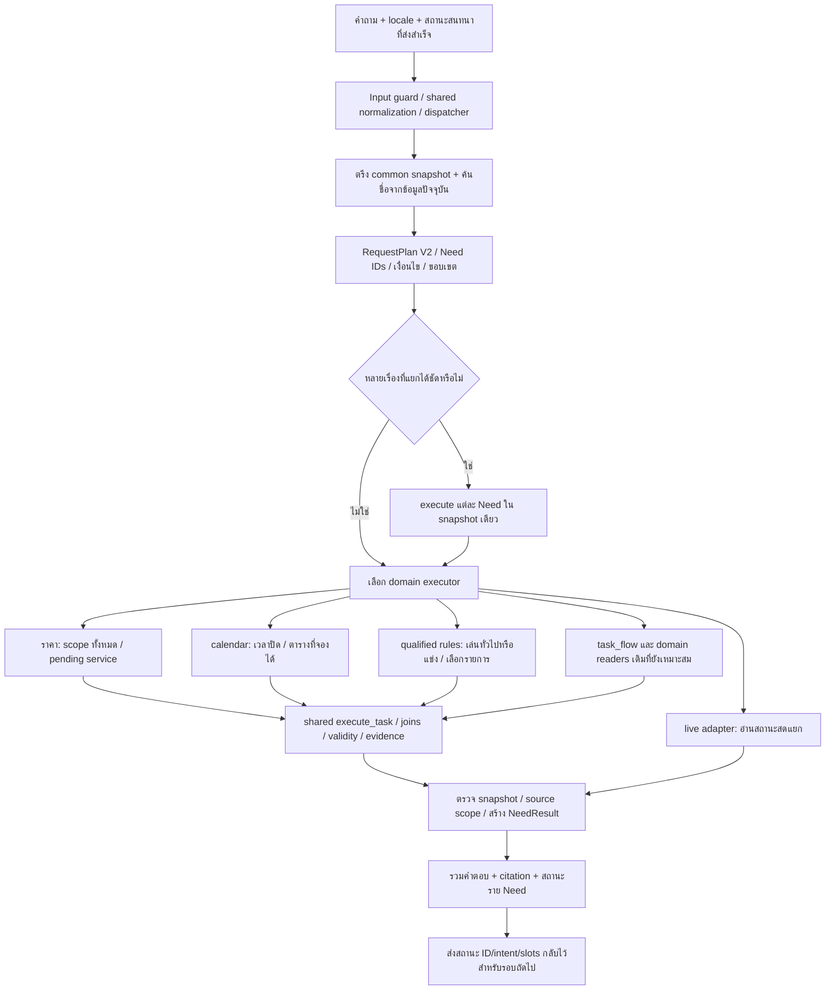

# R98 — Flow V2 ที่ลงมือทำและขอบเขตจริง

วันที่ 19 ตุลาคม 2026 · candidate ทดลองแยก · ยังไม่ได้ติดตั้งทับ R78

อ้างอิงแผน [R97 Flow V2](../r97_flow_reassessment_20261019/02_FLOW_V2_TH.md) และงานวิจัยใน [R96](../r96_paper_informed_flow_20261019/01_RESEARCH_AND_DIAGNOSIS_TH.md) รอบนี้ใช้ข้อค้นพบที่ตรวจแล้ว ไม่ได้ทำ literature search เพิ่มหรืออ้างประสิทธิภาพจาก paper ว่าเป็นคะแนนของระบบนี้

## 1. สิ่งที่เปลี่ยนในโครงสร้าง

**ข้อจำกัดของภาพ:** เป็นทางเดินของ common candidate ชั้นใหม่ ยังมี compatibility parsers และบางทางกลับออกจาก dispatcher ก่อนถึง CommonAnswerer จึงไม่ได้หมายความว่าทุกคำถามทั้งระบบถูกแปลงเป็นแผน semantic แบบใหม่ทั้งหมดแล้ว

## 2. ลำดับการทำงานจริง

### 2.1 Candidate และ source authority

1. ตรวจ hash ของ source R95 จำนวน 1,075 ไฟล์ก่อนคัดลอก
2. คัดลอก runtime เข้าโฟลเดอร์ `system` ของ R98
3. แก้เฉพาะ candidate; ใช้ฐานข้อมูล common ที่คัดลอกมา
4. New/edit/withdraw tests ใช้ SQLite แยก พร้อมชื่อ SYNTHETIC ชัดเจนและ approvals จำลอง
5. ไม่แก้วันมีผล ราคา หรือสิทธิ์ที่ไม่มีข้อมูลเพื่อให้ตอบหรือทำคะแนนผ่าน

### 2.2 แผนร่วมและหลายความต้องการ

ไฟล์หลัก: `request_plan.py`, `answer.py`, `migrated_chat.py`

- Need เก็บ task, source span, record IDs, qualifiers และที่มาของบริบท
- แยกคำถามเชื่อมที่เห็นชัดเป็น 2–4 ส่วน โดยป้องกันการตัดชื่อรายการที่มีคำว่า and/และ อยู่ในชื่อ
- สองคำถามที่เป็นงานชนิดเดียวกันแต่ถามคนละเกมทำงานได้
- ไม่ตัดเงื่อนไข if/unless/except เป็นอีกคำถามโดยอัตโนมัติ
- คำตอบหนึ่ง Need ที่ยังไม่พร้อม ไม่ทำให้ส่วนที่มีแหล่งข้อมูลหายไป
- ผลราย Need แยก supported / partial / ต้องเลือกเพิ่ม / ไม่มี source / ไม่อยู่ในช่วงมีผล / live unavailable / temporary failure
- NeedResult receipts ผูก field กับ evidence และ release แต่ตั้ง `claim_entailment_verified=false` เพราะไม่ได้พิสูจน์ความหมายทุกประโยคด้วยตัวตรวจอิสระ
- ถ้ามี pending selection ที่ยังไม่จบเพียงหนึ่งรายการ จะส่งขึ้นสู่ state ของคำตอบรวมเพื่อรับคำตอบสั้นในรอบต่อไป

### 2.3 ราคา “ทั้งหมด” และ “PC” หลังจากระบบถามกลับ

ไฟล์หลัก: `scope_requests.py`, `dialogue.py`

1. แยก hourly/session price จาก rental ด้วย contract ของ rental เดิมก่อน
2. ถ้าระบุทั้งหมด สแกน service records ใน snapshot โดยครบทุกสมาชิก ไม่ใช้ retrieval top-K เป็นข้อสรุปว่าครบ
3. ถ้ายังขาด service จริง เก็บ audience query, audience IDs, ระยะเวลา และ candidate IDs
4. ผู้ใช้เลือกชื่อ service, PC หรือ all → เลือกใหม่จากข้อมูลปัจจุบัน พร้อมคง intent/audience/duration เดิม
5. อ่าน service → rate → audience โดยรักษาขอบเขตเดิม
6. ให้สูตร billing เดิมคำนวณเมื่อ source ยืนยันฐานคิดราคา
7. แสดง service ที่ยังไม่มี rate ด้วย ไม่ทำให้หายจากคำตอบทั้งหมด
8. ราคาไม่ทราบช่วงมีผลหรือหมดอายุไม่ถูกแสดงเป็นราคาปัจจุบันที่ยืนยันแล้ว
9. คำว่า external visitors ไม่ถูกเหมารวมเป็น General Adult หาก owner ยังไม่ได้กำหนดสิทธิ์
10. คำถามยกเว้น/ไม่เอาบางรายการยังส่งไป reader ที่รองรับเงื่อนไขนั้น ไม่ใช้ all ธรรมดาทับข้อยกเว้น

`set_receipt` บอกสมาชิกที่สแกน จำนวนสมาชิก รายการที่คืน และสมาชิกที่ยังไม่ยืนยันราคา ขอบเขตความครบคือ release นี้ ไม่ใช่รายการที่ร้านมีจริงทั้งหมดนอกข้อมูล

### 2.4 เกมและ relations

ไฟล์หลัก: `task_flow.py`, shared `execute_task`

- จำนวนผู้เล่นอ่าน reverse relation `game_mode.game_id` โดยไม่บังคับว่าต้องทราบ `studio_supported` เสมอไป
- คำถามว่าเกมเล่นได้กี่คนไม่เท่ากับคำถามว่าที่ศูนย์มีอุปกรณ์ให้เล่นพร้อมกันกี่คน
- ถ้าเกมไม่มี mode/count ในข้อมูล จะระบุว่าข้อมูลส่วนนี้ยังไม่ยืนยัน ไม่สร้างตัวเลขขึ้นมา
- การถามสองเกมภาษาอังกฤษได้ผลรายเกมพร้อม source ของแต่ละเกม
- เพิ่มชื่อเกมและ mode ใหม่ใน owner form แล้วอ่านได้โดยไม่เพิ่ม alias เกมในโค้ด

### 2.5 เวลาเปิดปิดและตารางที่จองได้

ไฟล์หลัก: `calendar_queries.py`

- แยก “ขั้นตอนจอง” ออกจาก “วันและช่วงเวลาที่จองได้” ก่อน legacy booking FAQ reader
- อ่าน schedule ที่ระบุ scope ชัดก่อน; กรณี migration ยังมีตารางครบใน FAQ ให้ใช้ FAQ source ที่ตรง task
- ตารางประจำสัปดาห์ไม่ถูกนำไปอ้างว่าเป็น slot ว่างสด
- วัน today/tomorrow และวันที่เฉพาะไม่ถูก override ด้วย FAQ ตารางประจำโดยเส้นทาง weekly ใหม่
- ถ้ามีเพียง bookable period จะไม่เรียกว่าเป็นเวลาปิดทางกายภาพใน renderer ที่เพิ่มใหม่
- คำถามวันนี้เปิดไหมยังใช้ compact day adapter เดิม และอิง Asia/Bangkok

**ยังเหลือ:** day adapter เดิมมี fallback จาก bookable period ไป service-open ในบางกรณี ยังไม่ได้ย้าย opening/bookability predicate ทั้งระบบให้ครบตาม R97

### 2.6 กติกาและบริบท

ไฟล์หลัก: `qualified_tasks.py`

สำหรับ disconnection ที่ยังไม่รู้ว่าเล่นทั่วไปหรือแข่งขัน:

1. เก็บเกมและหัวข้อจากคำถาม
2. ถามเฉพาะบริบทที่มีผลต่อคำตอบ
3. คำตอบสั้นว่า แข่ง/competition → อ่าน competition ที่อ้างเกมนั้น
4. หากมีหลายรายการ ให้ถามรายการต่อโดยไม่ข้ามไปเกมอื่น
5. เลือก clauses ในรายการนั้นที่มีข้อความเรื่อง disconnect/reconnect
6. ใช้ full text และ dependency reader เดิม ไม่ตัดข้อห้าม/ข้อยกเว้นท้ายข้อ
7. คำตอบทั่วไปที่ไม่มี procedure ยืนยันต้องระบุว่าขาด source ไม่เอากฎแข่งขันมาใช้แทน

นี่เป็น slice บริบท disconnection ไม่ใช่ generic clarification engine ที่ครอบคลุมทุกเงื่อนไขกติกาแล้ว

### 2.7 Source scope

ไฟล์หลัก: `source_scope.py`

“รับประทานเฉพาะพื้นที่” ไม่ได้พิสูจน์ว่า “นำอาหารของตัวเองมาได้” จึงส่งคำตอบบางส่วนพร้อมข้อจำกัดเรื่อง permission ที่ยังไม่ยืนยัน ข้อเท็จจริงเรื่องพื้นที่ยังคงมี citation

**ยังเหลือ:** action-scope entailment แบบทั่วไป เช่น bring / consume / store ยังไม่ได้ทำเป็น validator ที่ใช้ได้ทุก policy

## 3. สถานะ Work Packages เทียบ R97

| WP | สถานะจริงใน R98 |
|---|---|
| W0 freeze | ทำแล้ว; มี baseline/final manifests และ integrity audit |
| W1 shared plan | ใช้ที่ common boundary และ compound ใหม่แล้ว; dispatcher/compatibility ทุกทางยังไม่แปลงครบ |
| W2 discovery + interpretation | ใช้ common dynamic names + แก้ precedence center/FAQ; generic semantic discovery ยังไม่ครบ |
| W3 all/pending | ราคา all/service selector/audience/duration/revision re-read ทำแล้ว; ordinal selection และ reset ทุกแบบยังไม่ครบ |
| W4 relation graph | ตรวจ game-mode count และ existing relation readers; generic required/optional/any-of graph ทุก task ยังไม่ครบ |
| W5 fees/calendar/policy | แก้ price scope, validity guard, booking timetable และ food scope; budget/calendar predicate ทุกแบบยังไม่ครบ |
| W6 rules/controls/live | same-task compound, mixed live+booking, disconnect clarification ทำแล้ว;ทุก facet/edition/controls combination ยังไม่ครบ |
| W7 bounded semantic planner | คง planner เดิมและเปิด LLM ได้; ยังไม่ทำงบ semantic attempt เดียวร่วมทุก Need ตามแผนใหม่ครบ |
| W8 lifecycle | tests เพิ่ม/แก้/ถอนผ่านสำหรับ fixture slices; ยังไม่เท่ากับ production rollout/index migration ทุก family |
| W9 focused verification | ทำทั้ง source contracts, customer probes, 91 saved-corpus requests;ยังไม่มี full test ของ R98 |

## 4. สิ่งที่ต้องทำต่อก่อนเรียกว่า production-ready

1. ขยาย semantic interpretation ที่ใช้ schema/task descriptions โดยไม่เพิ่ม canned customer question ทีละประโยค
2. ย้าย legacy compatibility paths ให้ใช้ NeedResult/slot origin เดียวกันครบ รวม rejection และ fallback
3. ทำ global per-request model budget และ deadline allocation ระหว่าง Needs
4. แยก opening/bookability/maintenance/live occupancy ทุก predicate พร้อม closure/zone precedence tests
5. แก้ ambiguity ของชื่อหลาย edition เช่น Call of Duty ให้มี targeted choices
6. ขยาย policy entailment ให้แยก action กับเงื่อนไขและอ่าน supporting clauses ที่จำเป็นครบ
7. ตรวจราคา validity และ audience eligibility จาก owner; ห้ามอนุมานวันที่หรือสิทธิ์แทน
8. ทำ holdout ที่ยังไม่ใช้พัฒนาและ full test เมื่อผ่านเกณฑ์ focused ที่ตกลงกันแล้ว

ผลคะแนนและความล้มเหลวจริงดู `RESULTS_TH.md` ไม่ใช้ design completeness หรือ readiness ของ 24 kinds เป็นคะแนนความถูกต้องในการตอบ
