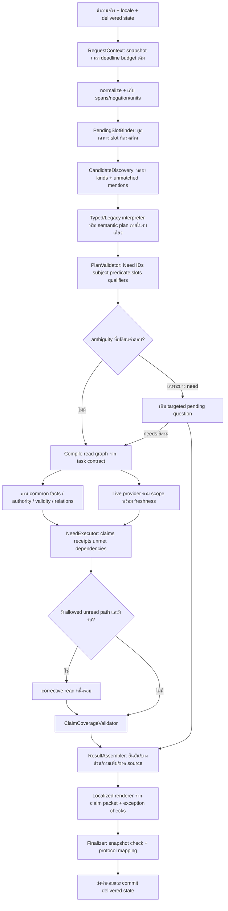

# ข้อเสนอปรับ Flow — ใช้ R97 เป็นโครง และใช้หลักฐาน R98 ปิดช่องว่าง

วันที่ 19 ตุลาคม 2026 · งานรอบนี้เป็น review/design เท่านั้น

## 0. เอกสารที่นำมา review และที่มาของข้อสรุป

ผู้ใช้ยืนยันแล้วว่า Flow ที่ Astra สร้างหมายถึง [R97 Flow V2 ในแชทนี้](../r97_flow_reassessment_20261019/02_FLOW_V2_TH.md) จึงใช้ R97 เป็นฐานอ้างอิงของข้อเสนอทั้ง 14 จุด การระบุผู้สร้างอ้างอิงคำยืนยันของผู้ใช้ ส่วนข้อวิเคราะห์อ้างอิงตัวเอกสาร โค้ด และผล R98 ที่เก็บไว้

หลักฐานที่ใช้:

1. [R97 design](../r97_flow_reassessment_20261019/02_FLOW_V2_TH.md) และ [implementation/acceptance plan](../r97_flow_reassessment_20261019/03_IMPLEMENTATION_AND_ACCEPTANCE_TH.md)
2. [R98 implementation status](../r98_flow_v2_implementation_20261019/IMPLEMENTED_FLOW_TH.md)
3. [R98 results](../r98_flow_v2_implementation_20261019/RESULTS_TH.md)
4. [91 same-key comparison](../r98_flow_v2_implementation_20261019/subset02/COMPARISON.json) และ [remaining content cases](../r98_flow_v2_implementation_20261019/subset02/CONTENT_REVIEW.json)
5. โค้ด R98: `request_plan.py`, `answer.py`, `task_flow.py`, `planner.py`, `source_scope.py`, `need_ledger.py`, `migrated_chat.py`, `request_deadline.py` และ `llm_health.py`

**ไม่รันทดสอบ chatbot ใหม่ ไม่เปลี่ยน runtime/ข้อมูล/approvals และไม่สร้างคะแนนใหม่ใน review นี้** ตัวเลขทุกตัวเป็นผลที่เก็บไว้จาก R98

## 1. คำแนะนำหลัก

ควรเก็บโครง R97 ต่อ แล้วทำให้ contract ที่ R97 ระบุมีผลจริงทุก branch ก่อนเพิ่มกลไกหรือ prompt ใหม่หลายชั้น

R97 วางหลักสำคัญไว้แล้ว ได้แก่ needs ก่อน fields, candidate discovery ก่อน grounded planning, หลักฐานตรง predicate, partial answers, pending state ที่อ่าน facts ใหม่ และขอบเขตรายการทั้งหมด ปัญหาสำคัญจาก R98 คือหลายจุดยังเป็น wrapper รอบ readers เดิม จึงยังไม่ได้บังคับหลักเหล่านี้ครบ

คุณภาพของข้อเสนอต้องตัดสินจาก contract และผลที่ตรวจได้ ไม่อนุมานว่าดีกว่าเพียงเพราะชื่อโมเดลผู้เขียน

## 2. ส่วนที่ควรเก็บจาก R97

| ส่วน | เหตุผลที่ควรเก็บ | หลักฐาน/ข้อจำกัด |
|---|---|---|
| Common data เป็น fact authority | เพิ่ม/แก้ข้อมูลแล้วใช้ที่เดียว ลดโอกาส FAQ/ราคาเก่าทับข้อมูลใหม่ | R98 lifecycle fixtures แสดงการอ่าน revision ใหม่และถอนข้อมูลได้ใน slices ที่ทดสอบ |
| Need IDs เริ่มจากคำถาม | ป้องกันอ่าน fields ครบแต่ตอบไม่ครบสิ่งที่ถาม | R98 mixed live+booking และ location+price แสดงประโยชน์ของการตอบแยกส่วน |
| Candidate discovery ก่อน planner | โมเดลเลือกจาก IDs ที่มีจริง และอธิบายหลาย edition ได้ | ยังต้องทำ candidate ambiguity ให้ครบ; Call of Duty ใน saved cases ยัง fallback กว้าง |
| all_of / any_of / optional | จำนวนผู้เล่นไม่ควรล้มเพราะ field studio support ที่ผู้ใช้ไม่ได้ถาม | R98 synthetic game-mode join ผ่านโดยไม่ต้องมี studio_supported |
| Exhaustive set receipt | คำว่า “ทั้งหมด” ต้องมีขอบเขตและจำนวนที่ตรวจได้ | R98 price scope ทำได้ใน slice นี้;ไม่ใช่ proof ของทุก list task |
| Partial answer ของงานอิสระ | live ล่มไม่ควรทำให้วิธีจองหาย | R98 focused case มี live_unavailable และ supported แยกกัน |
| Intent/slots ใน state; facts อ่านใหม่ | ราคาแก้แล้วไม่ตอบค่าจาก history | R98 source fixtures ผ่านใน task ที่ทดสอบ |
| Deadline/source/approval guards เดิม | มี infrastructure ใช้ได้อยู่แล้ว | ไม่ควรสร้าง counter หรือ publication path อีกชุด |

## 3. จุดที่ควรปรับให้ชัดขึ้น 14 ข้อ

ชนิดหลักฐาน: CODE = อ่านพบใน implementation, LOG = เห็นคำตอบในผลเก็บไว้, DESIGN = ข้อกำหนดที่ควรเติม, RISK = ความเสี่ยงที่ยังไม่ได้พิสูจน์ด้วย runtime test รอบนี้

### P01 — ให้ทุก ingress เข้าสู่ผลลัพธ์ราย Need เดียวกัน

**หลักฐาน:** CODE; `migrated_chat.py` มี greeting, follow-up repair, validation rejection และ fallback ที่คืนผลเอง ส่วน `CommonAnswerer.answer` เป็นแผนร่วมเฉพาะทางที่เข้าไปถึง

**ความเสี่ยง:** ผลบางทางไม่มี RequestPlan/NeedResult ที่ตรวจได้ และ rejection อาจทำให้ข้อมูลที่ตีความได้หายจาก final artifact

**ปรับ Flow:** กำหนดจุดจบเพียง `finalize_request(RequestResult)` ทาง interface/greeting ยังคงตอบเร็วได้ แต่คืน interface result ที่มีชนิดชัด ไม่ทำเป็น source-backed business answer

**เกณฑ์ตรวจรับ:** ทุก business request มี initial need ledger และ terminal status ครบ; transport/schema failure ยังคงเก็บ need ID และสาเหตุเดิม โดยไม่ยก candidate ที่ validation ล้มให้เป็นคำตอบยืนยัน

### P02 — Canonical task IDs และ contract registry ต้องมี adapter ที่ประกาศชัด

**หลักฐาน:** CODE; `request_plan.task_of` ใช้ generic labels เช่น `players`, `location`, `booking` ขณะที่ task executor ใช้ IDs เช่น `game_players`, `center_location` และ task-specific contracts

**ปรับ Flow:** ใช้ canonical task IDs เป็นภาษาเดียวระหว่าง planner, compiler, executor และ readiness; generic task family ใช้เป็น discovery hint เท่านั้น ถ้าจำเป็นต้องเก็บชื่อเดิม ให้มี versioned mapping พร้อมตรวจ unknown task ID

**เกณฑ์ตรวจรับ:** ไม่มี branch ที่คืน task ID ซึ่ง compiler หา contract ไม่ได้แล้วแอบเปลี่ยน task; readiness ของ 24 record kinds ต้องไม่สับสนกับจำนวน task capabilities

### P03 — ให้ planner คืน intent/subject/predicate/slots ไม่เริ่มด้วย fields

**หลักฐาน:** CODE/LOG; R98 `planner.py` ยังรับ selected record ที่เลือกแล้วและเสนอ `requested_fields`; คำถามวันเวลาจองเคยถูกส่งไป booking procedure ก่อนแก้ slice

**ปรับ Flow:** planner เสนอสิ่งที่ผู้ใช้ต้องการ จากนั้น deterministic compiler ค่อยเลือก fields/relations ตัวอย่าง predicate แยก `booking_steps`, `bookable_period`, `access_open`, `live_resource_available`

ไม่เพิ่มโมเดลอีกชั้นสำหรับทุกคำถาม: typed interpreter ที่ bind ได้ครบคืนแผนเดียวกันเลย ส่วน semantic call ใช้เมื่อยังไม่ครบจริง

**เกณฑ์ตรวจรับ:** “จองยังไง”, “จองได้ช่วงไหน” และ “ตอนนี้มีเครื่องว่างไหม” ต่างไปคนละ executor แม้มีคำว่า “จอง” เหมือนกัน

### P04 — เลิกใช้ความยาวข้อความตัดสิน origin ของ slot

**หลักฐาน:** CODE; `make_plan` ตั้ง `delivered_state_selection` เมื่อมี prior state และคำถามสั้นกว่า 35 ตัวอักษร ไม่ได้ตรวจว่ามีการ bind pending slot เกิดขึ้นจริง

**ปรับ Flow:** เก็บ origin แยกราย slot จากผล binding จริง เช่น service มาจากข้อความปัจจุบัน, audience มาจาก delivered state, date มาจาก explicit date rule พร้อม raw span/state revision

**เกณฑ์ตรวจรับ:** หลังคุยราคาแล้วถามสั้น ๆ ว่า “ศูนย์อยู่ไหน” ต้องเป็นคำถามใหม่; “PC” หลังถามเลือก service จึงเป็น pending selection ไม่ใช้ความสั้นเป็นหลักฐาน

### P05 — Meaningful qualifier ต้องเข้า validator ได้ ไม่ใช่ถูกส่งไป compatibility แล้วจบ

**หลักฐาน:** CODE; `_select_task` ใช้รายการคำและตัวเลขใน `semantic_sensitive` เพื่อส่งคำถามที่มี if/only/not/own/and ฯลฯ ไปเส้นทาง compatibility

**ปรับ Flow:** คำเหล่านี้ยังต้องถูกป้องกัน แต่ให้กลายเป็น typed qualifier/condition หรือ unresolved span ถ้า typed contract ไม่พอให้ semantic planner เห็นคำถามครบและ validator ตรวจว่าไม่ได้ทำ qualifier หาย

ห้ามเปลี่ยนโดยลบ blacklist แล้วปล่อยโมเดลยืนยัน policy เอง ต้องมี contract check ของ actor/action/condition/negation ก่อนเปิด semantic path

**เกณฑ์ตรวจรับ:** paraphrase ที่เปลี่ยน wording แต่ไม่เปลี่ยนเงื่อนไขเข้า executor เดียวกัน; เพิ่ม negation/except แล้วต้องเปลี่ยน plan หรือ explicit status ตามความหมาย

### P06 — NeedResult ต้องมาจากการ execute Need ไม่ใช่แปลงจาก response_type อย่างเดียว

**หลักฐาน:** CODE; `attach` map `answer/list` เป็น supported และรวบ known field obligations เป็น receipts ไม่มีการพิสูจน์ว่า claim ตรง predicate ของ need นั้น

**ปรับ Flow:** executor คืน `NeedResult(need_id, predicate, subject, claims, unmet_dependencies, status)` เอง; adapter เก่าเก็บสถานะ `unverified_scope` ได้จนกว่าจะผูก claim กลับ need ครบ

**เกณฑ์ตรวจรับ:** source pointer ถูกแต่ตอบ booking steps แทนเวลาจอง ต้องไม่ผ่าน semantic coverage; ledger จำนวน fields ครบไม่ใช่หลักฐานว่าตอบ needs ครบ

### P07 — Compile dependencies จาก task contract และ source จริง

**หลักฐาน:** LOG/DESIGN; food/noise/damage summary ยังไม่ตรง clause ที่ GT รอ และ game-mode มีตัวอย่าง required/optional ที่เคยผิด

**ปรับ Flow:** แต่ละ task ระบุ required claims, allowed relation paths, hard dependencies, optional context และ alternative branches โดยใช้ relation metadata เดิมก่อนเพิ่ม schema ใหม่

**เกณฑ์ตรวจรับ:** หาก source ระบุข้อยกเว้น/ข้อพ่วงที่จำเป็น ต้องอ่านร่วม;จำนวนเงิน 100–500 THB ห้ามเติมเพื่อให้ผ่าน checker จนกว่าจะพิสูจน์ว่าเป็นค่าปรับสำหรับ action เดียวกับที่ตอบ

### P08 — Policy coverage ต้องตรวจ actor + action + object + conditions

**หลักฐาน:** CODE/LOG; `source_scope.py` ช่วยเฉพาะ food-origin กับ consumption area; saved alcohol case ยังเป็น generic clarification

**ปรับ Flow:** เพิ่ม coverage matrix ที่ระบุ action ที่ source รองรับ เช่น consume กับ bring เป็นคนละ claim ถ้า source ยืนยันเฉพาะห้ามดื่ม ให้ตอบส่วนนี้และระบุว่าเงื่อนไขการนำเข้ายังไม่ยืนยัน

**เกณฑ์ตรวจรับ:** “ห้ามดื่ม” ไม่กลายเป็น “ห้ามนำเข้า” เอง และ “กินเฉพาะพื้นที่” ไม่กลายเป็น “อาหารของตัวเองนำมาได้” เอง

### P09 — Ambiguity และ unknown target ต้องมีผลลัพธ์เฉพาะ

**หลักฐาน:** LOG; Call of Duty และ Example Quest ยังตอบ generic clarification

**ปรับ Flow:** แยก `multiple_candidates`, `no_catalog_match`, `missing_user_slot`, `missing_owner_fact` และ `unsupported_operation`

- หลาย edition → ถามตัวเลือกจาก snapshot พร้อม pending task
- ชื่อที่ไม่มี → สะท้อนชื่อนั้นและบอกขอบเขตการค้นที่ยืนยันได้
- ขาด facts จาก owner → บอกช่องข้อมูลที่ขาด ไม่ถามผู้ใช้ให้แก้ fact ของร้าน

**เกณฑ์ตรวจรับ:** ผู้ใช้ตอบชื่อ edition อย่างเดียวหลังถามกลับ แล้วอ่านตำแหน่ง/บริการของ edition นั้นใหม่โดยไม่ถามหัวข้อราคา/ปุ่มอีก

### P10 — Universal claims และ complete sets ต้องประกาศวิธีพิสูจน์

**หลักฐาน:** LOG/DESIGN; “คนนอกเล่นได้ทุกเกมไหม” ยังไม่สรุปข้อจำกัดตรงประเด็น; all service price ทำได้เฉพาะ slice

**ปรับ Flow:** แยก “แสดงทุก row” ออกจาก “ทุก row ผ่านเงื่อนไขนี้” อย่างหลังต้องตรวจ eligibility/applicability ของสมาชิกแต่ละตัวและ completeness ของเซ็ต

**เกณฑ์ตรวจรับ:** ถ้ามีเกมที่ eligibility unknown ต้องไม่ตอบว่าเล่นได้ทุกเกมเพียงเพราะเกมมีชื่อใน catalog;แสดง status per member หรือสรุปว่ายังยืนยันคำว่า “ทุกเกม” ไม่ได้

### P11 — แยก observation status, fact status และ interpretation status

**หลักฐาน:** CODE; `attach` แปลงหลาย validation errors เป็น missing_source แม้สาเหตุอาจเป็น unsupported field/processing หรือการตีความ

**ปรับ Flow:** error stage และ reason code ต้องมาจากต้นเหตุ; status ไม่อนุมานจากข้อความภาษาไทยหรือ substring ของ mode เป็นหลัก

**เกณฑ์ตรวจรับ:** model busy → temporary_failure; relation ขาด → broken_relation; expired rate → not_current; ambiguous subject → needs_user_slot; owner ไม่กรอก effective date → missing_source ของ current-price claim

### P12 — ใช้ budget เดิมให้มี policy ตรง R97

**หลักฐาน:** CODE; มี `reserve_llm_call` ใน request_deadline และถูกใช้ใน llm_health แล้ว default `PSU_LLM_MAX_CALLS=2` ดังนั้นไม่ถูกต้องที่จะบอกว่าปัจจุบันไม่มี global budget เลย

**ปรับ Flow:** ตรวจ shared context ของการเรียกซ้อนทุก branch แล้วกำหนด policy สำหรับ candidate ให้ชัด เช่น semantic plan ไม่เกินหนึ่ง attempt ต่อ request; corrective pass เป็น read ไม่ได้เรียกโมเดลใหม่โดยอัตโนมัติ

**เกณฑ์ตรวจรับ:** หลาย Needs/recursive clarification repair ใช้ ledger เดียว มี reason เมื่อหมดงบ และเหลือเวลา render/finalize ไม่เพิ่ม counter ใหม่ซ้อนของเดิม

### P13 — Owner readiness ต้องบอกความสามารถที่ขาดและไม่สร้างภาระกรอกคำถามตัวอย่างทุกเกม

**หลักฐาน:** LOG/DESIGN; migrated snapshot ไม่มี game_mode และหลาย audience/price validity ยังไม่ครบ;พร้อม publish ไม่ได้แปลว่าตอบทุก task ได้

**ปรับ Flow:** ใช้ forms/registry เดิม พร้อม derived readiness ตาม task ตัวอย่าง “ตอบภาพรวมได้ / จำนวนผู้เล่นยังขาด mode / ราคาปัจจุบันยังขาดช่วงมีผล”

**เกณฑ์ตรวจรับ:** เพิ่มเกมที่กรอกข้อมูลครบในชนิดที่รองรับแล้วอ่านได้โดยไม่มี regex/new Python/edit-router ต่อชื่อเกม;ถ้าเป็น business operation ใหม่ ต้องบอกว่ายังไม่มี executor

### P14 — แยก verification ของ design, implementation และ answer

**หลักฐาน:** LOG; R98 targeted contracts ผ่าน แต่ strict protocol score ของ subset ยังเดิม และยังเหลือ content cases

**ปรับ Flow:** แยก document/schema QA, plan-binding tests, source correctness, answer semantics, protocol, transport และ lifecycle;ต้องมี branch retirement record ว่าตัวใดถูกแทนจริง

**เกณฑ์ตรวจรับ:** ไม่ใช้ 24 kinds readiness หรือ JSON valid เป็นหลักฐานว่าตอบทุกคำถามถูก และไม่ใช้ผล development subset เป็น full-system accuracy

## 4. Flow ที่แนะนำหลังปรับ



ข้อเปลี่ยนสำคัญจากการวาด R97 เดิมคือ **ระบุเจ้าของ contract และจุดตัดสินชัด**: pending binder คืน slot bindings, compiler เลือก relation paths, executor คืนผลราย need, claim validator ตรวจความตรงคำถาม, finalizer คุมการส่ง ไม่มีชั้นใดเอา fields ที่อ่านได้กลับไปนิยามความต้องการของผู้ใช้อีกรอบ

### Representation ที่เสนอ

เป็น design ตัวอย่าง ยังไม่ใช่ schema ที่ runtime R98 รองรับ:

```json
{
  "need_id": "n1",
  "task_id": "price",
  "subject": {
    "kind": "service",
    "selection": "set",
    "scope_expression": {"operator": "all_declared_services_in_release"}
  },
  "predicate": "current_rate",
  "slots": {
    "audience": {
      "record_id": "selected_audience_id",
      "origin": "delivered_state",
      "binding_reason": "same_pending_price_task"
    },
    "duration_minutes": {
      "value": 120,
      "origin": "current_user",
      "source_span": "2 ชั่วโมง"
    }
  },
  "required_claims": ["current_rate_or_explicit_unconfirmed_per_member"],
  "protected_qualifiers": [],
  "unresolved_spans": [],
  "business_facts_generated_by_model": false
}
```

### เงื่อนไขจบงานราย Need

1. required claims มี evidence ตรง subject/action/applicability → supported
2. บาง claims ที่เป็นอิสระมีหลักฐาน แต่ required ของอีกส่วนยังขาด → partial_supported พร้อมขอบเขต
3. ตัวเลือกจากผู้ใช้เปลี่ยนคำตอบและมี candidates จริง → targeted clarification
4. ข้อมูลธุรกิจไม่มี/หมดอายุ/ขัดกัน → สถานะ source ที่ตรง ไม่ถามผู้ใช้ให้สร้างข้อมูล
5. model/transport/deadline ไม่พร้อม → temporary failure รักษาส่วนที่อ่านได้แล้ว
6. ไม่มี capability หรือไม่อยู่ใน studio scope → unsupported ที่เฉพาะ ไม่เรียก general knowledge มาอุดช่อง

## 5. Owner flow ที่เหมาะกับการส่งใช้งานจริง

Owner กรอก form เดิม → ตรวจ schema/references/evidence → แสดง task readiness → preview ด้วย runtime เดียวกับ public แต่แยก draft profile → owner เผยแพร่ revision → runtime อ่าน release ใหม่

สิ่งที่ระบบควรช่วยเติมให้เป็น derived metadata: searchable names, relation index, task-ready flags, content signatures และ affected cache keys ไม่ควรให้ owner กรอกข้อมูลเหล่านี้ซ้ำเป็น fact store อีกชุด

หากต้องเพิ่ม structured policy conditions จริง ควรแสดงเป็นตัวเลือกเข้าใจง่าย เช่น “การกระทำ: นำเข้า/รับประทาน”, “ใช้กับใคร”, “สถานที่”, “ข้อยกเว้น” พร้อมต้นฉบับ และให้ owner ยืนยัน ห้ามให้ LLM แปลง prose เป็นกฎ permission ที่ถือว่า approved อัตโนมัติ

ข้อมูลเก่าที่แปลงไม่ได้แน่นอนยังเก็บเป็น source prose ได้ โดยตั้ง scope unverified/unknown เฉพาะส่วน ไม่ทิ้งต้นฉบับและไม่อนุมาน fact ให้ครบ schema เพื่อให้ผ่าน

## 6. ลำดับลงมือที่แนะนำ

| ลำดับ | งาน | ทำไมก่อน | เกณฑ์ส่งต่อ |
|---|---|---|---|
| 1 | Canonical task/result/status adapters + finalizer coverage | เป็นโครงให้ขั้นอื่นคืนผลชนิดเดียวกัน | ทุก ingress/fallback ผูก need IDs ได้และไม่สูญเสีย reason |
| 2 | PendingSlotBinder + candidate ambiguity | แก้ follow-up/edition โดยใช้ facts ปัจจุบัน | PC/all/เปลี่ยนเรื่อง/เลือก edition/revision change ทำงานโดยไม่ใช้ answer values |
| 3 | Shared semantic plan + predicate validation | ลดการแก้แพตเทิร์นคำถามทีละประโยค | typed/semantic paraphrases เข้า executor เดียว; qualifiers ไม่หาย |
| 4 | Read graph + claim coverage สำหรับ calendar/policy/fees | เป็นหมวดที่ผิดความหมายแล้วมีผลต่อการใช้งาน | แยก steps/time/live, bring/consume, current/historical rate ได้ |
| 5 | Owner readiness + publish/cache dependencies | ทำให้ข้อมูลใหม่ตอบได้ผ่านทางเดิม | เพิ่ม/แก้/ถอนโดยไม่แก้ routing code และไม่คืนค่าประวัติ |
| 6 | Untouched holdout + protocol compatibility review | แยกผลจากการจำ development cases | ไม่มี source/qualifier/scope regression และรายงาน metrics แยก |

ไม่จำเป็นต้องสร้าง runtime ใหม่ทั้งหมด ใช้ store, source validation, calculators, snapshots, provider adapters และ deadline ที่มีอยู่ เปลี่ยน interface และ retire old early-return branches ตาม task ที่ผ่านเกณฑ์แล้ว

## 7. วิธีพิสูจน์ผลเมื่อเริ่ม implementation รอบถัดไป

- ใช้ 23 customer probes เป็น development regression เท่านั้น
- ใช้ 91 saved keys เปรียบเทียบ retained R95 ได้ แต่ไม่นับเป็น untouched holdout เพราะเคยใช้แก้ calendar แล้ว
- เตรียม paraphrase/negation/exception/multi-turn ชุดใหม่ก่อนเห็นคำตอบ runtime
- new-record tests ต้องใช้ชื่อ/จำนวน/ราคา/เงื่อนไขทดลองใหม่ ไม่แอบใส่ alias เหล่านั้นใน source code
- แยก 3 กลุ่ม: มี source พอ, source ขาดจริง, source ขัดกัน/ถอน/หมดอายุ
- ประเมินผลตรง predicate และเงื่อนไข ไม่ใช้คำตอบ Legacy เป็น truth โดยอัตโนมัติ
- เก็บ first run, revisions, model attempts, transport stages และ source manifests;ไม่เปลี่ยน GT เดิมเพื่อให้ผ่าน
- source-invalid supported claim เป็น release blocker; protocol mismatch ต้องมี versioned adapter/contract ที่ยอมรับตรงกันก่อนติดตั้ง

## 8. ตัวเลขฐานที่ต้องใช้ให้ถูก

จากผล R98 ที่เก็บไว้: 91 requests / 162 grades, positive literal/clause score 55/72 ใน R95 retained และ 61/72 ใน R98; strict 19/162 ทั้งคู่ ไม่มีคะแนนใหม่จากเอกสารนี้

ผลนี้สนับสนุนว่าการแก้ routing/calendar บาง slice ช่วยได้ ไม่พิสูจน์ว่า generic semantic flow หรือทุกหมวดของ R97 สำเร็จแล้ว และไม่พิสูจน์ว่าเปลี่ยนโมเดลผู้เขียนแผนแล้วคะแนนจะดีขึ้น

## 9. ข้อสรุป

แนะนำให้ใช้ R97 เป็นโครงต่อ แต่เปลี่ยนงานถัดไปจากการเพิ่ม guards ด้านหน้าทีละหัวข้อ เป็นการทำ contract เดียวตั้งแต่คำถาม → plan → read → claims → results → delivery ให้ executor เดิมเข้าร่วมได้จริง

งานเร่งที่สุดคือ **ทำ NeedResult ให้ตรวจความหมายจริง, ผูก slot origin จาก binding จริง, และแยก predicate ก่อนเลือก FAQ/fields** จากนั้นจึงขยาย semantic planning ที่เก็บเงื่อนไขครบ วิธีนี้ตรงกับเป้าหมาย owner เพิ่มข้อมูลแล้วแชทนำไปตอบได้ โดยไม่ต้องเขียนกรณีใหม่ต่อเกมทุกครั้ง
